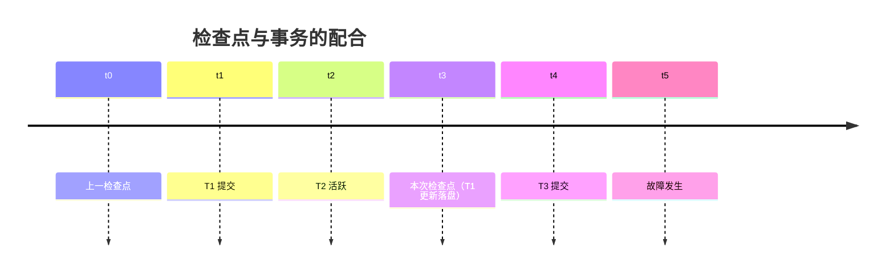

# 具有检查点的恢复技术

数据库恢复的一种常见做法是扫描整个日志文件，找出所有故障前活跃（未提交）的事务逐一撤销。但当系统已运行很久时，日志可能有几十万条记录，==从头扫描日志会让恢复非常慢==。检查点技术就是为了解决这个效率问题。

## 检查点是什么

**检查点（Checkpoint）** 是 DBMS 在运行过程中，每隔一定时间主动在日志文件里插入的一个特殊标记 `<checkpoint>`。在插入这个标记的时刻，DBMS 还要完成一件"清理现场"的活：==把上一个检查点之后**已提交（COMMIT）**的事务对数据库的更新写入磁盘==。

> [!IMPORTANT]
> 检查点时刻的核心动作：落盘"上一检查点之后的已提交事务的更新"，并在日志中登记 `<checkpoint>` 记录。

想一想：为什么检查点只落盘"已提交事务"的更新，而不管未提交的？

原因有两条：
- 未提交的事务之后**可能回滚**，现在写进磁盘反而要再撤销，多一次 I/O；
- 已提交事务的更新==必须落盘==才满足事务的持久性，趁检查点统一刷盘正合适。

## 恢复时怎么做

故障发生后，==**只需处理最近一个检查点之后**到故障时刻之间的事务==，更早的事务在上次检查点时已经落盘，不必再扫。

具体规则：

| 事务状态 | 处理动作 | 原因 |
|---|---|---|
| 最近检查点前已提交 | 不处理 | 上次检查点已刷盘 |
| 检查点后到故障时已提交 | **REDO**（重做） | COMMIT 的持久性必须保证 |
| 检查点后到故障时未提交 | **UNDO**（撤销） | 原子性要求整件事不成则全退 |

> [!TIP]
> 记忆口诀：**先 RE 后 UN**——正向扫描日志，把已提交的丢进重做队列；反向扫描，把未提交的丢进撤销队列。

## 一道典型日志题

某日志片段（A、B、C 初值均为 0）：

| 序号 | 日志 | 序号 | 日志 |
| :--- | :--- | :--- | :--- |
| 1 | $T_1$: 开始 | 9 | **检查点** |
| 2 | $T_1$: 写 A, A=5 | 10 | $T_3$: 写 C, C=16 |
| 3 | $T_2$: 开始 | 11 | $T_2$: 回滚 |
| 4 | $T_2$: 写 B, B=10 | 12 | $T_3$: 写 B, B=15 |
| 5 | $T_1$: 写 C, C=8 | 13 | $T_4$: 开始 |
| 6 | $T_1$: 提交 | 14 | $T_3$: 提交 |
| 7 | $T_2$: 写 B, B=12 | 15 | $T_4$: 写 C, C=20 |
| 8 | $T_3$: 开始 | 16 | $T_4$: 写 B, B=18 |

**关键判断**：
- $T_1$（序号 1–6）在检查点之前就已提交 ⇒ ==**不必恢复**==；
- $T_2$ 中途已回滚（序号 11），没有 COMMIT ⇒ 不属于需要 REDO 的对象；
- $T_3$（序号 8–14）跨越检查点，最终提交 ⇒ **REDO**；
- $T_4$（序号 13–16）在检查点之后开始，未提交 ⇒ **UNDO**。

> [!WARNING]
> 易错点：**"提交"要以 COMMIT 记录为准**，不是开始就算；**"跨越检查点的已提交事务"仍要 REDO**，不能因为它在检查点前就开始就跳过。

## 与相近概念的区别

| 技术 | 何时触发 | 主要作用 | 代价 |
|---|---|---|---|
| 数据转储 | 周期性备份 | 整库冗余副本 | 耗时长，不能频繁 |
| 日志文件 | 每次更新 | 记录更新操作 | 常态开销 |
| 检查点 | 周期性 | ==缩小恢复范围、提升效率== | 检查点时刻 I/O 较大 |

> [!NOTE]
> 检查点**不替代**日志，它只是给日志"划段"；真正的恢复依然靠日志（UNDO/REDO）。数据库的恢复机制最终保证的是==事务的原子性和持久性==。
