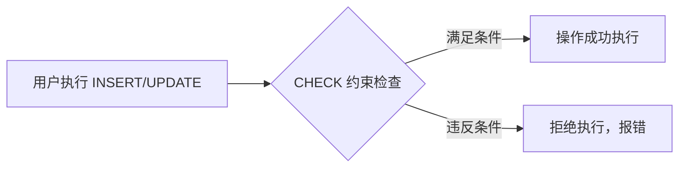

# 用户定义的完整性（属性约束、元组约束、CHECK）

## 用户定义的完整性

前面我们学了实体完整性和参照完整性，它们分别保证主键唯一非空和外键引用有效。但现实中的业务规则远不止这些——年龄不能为负、性别只能是“男”或“女”、还书日期必须晚于借书日期。这些“千奇百怪”的规则，数据库系统怎么帮我们守住？

这就轮到==用户定义的完整性==登场了。

### 它是什么

用户定义的完整性，是==针对某一具体应用的数据必须满足的语义要求==。它不像实体完整性和参照完整性那样“放之四海而皆准”，而是随业务场景变化的——教务系统有教务系统的规矩，电商系统有电商系统的讲究。

> [!IMPORTANT]
> 用户定义的完整性本质是**业务规则在数据库层面的直接体现**，让 DBMS 替我们“执法”，而非全靠应用代码检查。

### 检查什么：两类约束

用户定义的完整性可以作用在两个层面：

| 约束类型 | 作用范围 | 典型场景 |
| :--- | :--- | :--- |
| **属性约束（列级）** | 单个列的值 | 性别只能是『男』或『女』、成绩在 0~100 之间 |
| **元组约束（表级）** | 同一元组中多列的关系 | 还书日期必须晚于借书日期、基本工资 ≤ 总工资 |

> [!TIP]
> 记法口诀：==列级盯单列，表级管行内==。能用一个 CHECK 带走的规则，尽量交给 DBMS 而非应用层。

### SQL 怎么做：CHECK 的列级与表级

**① 列级 CHECK——检查列值是否满足条件表达式**

在定义列时直接追加约束。以下来自课件经典例子：

```sql
-- 例5.7：Student表的Ssex只允许取“男”或“女”
Ssex CHAR(6) CHECK (Ssex IN ('男', '女'))
```

同样可以约束取值范围：

```sql
AGE INT CHECK (AGE BETWEEN 16 AND 25)
```

**② 表级 CHECK——在元组上定义约束条件**

当规则牵扯同一行的多个列，就需要在 CREATE TABLE 末尾用 CONSTRAINT 统一声明：

```sql
CONSTRAINT C1 CHECK (Sno BETWEEN '10000000' AND '29999999'),
CONSTRAINT C3 CHECK (Sbirthdate > '1980-1-1'),
CONSTRAINT C4 CHECK (Ssex IN ('男', '女'))
```

一个经典的行内多列约束——借还日期：

```sql
CHECK((还期 IS NULL) OR (还期 > 借期))
```

允许还期为 NULL（尚未归还），但一旦有值就必须晚于借期。

**③ 后期修改也可以用 ALTER TABLE 追加 CHECK**：

```sql
ADD CONSTRAINT C1 CHECK (Sno BETWEEN '900000' AND '999999'),
ADD CONSTRAINT C3 CHECK(Sbirthdate > '1985-1-1');
```

### 完整性的“三部曲”与底线

> [!NOTE]
> 数据库完整性定义的完整框架由三部分组成：**何时检查（触发条件）→ 检查什么（约束条件）→ 违约怎么办（动作）**。

SQL 中的用户定义完整性，检查时机一律是==执行插入或修改操作时==。一旦检测到违规——最简单粗暴的应对：==拒绝执行==（这点与实体完整性一致，区别于参照完整性可能采用的级联操作或置空）。



### 常见的坑

- 把本属于参照完整性的外键约束错当作用户定义完整性——分工要清：参照完整性管“值是否存在”，用户定义完整性管“值合不合理”。
- 误以为 CHECK 能跨表检查——标准 SQL 的 CHECK 只能看**本行内**的数据，跨表约束得用断言（ASSERTION）或触发器。
- 不合理的 NULL 处理：CHECK 的表达式若为 `NULL`（未知），判定为 **TRUE** 而非 FALSE，所以空值往往能“悄悄通过”约束检查——写条件时要考虑 NULL 的情况，必要时显式加 `IS NOT NULL`。

### 练手：一个完整定义的“生产”表

取自课堂练习，工业场景常见约束：

```sql
CREATE TABLE 生产 (
    工厂编号 CHAR(10),
    产品号   CHAR(8),
    数量     INT,
    PRIMARY KEY (工厂编号, 产品号),
    FOREIGN KEY (工厂编号) REFERENCES 工厂,
    FOREIGN KEY (产品号)   REFERENCES 产品,
    CHECK (数量 >= 300)
);
```

这里 `CHECK (数量 >= 300)` 就是用列级约束直接卡死业务下限——每个工厂生产任一产品的计划数量不得低于 300。违约处理就一条路：插入或修改动作直接拒绝。
