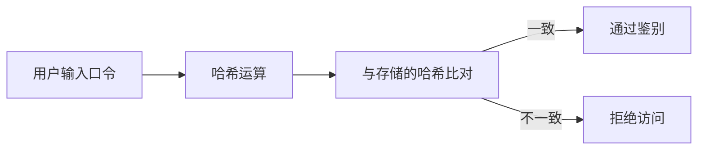

# 用户身份鉴别方法
数据库安全的第一道门，是确认“你是谁”。用户身份鉴别（Authentication）要回答一个问题：==来访问数据库的人，凭什么证明他就是他声称的那个用户？== 如果这一步被绕过，后面的授权、审计都失去了意义。

### 为什么需要多种鉴别方法

单一凭证一旦泄露，系统就完全失守。因此数据库系统通常提供多种鉴别方式，并按场景组合使用。南邮课程中主要涉及三类：

| 方法 | 依据 | 典型形式 |
|---|---|---|
| 静态口令鉴别 | 用户知道什么 | 用户名 + 密码 |
| 动态口令鉴别 | 用户持有什么 | 短信验证码、硬件令牌、动态口令卡 |
| 生物特征鉴别 | 用户是什么 | 指纹、人脸、虹膜 |
| 智能卡鉴别 | 用户持有什么 | 内置芯片的物理卡片 |

> [!IMPORTANT]
> 考试中经常把“用户身份鉴别”与“存取控制”并列考察。鉴别的任务是**验证身份**，存取控制的任务是**决定已通过验证的用户能做什么**。两者顺序不能颠倒。

### 最常考的方式：静态口令

静态口令是数据库系统最基础的鉴别方式。用户创建时设定口令，登录时系统比对。在 SQL 中创建带口令的用户：

```sql
CREATE USER User1 IDENTIFIED BY 'PWI';
```

这里的 `PWI` 是口令。系统会将其加密存储（通常为哈希值），登录时对输入口令做同样运算后比对，而不是直接存明文。



> [!WARNING]
> 口令比对的是**哈希后的结果**，不是口令本身。若数据库存的是明文口令，一旦数据文件泄露，所有用户口令直接暴露。

### 动态口令与生物特征

静态口令的弱点很明显：可被猜测、截获、重放。动态口令每次登录使用一次性凭证，即使被截获也无法再次使用。生物特征利用人体固有属性，难以伪造但实现成本高、存在隐私争议。

### 授权与鉴别的衔接：一个容易混淆的点

考试中常把“创建用户”和“授予角色”放在同一个题里。它们解决的是两个不同阶段的问题：

```sql
CREATE USER User1 IDENTIFIED BY 'PWI';
GRANT DBA TO User1;
```

第一句让系统认识 `User1` 这个人（鉴别阶段）；第二句把 `DBA` 角色授予 `User1`，让他拥有相应的操作权限（存取控制阶段）。

再看一个角色传递授权的例子：

```sql
GRANT R1
TO U1
WITH ADMIN OPTION;
```

`WITH ADMIN OPTION` 表示 U1 不仅拥有角色 R1 的权限，还可以把 R1 **再授予其他用户**。这属于授权语义，并非鉴别的内容，但两者在题目里常连在一起出现。

> [!TIP]
> 区分两个短语：`WITH GRANT OPTION` 用于授权**对象权限**（如表上的 SELECT）；`WITH ADMIN OPTION` 用于授权**角色或系统权限**。考试常在这里设陷阱。

### 常见误区

> [!CAUTION]
> 不要认为“创建了用户”就等于“用户有了权限”。刚创建的普通用户（如 `User1`）默认**没有任何数据库对象的操作权限**，必须通过 `GRANT` 显式授权。上例中 `User1` 被授予 `DBA` 角色后才拥有管理权限。

另外，`CREATE USER` 只是定义了一个可登录的账号，与“创建数据库”完全是两回事。用户身份的建立不等于资源的分配。
