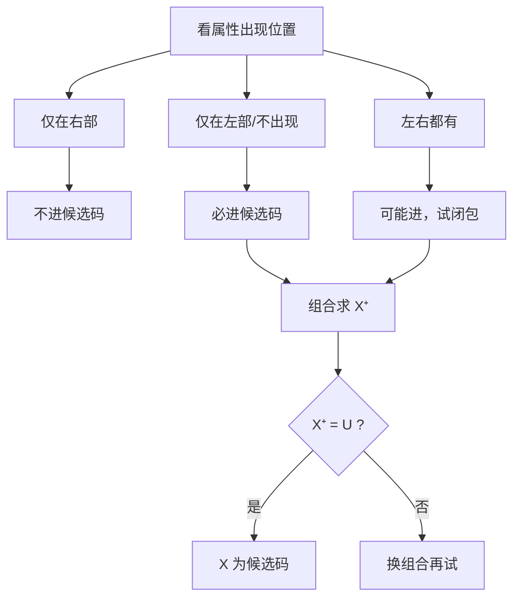

# 码（候选码、主码、外码）

## 码：候选码、主码与外码

在关系数据理论里，==码（Key）==是唯一标识一个元组的属性（或属性组合）。它决定了一张表"这一行到底是谁"，也决定了范式判断的基准。南邮这门课里要掌握三种码：候选码、主码、外码，以及一个延伸概念：主属性。

## 候选码与主码

设关系模式 $R<U,F>$ 中的属性或属性组合 $K$。若 $K \rightarrow U$（$K$ 能函数决定全部属性），则 $K$ 称为 $R$ 的一个==候选码（Candidate Key）==。

再要求一步：==候选码是最小的超码==，即 $K$ 的任意真子集都不再是候选码（否则它就是"超码"而不是候选码）。

> [!IMPORTANT]
> 两个条件缺一不可：① $K \rightarrow U$；② $K$ 的真子集不能推出 $U$。

若 $R$ 有多个候选码，人工选定一个作为==主码（Primary Key）==，其余仍叫候选码。例如学生表 $S(\text{Sno},\text{Sname},\text{Sdept},\text{Sage})$，若学生无重名，则 $\text{Sno}$、$\text{Sname}$ 都是候选码，通常选 $\text{Sno}$ 为主码。

**主属性与非主属性**：==包含在任何一个候选码中的属性叫主属性（Prime attribute）==，其余为非主属性。注意是"任何一个"，不能只看选定的那个主码。

## 外部码

若属性（组） $X$ 不是 $R$ 的码，但它是另一个关系模式的码，则 $X$ 称为 $R$ 的==外部码（Foreign Key）==，也叫外码。==主码与外码一起提供了表示关系间联系的手段==，外码必须参照被引用表的主码（或候选码）。

> [!TIP]
> 外码取值规则：==外键若不是本关系主键的一部分（主属性），允许为空；否则不允许为空==。原因是参照完整性不允许引用不存在的实体，而主属性为空就无法唯一标识元组。

## 求候选码的方法

给定 $F$，求候选码的通用套路：

- 属性仅出现在 $F$ 的右部 → ==一定不含在任何候选码中==。
- 属性仅出现在左部，或根本不在 $F$ 中出现 → ==一定含在某个候选码中==。
- 属性左右都出现 → 可能含在候选码中。
- 在上述基础上求属性闭包：若 $X_F^+ = U$，则 $X$ 是候选码（再检查真子集是否也是，保证最小性）。

> [!WARNING]
> 常见坑：① 把"超码"当候选码，忘了最小性；② 只认定的主码算主属性，漏掉其他候选码里的属性；③ 两个元组的候选码取值 ==不能相同==（实体完整性）。

## 一个算对了的例子

设有关系模式 $R(ABCD)$，$F = \{ AB \rightarrow C,\ C \rightarrow A,\ C \rightarrow D \}$，求候选码。

- $B$ 只在左部出现，必在码中。
- $(AB)^+ = ABCD = U$，故 $AB$ 是候选码。
- $(BC)^+ = BCAD = U$（由 $C\rightarrow A, C\rightarrow D$），故 $BC$ 也是候选码。
- 检查真子集：$A^+ = A$、$C^+ = ACD$、$B^+ = B$，都不等于 $U$，故 $AB$、$BC$ 均为最小超码。

==候选码为 $AB$ 与 $BC$==，主属性集为 $\{A, B, C\}$，非主属性为 $\{D\}$。
