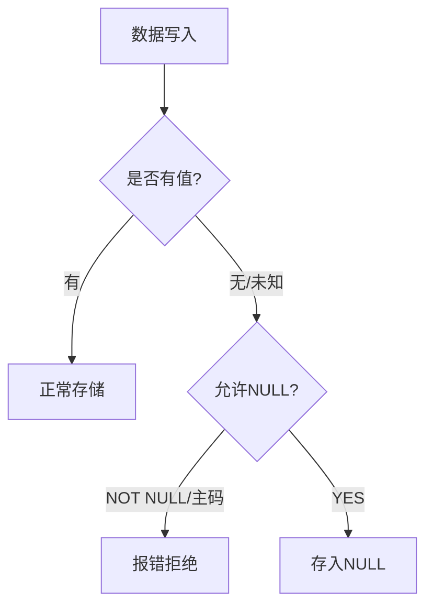

# 空值（NULL）的产生、判断与运算规则

空值就是“不知道”、“不存在”或“无意义”的值。在关系数据库中，如果一个学生的成绩还没录入，或者某门课没有先修课，我们该填什么？填 $0$ 代表零分，填空字符串代表没名字，都不对——它们都有确定含义。这时就需要 NULL 来表示这种==不确定性==。

## 空值的产生与约束

空值通常由以下场景产生：

- **插入数据时未指定列**：`INSERT INTO SC(Sno, Cno) VALUES('S1','C1');`，未指定的 Grade 等列自动取空值（除非有 DEFAULT）。
- **显式赋空**：`VALUES ('S2', 'C4', NULL)` 或用 `UPDATE Student SET Smajor = NULL WHERE Sno='20180006';`。
- **修改表结构新增列**：不论基本表中原来是否已有数据，新增加的列一律为空值。
- **外连接运算**：左/右/完全外连接中，未匹配的行在新增加的属性上填空值。

> [!IMPORTANT]
> ==主码属性绝对不能取空值==（实体完整性规则）。加了 `NOT NULL` 约束的列也不能取空值；但加了 `UNIQUE` 限制的列是可以取空值的。



## 空值的判断

思考一下：如果写 `WHERE Grade = NULL`，能查出缺考的学生吗？

不能！因为 NULL 参与比较的结果不是 TRUE，而是 UNKNOWN。判断空值必须使用专门的谓词：`IS NULL` 或 `IS NOT NULL`。

例如，删除读者马林所借图书中未还的记录：
```sql
DELETE FROM 读者借阅 
WHERE 读者号 IN (SELECT 读者号 FROM 读者 WHERE 姓名 = '马林')
AND 还期 IS NULL;
```

## 空值的运算规则

这是考试最爱挖坑的地方。含有 NULL 的运算遵循特殊规则：

| 运算类型 | 规则描述 | 示例 |
| :--- | :--- | :--- |
| **算术运算** | 空值与另一个值（包括空值）运算，结果仍为 ==NULL== | $5 + \text{NULL} = \text{NULL}$ |
| **比较运算** | 空值与另一个值比较，结果为 ==UNKNOWN== | $\text{NULL} > 10 \Rightarrow \text{UNKNOWN}$ |
| **逻辑运算** | 遵循三值逻辑（TRUE/FALSE/UNKNOWN） | $\text{UNKNOWN AND FALSE} \Rightarrow \text{FALSE}$ |
| **聚集函数** | ==跳过空值==，只处理非空值 | `AVG(Grade)` 不计入 NULL |

> [!WARNING]
> 查询“不及格学生”时，若写 `WHERE Grade < 60`，那些缺考（Grade 为 NULL）的学生**不会**被选出，因为 `NULL < 60` 是 UNKNOWN，不满足 WHERE 条件。若业务要求包含缺考者，需写成 `WHERE Grade < 60 OR Grade IS NULL`。

## 常见易混辨析

> [!CAUTION]
> ==NULL、空字符串 `''` 与数字 $0$ 完全不同！==
> - `0` 是一个确定的数值。
> - `''` 是长度为 $0$ 的确切字符串。
> - `NULL` 表示“根本没有值”或“值未知”。
> 在插入记录时，若地址暂缺，应写 `NULL` 而非 `''`。

**算对了的例子：**
在读者表中插入一位读者的信息，读者号为 SO23，姓名为王敏，工作单位是 Dept1，地址暂缺。
```sql
INSERT INTO 读者 (读者号, 姓名, 工作单位, 地址)
VALUES ('SO23', '王敏', 'Dept1', NULL);
```
这里明确给出了列名，地址暂缺填入 `NULL`。如果 `INTO` 子句省略了列名，则必须在 `VALUES` 对应位置显式写出 `NULL`，否则系统无法对齐字段。

> [!TIP]
> 记忆口诀：判空用 `IS`，算术遇空得空，比较遇空未知，聚合直接跳过，主键绝不为空。
