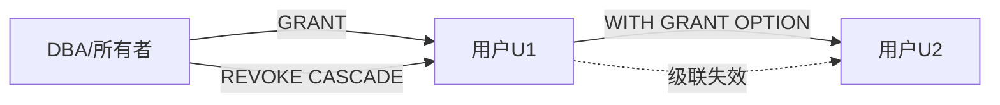

# 自主存取控制（GRANT、REVOKE、数据库角色）

## 自主存取控制（DAC）是什么

如果数据库里所有用户都能随意查看工资表或修改成绩，系统还能安全吗？显然不能。**自主存取控制（Discretionary Access Control, DAC）** 就是解决“谁能对哪个数据做什么操作”的机制。它的核心特征是 ==权限由数据所有者或DBMS自主决定==，通过 SQL 的 `GRANT` 和 `REVOKE` 语句实现，是南邮《数据库系统》第4章安全性中最基础、考试必考的内容。

## GRANT 与 REVOKE 怎么用

授权的基本语法为 `GRANT <权限> ON <对象> TO <用户> [WITH GRANT OPTION]`。其中 `WITH GRANT OPTION` 表示被授权者可将该权限转授他人；回收权限则用 `REVOKE`，需注意级联回收问题。



> [!IMPORTANT]
> ==WITH GRANT OPTION 是转授权限的关键==，但角色授权时使用的是 `WITH ADMIN OPTION`，二者不可混淆。

## 为什么需要数据库角色

当多个用户需要相同权限组合时，逐个授权效率极低且难以维护。此时应引入**数据库角色**——一组被命名的权限集合。先将权限授予角色，再将角色授予用户，实现权限的批量管理与复用。

> [!TIP]
> 记忆口诀：==权限给角色，角色给用户==。创建角色用 `CREATE ROLE`，授权给角色仍用 `GRANT`，只是目标变为角色名。

## DAC 与强制存取控制的区别

| 对比维度 | 自主存取控制（DAC） | 强制存取控制（MAC） |
| :--- | :--- | :--- |
| 控制依据 | 用户身份与显式授权 | 数据与用户的安全标记 |
| 灵活性 | 高，用户可自主转授 | 低，由系统强制执行 |
| 安全性 | 较低，存在权限传播风险 | 较高，防止信息泄露 |
| 典型实现 | GRANT / REVOKE | 标签、密级比较 |

> [!WARNING]
> DAC 仅检查“有没有权限”，不检查“数据本身是否允许被该级别用户访问”，因此 ==无法防止合法用户越权推理敏感信息==。

## 一个算对了的例子

已知关系模式：学生（学号，姓名，年龄，性别，家庭住址，班级号），班级（班级号，班级名，班主任，班长）。要求授予用户 U2 对学生表的查询权限及对家庭住址的更新权限。

正确写法：

```sql
GRANT SELECT, UPDATE(家庭住址)
ON TABLE 学生
TO U2;
```

> [!CAUTION]
> 列级权限必须写在括号内，如 `UPDATE(家庭住址)`；若写成 `UPDATE` 则表示整表更新权限，这是阅卷中高频扣分点。同时注意 `ON TABLE` 不可省略，对象类型要明确。
