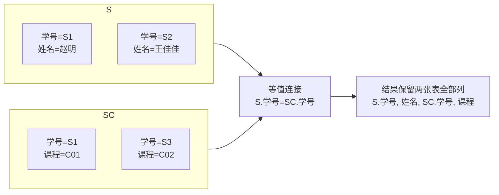
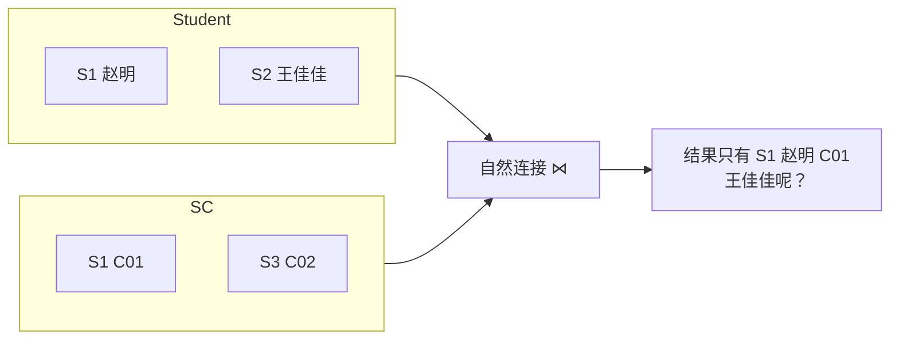

# 自然连接、悬浮元组与外连接（左外连接、右外连接、全外连接）

## 自然连接

先从你已经熟悉的等值连接说起。等值连接是按某个条件把两个表拼起来，结果里会保留两张表的所有列，包括内容相同的那些。

但你很快会发现一个问题：结果里「学号」出现了两列，这是冗余的。**自然连接**就是为解决这个设计的——它在等值连接的基础上，==自动把重复列去掉，只保留一列==。

> [!IMPORTANT]
> 自然连接是一种特殊的等值连接，它同时从行和列两个方向做运算：行方向找公共属性值相等的元组，列方向消除重复属性。

那两张表如果没有公共属性呢？自然连接就退化为笛卡儿积。

---

### 悬浮元组：为什么有同学「消失」了

回到刚才的例子。把 Student 和 SC 做自然连接：

王佳佳（S2）在 SC 表里根本没有选课记录，自然连接时找不到匹配，就被丢弃了。SC 表里的 S3 也一样被丢弃。

> [!IMPORTANT]
> 两个关系做自然连接时，某关系中那些在对方关系里找不到公共属性值匹配的元组会被舍弃，称为 **悬浮元组**（Dangling tuple）。

---

### 外连接：把消失的元组找回来

如果业务需要保留这些没匹配上的元组，就得用**外连接**。在被舍弃的位置填上空值 NULL，表示「这边没有匹配数据」。

三种外连接的区别，记一个场景就够：假设左表是 Student，右表是 SC。

| 类型 | 保留谁的悬浮元组 | 对方无匹配时 |
|---|---|---|
| **左外连接** (LEFT JOIN) | 只保留左表 | 右表属性填 NULL |
| **右外连接** (RIGHT JOIN) | 只保留右表 | 左表属性填 NULL |
| **全外连接** (FULL JOIN) | 两边都保留 | 缺失侧填 NULL |

> [!TIP]
> 记忆口诀：左外就是「左表一个都不能少」，右外反过来。全外就是「谁都不能少」。

以上面 Student 和 SC 为例，左外连接的结果：

| 学号 | 姓名 | 课程 |
|---|---|---|
| S1 | 赵明 | C01 |
| S2 | 王佳佳 | NULL |

王佳佳回来了，但她没有选课记录，所以课程号填 NULL。

> [!WARNING]
> 全外连接在 MySQL 里不直接支持，需要用 `LEFT JOIN UNION RIGHT JOIN` 实现，这是考试和实践中都容易踩的坑。

---

### 一个算对了的例子

给定关系 R 和 S：

| A | B | C |
|---|---|---|
| 3 | 6 | 7 |
| 2 | 5 | 7 |
| 7 | 2 | 3 |
| 4 | 4 | 3 |

| A | B | C |
|---|---|---|
| 3 | 4 | 5 |
| 7 | 2 | 3 |

公共属性是 A、B、C 全部三列。自然连接要求三个属性值都相等才匹配。逐行对照：

- R 第 1 行 (3,6,7)：S 中 (3,4,5) 和 (7,2,3) 都不匹配。
- R 第 2 行 (2,5,7)：S 中都不匹配。
- R 第 3 行 (7,2,3)：与 S 第 2 行 (7,2,3) 完全匹配 ✔
- R 第 4 行 (4,4,3)：S 中都不匹配。

所以 R ⋈ S 只有一行：

| A | B | C |
|---|---|---|
| 7 | 2 | 3 |

> [!NOTE]
> 如果做左外连接，R 的另外三行也会出现在结果中。如果做全外连接，S 的第一行 (3,4,5) 也会保留。动手画一下，能帮你彻底分清这三种连接。
