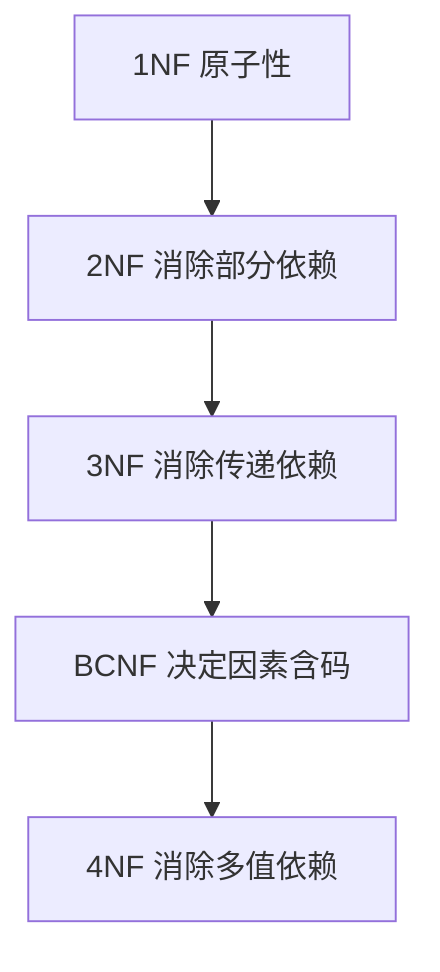

# 范式（1NF、2NF、3NF、BCNF）
### 为什么需要范式

先看一个不满足要求的例子：学生选课关系 S-L-C(Sno, Cno, Sdept, Sloc, Grade)，语义约束为 (Sno, Cno)→Grade，Sno→Sdept，Sdept→Sloc。它会产生四类问题：

- **插入异常**：没选课的学生（无 Cno）无法插入，因为码 (Sno, Cno) 不能为空。
- **删除异常**：某学生只选一门课，删除选课记录会把学生所在系的信息一并删掉。
- **数据冗余**：一个系的学生元组重复存储该系的 Sloc。
- **修改复杂**：换宿舍需更新大量元组，易遗漏造成不一致。

根源在于==非主属性对码存在部分依赖和传递依赖==。规范化（normalization）就是把低一级范式的关系模式，通过模式分解转换为高一级范式的过程。

### 各级范式定义

各级范式之间存在严格包含关系：$1NF \supset 2NF \supset 3NF \supset BCNF \supset 4NF \supset 5NF$。

| 范式 | 定义（核心条件） | 消除的异常根源 |
|------|------------------|----------------|
| 1NF | 所有属性都是不可分的基本数据项 | 属性可再分 |
| 2NF | $R\in 1NF$，且每一个非主属性都**完全**函数依赖于码 | 非主属性对码的**部分**依赖 |
| 3NF | 不存在码 X、属性组 Y 及非主属性 Z，使 X→Y，Y→Z，Y↛X | 非主属性对码的**传递**依赖 |
| BCNF | 每一个非平凡函数依赖 X→Y 的决定因素 X 都**含有码** | 主属性对码的部分和传递依赖 |

> [!IMPORTANT]
> BCNF 是修正的第三范式：$R\in BCNF$ 必有 $R\in 3NF$，反之不一定。若数据库中所有模式都属于 BCNF，则在函数依赖范畴内已彻底消除操作异常。

> [!TIP]
> 判断范式级别的步骤：① 由 FD 集求候选码（只在左部出现的属性必在码中）；② 分析非主属性对码的依赖类型；③ 按定义逐级验证。

### 规范化过程

以 S-L-C 为例：先分解出 S-L(Sno, Sdept, Sloc) 与 S-C(Sno, Cno, Grade) 达到 2NF；再将 S-L 中传递依赖 Sno→Sdept→Sloc 拆开，得 S-D(Sno, Sdept) 和 D-L(Sdept, Sloc)，达到 3NF。

### 典型例题

设 $R(ABCD)$，$F=\{A\to B, B\to C, D\to B\}$，分解 $\rho=\{ACD, BD\}$。

**求投影**：$F_1=\{A\to C, D\to C\}$（由传递性），$F_2=\{D\to B\}$。

**判断范式**：$R_1(ACD)$ 的码为 AD，但 $A\to C$ 是部分依赖，故仅达 1NF，可分解为 $\{AC, AD\}$；$R_2(BD)$ 的码为 D，唯一依赖 $D\to B$ 左部含码，故达 BCNF。

> [!WARNING]
> 判断分解 $\rho$ 达到的范式级别时，必须对每个子模式 $R_i$ 先求出 $F$ 在其上的投影 $F_i$，再分别判断；$\rho$ 的级别是其中**最低**的级别。
