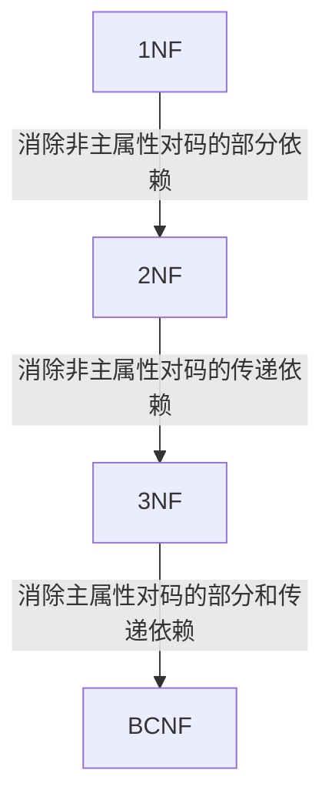

# 关系模式的规范化（分解与优化）

> [!IMPORTANT]
> 关系模式的规范化，就是把一个低一级范式的关系模式，通过==投影分解法==转换为若干个高一级范式的关系模式集合的过程。

为什么要分解？因为低范式（如 1NF）存在部分函数依赖或传递函数依赖，会导致插入异常、删除异常和数据冗余。我们一步步把“坏”的表拆成“好”的表。

## 怎么一步步拆

规范化的核心路线就是不断消除不合适的依赖：

- **算法 4.4（分解为 2NF）**：若主键 $W$，存在 $X \to Z$（$Z$ 为非主属性，$X \subset W$），则 $W \to Z$ 是局部依赖。将 $R$ 拆为两个模式，把依赖于 $X$ 的属性分离出去。
- **算法 4.5（分解为 3NF）**：若存在 $X \to Z$（$Z$ 非主属性，$Z \not\subseteq X$ 且 $X$ 不是候选键），则是传递依赖。同样投影分离。

> [!TIP]
> 口诀：找码 $\to$ 找依赖类型 $\to$ 按违规依赖拆开。

## 拆得好不好：两个衡量标准

分解方法不唯一，但只有与原模式等价的分解才有意义。等价用两个准则衡量：

| 准则 | 衡量什么 | 核心要求 |
| :--- | :--- | :--- |
| **无损连接** | 数据是否等价 | 投影后再自然连接能恢复原表，不多不少 |
| **保持函数依赖** | 约束是否等价 | $F^+ = (F_1 \cup F_2 \cup \ldots \cup F_n)^+$，没丢掉原有的 FD |

> [!WARNING]
> 分解仅含 2 个模式时，用定理 4.6 判无损：$\rho=\{R_1, R_2\}$ 无损的充要条件是 $(R_1 \cap R_2) \to (R_1 - R_2)$ 或 $(R_1 \cap R_2) \to (R_2 - R_1)$ 属于 $F^+$。超过 2 个模式必须用 Chase 算法（算法 4.3）。

## 常见坑与易混点

> [!CAUTION]
> 求 $F$ 在子模式上的投影，不是只拿 $F$ 里属性全在子模式中的 FD！必须先求 $F^+$，再挑出属性全在子模式里的 FD。

- **无损 vs 保持依赖**：分解到 3NF 可以做到既无损又保持依赖；但分解到 BCNF 只能保证无损，不一定保持依赖。
- **整个分解的范式级别**：取决于所有子模式中==最低的==那个范式级别。需先对每个 $R_i$ 投影出 $F_i$，再单独判断。

## 完整算例演示

设 $R(A,B,C,D)$，$F=\{A \to B,\ B \to C,\ D \to B\}$，分解 $\rho=\{R_1(ACD),\ R_2(BD)\}$。

**第一步：求投影 $F_1, F_2$**
先推 $F^+$ 中相关的：由 $A \to B, B \to C$ 得 $A \to C$；由 $D \to B, B \to C$ 得 $D \to C$。
- $F_1$（在 $ACD$ 上）：$\{A \to C,\ D \to C\}$
- $F_2$（在 $BD$ 上）：$\{D \to B\}$

**第二步：求各子模式的键并判断范式**
- $R_1(ACD)$：不在任何 FD 右部的属性是 $A, D$。验证 $(AD)^+ = ACD$，故 Key1 为 $AD$。
  存在 $A \to C$，$A$ 是码的真子集，这是部分依赖。所以 $R_1$ 连 2NF 都不是，更非 BCNF。
- $R_2(BD)$：Key2 为 $D$（$(D)^+=DB$）。唯一的非平凡 FD $D \to B$ 左部是码，故 $R_2$ 已达 BCNF。

**第三步：将 $R_1$ 继续分解至 BCNF**
针对 $A \to C$ 进行投影分解，拆为 $R_{11}(AC)$ 和 $R_{12}(AD)$。
最终分解结果：$\{AC,\ AD,\ BD\}$。

> [!NOTE]
> 如果题目要求“无损且保持依赖地分解为 3NF”，直接使用教材算法 4.7：对 $F$ 的最小覆盖中每个 FD $X \to Y$ 建模式 $XY$，若这些模式都不包含原关系的键，再把键单独作为一个模式加入即可。
