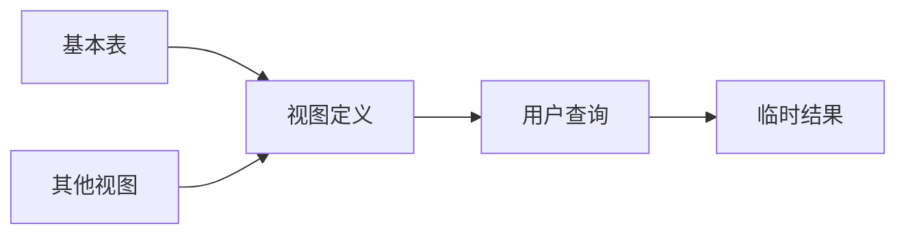

# 视图（建立、查询、更新、删除视图）

视图是==从基本表或其他视图中导出的虚表==。数据库只保存视图定义，不单独保存其查询结果；查询视图时，系统根据定义访问基本表。因此，基本表数据变化后，视图查询结果也会随之变化。

## 为什么需要视图

视图可以把复杂的多表连接、分组统计封装成一个简单的“表”，主要有三个作用：

- **简化查询**：定义一次，之后直接 `SELECT`。
- **定制数据**：不同用户只看到所需行列。
- **控制权限**：只授权查询统计视图，使用户不能查看职工个人工资等明细。

视图对应数据库的==外模式==，基本表对应模式；不要把它理解为查询结果的永久副本。



## 建立与查询视图

基本格式为：

```sql
CREATE VIEW <视图名> [(列名表)]
AS <SELECT查询语句>;
```

例如，为学生选课表 `SC(Sno,Cno,Grade)` 和学生表 `Student` 建立平均成绩视图：

```sql
CREATE VIEW G(Sno, Sname, AvgGrade) AS
SELECT Student.Sno, Sname, AVG(Grade)
FROM Student, SC
WHERE Student.Sno = SC.Sno
GROUP BY Student.Sno, Sname;
```

之后可像查询基本表一样使用：

```sql
SELECT *
FROM G
WHERE AvgGrade >= 80;
```

> [!TIP]
> 建视图先写对 `SELECT`：确定 `FROM` 中的表、`WHERE` 中的连接与筛选条件，再确定输出列。若查询含表达式或聚集函数，应在视图列名表中明确命名。

## 一个完整例子

为“三建”工程项目建立供应情况视图，包括供应商代码、零件代码和供应数量：

```sql
CREATE VIEW SANJIAN_SPJ(SNO, PNO, QTY) AS
SELECT SNO, PNO, QTY
FROM SPJ, J
WHERE SPJ.JNO = J.JNO
  AND J.JNAME = '三建';
```

查询供应商 `S1` 的供应情况：

```sql
SELECT *
FROM SANJIAN_SPJ
WHERE SNO = 'S1';
```

统计“三建”工程每种零件的总供应量：

```sql
SELECT PNO, SUM(QTY) AS TotalQty
FROM SANJIAN_SPJ
GROUP BY PNO;
```

这里==视图负责限定“三建”的数据范围，外层查询负责进一步筛选或统计==，两层任务不要混淆。

## 更新与删除视图

对视图执行 `INSERT`、`UPDATE`、`DELETE`，本质上是希望修改其底层基本表，并非所有视图都能更新。通常，行列子集视图较容易更新；含多表连接、分组、聚集函数、`DISTINCT` 或表达式的视图通常不可直接更新，具体还受 DBMS 限制。

```sql
DROP VIEW SANJIAN_SPJ;
```

删除视图只删除其定义，不删除基本表数据。若其他视图依赖它，删除可能失败或级联删除依赖对象。

> [!WARNING]
> 删除基本表时，`RESTRICT` 在存在依赖视图等对象时拒绝删除；`CASCADE` 可能连同依赖视图一起删除。视图查询中的条件放在外层 `WHERE`，分组后的统计限制才使用 `HAVING`，且不能写成 `WHERE SUM(QTY) >= 500`。
