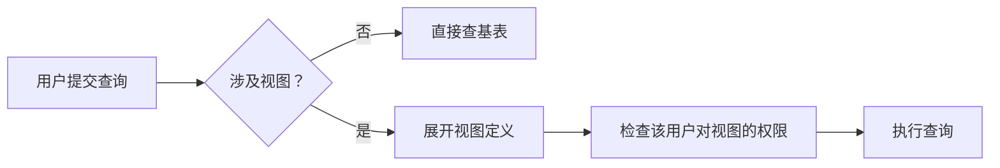
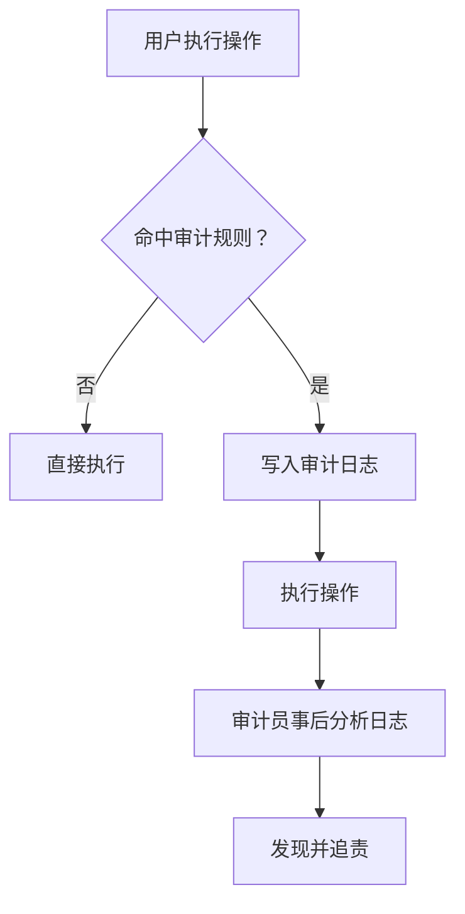

# 视图机制、审计与数据加密

## 视图机制

要理解视图的安全作用，先想一个问题：一张学生表里同时存着学号、姓名、成绩、家庭住址，班主任和普通学生都要查这张表，但你能让所有学生都看到别人的家庭住址吗？

显然不能。授权机制（GRANT）可以控制“谁能查哪张表”，但它**无法控制“谁能查一张表里的哪些列”**。这就是视图登场的地方。

视图的本质是一条**保存下来的查询语句**。它本身不含数据，只是从一个或多个基表（或其它视图）上按需“开一扇窗”。配合授权机制，管理员可以做到：

```sql
-- 仅暴露学号、姓名、成绩，隐藏家庭住址
CREATE VIEW Student_Grade AS
SELECT Sno, Sname, Grade FROM Student, SC
WHERE Student.Sno = SC.Sno;

-- 只把视图查询权限授予学生角色
GRANT SELECT ON Student_Grade TO Student_Role;
```

学生通过视图只能看到三条字段，底层的 `Address` 列对他们完全不存在。这就是==视图的核心安全价值：把要保密的数据对无权存取的用户隐藏起来，提供一定程度的安全保护==。

[!IMPORTANT]
> 视图是**逻辑层**的隔离手段，不是物理加密。底层表的数据仍然可以被有基表权限的用户直接访问，所以视图必须与授权机制**配合使用**才有安全意义。

流程上，视图的工作方式如下：



常见误区是以为“基表有权限就一定能通过视图查”，事实相反：用户**只需要视图的授权**，不需要拥有基表的直接授权。这也正是视图能实现“列级保护”的原因。

## 审计

授权与视图管的是“能不能做”，但如果有权限的人**故意泄露数据**，怎么办？能不能查出来“谁，在什么时候，对哪张表，做了什么操作”？

这就是审计（Audit）要回答的问题。审计的核心动作是：==启用一个专用的审计日志（Audit Log），把用户对数据库的关键操作自动记录下来==，供审计员事后分析。

[!TIP]
> 记忆口诀：**事前身份鉴别，事中存取控制，事后审计追责**。审计属于“事后控制”。

一条典型的审计记录至少包含：操作类型（SELECT / UPDATE / DELETE / DDL）、操作对象、操作用户、时间戳、终端信息。审计员通过分析审计日志，可以发现异常访问模式，例如某用户在凌晨两点批量导出了整张工资表。



[!CAUTION]
> 审计日志本身也包含敏感信息（谁查了什么），必须对审计日志的存储和访问加以严格控制，否则审计反而变成新的泄露源。

C2 以上安全级别的 DBMS 必须具有审计功能。不同数据库实现方式不同：Oracle 用 `AUDIT` 语句配置规则，MySQL 企业版有审计插件，PostgreSQL 可用扩展。**考题中常把审计列为 DBMS 安全性控制机制之一**，与用户身份鉴别、存取控制、视图、数据加密并列。

## 数据加密

视图和审计解决的是“数据库内部”的访问控制问题。但如果有人**绕过 DBMS 直接窃取磁盘上的数据文件**，或者**在网络传输过程中截获数据包**，视图和审计就都无能为力了。

数据加密应对的正是这两种场景：==加密存储==保护落盘数据，==加密传输==保护网络中流动的数据。


- **加密存储**：数据库将用户数据和对安全有关的审计文档等以密文形式写入磁盘。即使攻击者拿到数据文件，没有密钥也无法解读。
- **加密传输**：客户端与服务器之间使用 SSL/TLS 等协议加密通信，防止中间人窃听或篡改。

[!WARNING]
> 加密会带来性能开销（加解密计算、密钥管理），因此生产环境中通常**只对敏感字段加密**，而不是对整库加密。另一个易错点：加密 != 存取控制，两者解决不同层面的威胁。

## 三种机制的分工与对比

| 机制 | 防御场景 | 层次 | 核心手段 |
|------|---------|------|---------|
| 视图 | 用户绕过表级授权看敏感列 | 逻辑层 | 隐藏数据 |
| 审计 | 有权限的用户恶意操作 | 事后 | 记录+追责 |
| 加密 | 磁盘失窃、网络窃听 | 物理/传输层 | 密码技术 |

三者共同组成 DBMS 安全性控制机制，与用户身份鉴别、存取控制一起，构成数据库安全的完整防线。考题中常以“下列哪些属于 DBMS 安全性控制机制”形式出现，答案通常涵盖：==用户身份鉴别、存取控制、视图、审计、数据加密==。
