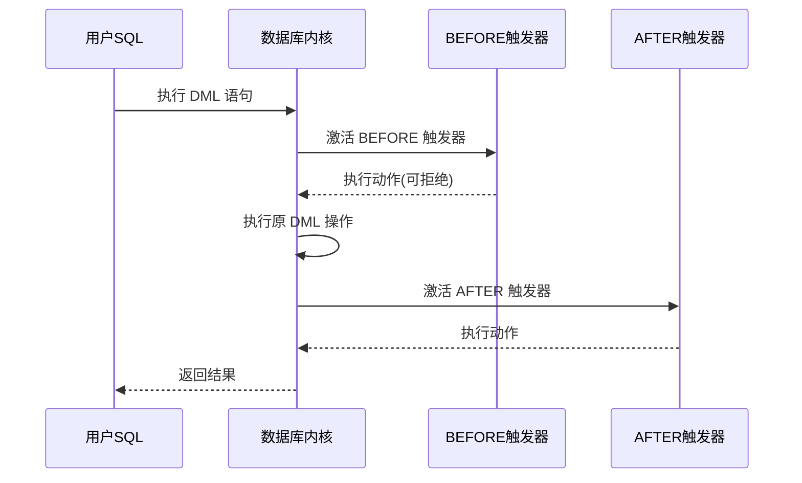

# 触发器（定义、执行与删除）

# 触发器（定义、执行与删除）

触发器（Trigger）是用户定义在关系表上的一类由**事件驱动**的特殊过程。它遵循 **ECA 规则**（Event-Condition-Action），即：当特定事件发生时，若满足指定条件，则自动执行相应的动作。

> [!IMPORTANT]
> ==核心定位==：触发器是实现**复杂完整性约束**和**自动化业务逻辑**的关键机制，弥补了标准 SQL 约束（如 `CHECK`、`FOREIGN KEY`）在处理跨表或多行聚合逻辑时的不足。

## 为什么需要触发器？

标准的完整性约束（实体、参照、用户定义）通常只能处理单表或简单的参照关系。思考以下场景：
1.  **复杂检查**：教授的工资不得低于 4000 元，且需根据职称动态调整。
2.  **级联审计**：每次修改学生成绩时，自动记录日志到另一张表。
3.  **跨表约束**：借阅图书时，检查库存是否充足并自动扣减。

这些操作涉及过程化逻辑或多表交互，仅靠 `CREATE TABLE` 中的约束无法实现，必须依赖触发器在 DBMS 核心层进行集中控制。

## 如何定义与执行？

### 1. 定义语法
触发器只能定义在**基本表**上，不能定义在视图上。

```sql
CREATE TRIGGER <触发器名>
{BEFORE | AFTER} <触发事件> ON <表名>
[FOR EACH {ROW | STATEMENT}]
[WHEN <触发条件>]
<触发动作体>; -- 通常为 PL/SQL 块
```

> [!TIP]
> **关键参数辨析**：
> *   **时机**：`BEFORE`（操作前检查/修正） vs `AFTER`（操作后审计/级联）。
> *   **粒度**：`FOR EACH ROW`（行级，受影响几行执行几次，可用 `NEW`/`OLD`） vs `FOR EACH STATEMENT`（语句级，无论影响几行只执行一次，不可用 `NEW`/`OLD`）。

### 2. 执行顺序
当一个 SQL 语句激活触发器时，DBMS 按以下顺序执行：



> [!WARNING]
> 如果触发动作体执行失败（如违反约束），整个事务将回滚，原 DML 操作也不会生效。

### 3. 删除触发器
```sql
DROP TRIGGER <触发器名> ON <表名>;
```
只有触发器的拥有者或具备相应权限的用户才能删除。

## 常见误区与示例

| 特性 | 行级触发器 (`FOR EACH ROW`) | 语句级触发器 (`FOR EACH STATEMENT`) |
| :--- | :--- | :--- |
| **触发次数** | 受影响的行数 | 1 次 |
| **数据引用** | 可使用 `NEW` (新值), `OLD` (旧值) | **不可**使用 `NEW`/`OLD` |
| **典型用途** | 数据校验、列值修正 | 统计操作次数、记录审计日志 |

> [!CAUTION]
> **易错点**：在行级触发器中，`NEW` 代表 `INSERT`/`UPDATE` 后的新值，`OLD` 代表 `UPDATE`/`DELETE` 前的旧值。`INSERT` 时无 `OLD`，`DELETE` 时无 `NEW`。

### 典型示例：教授工资下限控制
定义一个 `BEFORE` 行级触发器，确保教师表中“教授”的工资不低于 4000。

```sql
CREATE TRIGGER Insert_Sal_Check
BEFORE INSERT OR UPDATE ON Teacher
FOR EACH ROW
WHEN (NEW.job = '教授')
BEGIN
    IF NEW.sal < 4000 THEN
        SET NEW.sal = 4000; -- 自动修正为最低值
    END IF;
END;
```

此例展示了触发器如何在数据写入前进行**主动干预**，这是普通 `CHECK` 约束难以灵活实现的（尤其是涉及复杂条件判断时）。
