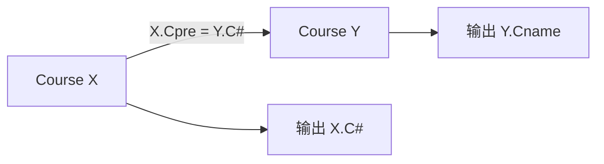

# 连接查询（等值连接、自然连接、自身连接、外连接、多表连接）

连接查询是把 **两个以上的表** 按照给定条件"拼"成一张更大的表（结果关系），从而回答跨表问题的核心手段。比如"男同学所学课程的课程号和课程名"，学生信息在 `S`，选课信息在 `SC`，课程信息在 `C`，单表查询根本拿不到，只能连接。

## 等值与非等值连接

在 WHERE 子句中给出连接谓词即可：

```sql
FROM S, SC WHERE S.S# = SC.S#
```

连接运算符为 `=` 时是 **等值连接**，否则（`>`、`<`、`!=` 等）是 **非等值连接**。等值连接的结果中 ==公共属性会重复出现两次==（如 `S#` 同时来自 `S` 和 `SC`）。

## 自然连接

> [!IMPORTANT]
> ==自然连接 = 等值连接 + 去掉重复的公共属性列==，是一种特殊的等值连接，记作 $R \bowtie S$。

例如 $\Pi_{Sno,Sname,Cno}(Student \bowtie SC)$ 中，`SC.Sno` 被自动消除，只保留 `Student.Sno`。

## 复合条件连接

WHERE 子句同时包含 **连接谓词** 与 **选择谓词**，一步完成"连接+筛选"：

```sql
FROM S, SC, C
WHERE S.S# = SC.S# AND SC.C# = C.C# AND SEX = 'M'
```

## 自身连接

> [!NOTE]
> ==自身连接：一个表与其自己进行连接==，必须用 **别名** 把它"拆"成两份。

典型用法是 Course 表中"课程→先修课"这种链式结构：取第一个副本的 C# 与第二个副本的先修课 Cpre，就得到"课程名与先修课名"。



```sql
SELECT X.C#, Y.Cname
FROM Course AS X, Course AS Y
WHERE X.Cpre = Y.C#;
```

## 外连接

普通连接会 ==丢掉不满足条件的元组==；外连接以某一侧为 **主体表**，把主体表中不匹配的行也保留，缺失列填 **空值**。

| 类型 | 关键字 | 保留范围 |
| --- | --- | --- |
| 左外连接 | `LEFT [OUTER] JOIN` | 左表全部行 |
| 右外连接 | `RIGHT [OUTER] JOIN` | 右表全部行 |
| 完全外连接 | `FULL [OUTER] JOIN` | 两表全部行 |

```sql
SELECT Student.Sno, Sname, Cno
FROM Student LEFT OUTER JOIN SC ON Student.Sno = SC.Sno;
```

> [!WARNING]
> 外连接引入的 **空值** 会影响 `IS NULL` 判断与聚合函数（`COUNT(*)` 计数、`AVG` 忽略 NULL），做题时要留意。

## 多表连接与嵌套查询的取舍

两个以上表的连接即多表连接，例如：

```sql
SELECT Student.Sno, Sname
FROM Student, SC, Course
WHERE Student.Sno = SC.Sno AND SC.Cno = Course.Cno
  AND Cname = '信息系统概论';
```

> [!TIP]
> ① 有些嵌套查询能用连接替代，有些（如含 `NOT EXISTS` 的全称/否定语义）==不能替代==；② 嵌套查询层次清晰、易于构造；③ 但 ==商用 DBMS 中，能用连接就尽量用连接==（优化器更易生成高效执行计划）。

## 一个完整的例子

教学库 `S(S#,SNAME,AGE,SEX)`、`SC(S#,C#,SCORE)`、`C(C#,CNAME,T#)`、`T(T#,TNAME,TITLE)`，检索"男同学所学课程的任课老师工号和姓名"：

```sql
SELECT T.T#, TNAME
FROM S, SC, C, T
WHERE S.S# = SC.S# AND SC.C# = C.C# AND C.T# = T.T#
  AND SEX = 'M';
```

求解思路：① 确定四张表和连接链 `S → SC → C → T`；② 写出 $n-1$ 个等值连接谓词；③ 加上选择谓词 `SEX='M'`；④ 投影到 `T.T#, TNAME`。结果即为所有给男同学上课的教师集合（自动去重可用 `SELECT DISTINCT`）。

> [!CAUTION]
> 用自身连接查"至少选修两门课的学生"时，必须加 `X.C# != Y.C#` 限定不同课程，并用 `DISTINCT` 去重；否则会产生笛卡尔积式的伪结果。
