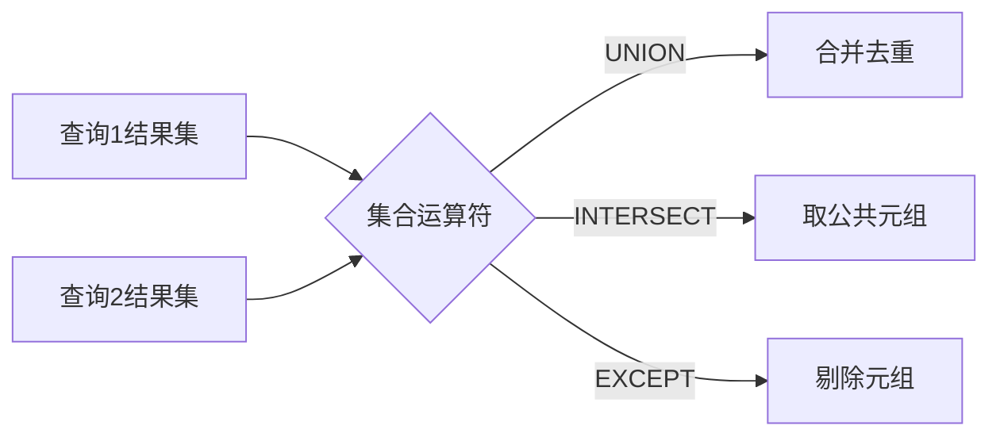

# 集合查询（UNION、INTERSECT、EXCEPT）与基于派生表的查询

---
requires: [数据库系统/SQL单表查询, 数据库系统/SQL连接查询]
---

当我们想找出“既选修了课程 A 又选修了课程 B 的学生”时，用普通的 `WHERE` 条件能直接写吗？如果两个条件在同一行里是矛盾的（比如 `Cno='81001' AND Cno='81002'`），结果必然为空。这时就需要把==两次独立查询的结果当作集合来运算==。

## 集合查询

集合查询将多个 `SELECT` 语句的结果看作数学中的集合，进行并、交、差运算。

> [!IMPORTANT]
> 参与集合运算的各查询结果必须满足：==列数相同==，且对应列的==数据类型兼容==。



| 运算符 | 含义 | 是否去重 |
| :--- | :--- | :--- |
| `UNION` | 并集，合并多个结果 | ==自动去掉重复元组== |
| `UNION ALL` | 并集，合并多个结果 | 保留重复元组 |
| `INTERSECT` | 交集，取共同存在的元组 | 自动去重 |
| `EXCEPT` | 差集，在第一个结果中但不在第二个中 | 自动去重 |

**算对了的例子**：查询同时选修了 '81001' 和 '81002' 课程的学号。

```sql
SELECT Sno FROM SC WHERE Cno = '81001'
INTERSECT
SELECT Sno FROM SC WHERE Cno = '81002';
```

> [!TIP]
> 很多集合查询可以改写为嵌套查询或连接查询，但集合查询语义最直观，代码更短。

> [!WARNING]
> 不要在各个 `SELECT` 子句后单独加 `ORDER BY`！整个集合查询只能在最后加一个全局的 `ORDER BY`。

## 基于派生表的查询

如果把一个查询的结果当成一张“临时表”，再放到外层 `FROM` 子句里继续查，这张临时表就叫==派生表==。

为什么需要它？当我们需要先对数据做分组聚合，再把聚合结果和原表连接比较时，单层查询往往无法实现。

语法格式：

```sql
SELECT ... 
FROM (子查询) AS 派生表别名(列别名列表)
WHERE ...;
```

> [!CAUTION]
> 派生表==必须起别名==（用 `AS`），否则外层查询无法引用它的列！这是考试 SQL 题最常见的扣分点。

**算对了的例子**：查询成绩处于相应课程平均成绩和最高成绩之间的学号和课程号（取自历年真题）。

```sql
SELECT SNO, sc.CNO 
FROM sc, (
    SELECT CNO, 
           MAX(GRADE) AS 最高成绩, 
           AVG(GRADE) AS 平均成绩 
    FROM sc 
    GROUP BY CNO
) AS rs 
WHERE sc.CNO = rs.CNO 
  AND sc.GRADE > 平均成绩 
  AND sc.GRADE < 最高成绩;
```

这里子查询按 `CNO` 分组算出每门课的最高分和平均分，生成派生表 `rs`；外层再将原表 `sc` 与 `rs` 按课程号连接，筛选符合条件的元组。

> [!NOTE]
> 派生表与视图的区别：派生表只在当前语句执行期间存在，不存入数据字典；视图是持久化的虚拟表。

> [!TIP]
> 遇到“求第 N 名”这类题（如真题中求 CS-110 第 4 名），也可以用派生表配合 `TOP` 子句嵌套实现：内层 `TOP 4` 降序取前四，外层 `TOP 1` 升序取最后一名。
