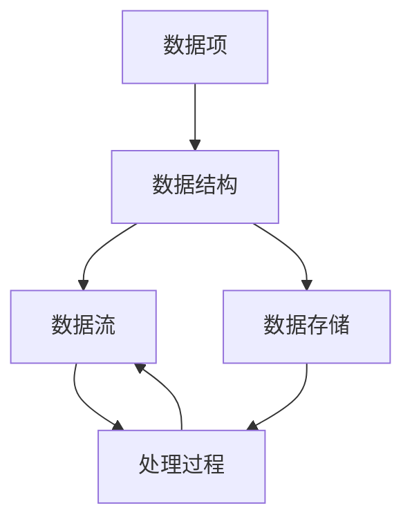

# 需求分析（数据字典：数据项、数据结构、数据流、数据存储、处理过程）

## 需求分析中的数据字典

在数据库设计的需求分析阶段，我们需要回答一个核心问题：**系统里到底有哪些数据？它们从哪来、到哪去、停在哪、被谁加工？** 仅凭“感觉”描述需求，会导致后续设计频繁返工。需求分析的重要原则是：==只要有可能就尽量推迟数据结构设计==，先把用户需求本身搞清楚。

> [!IMPORTANT]
> 数据字典在需求分析阶段建立，并在数据库设计的后续阶段不断修改、充实、完善。它是关于数据的数据（元数据），是需求分析的核心交付物之一。

数据字典包含五类条目：**数据项、数据结构、数据流、数据存储、处理过程**。后四者的定义都依赖于前者的定义，形成层层引用的关系。

---

## 数据项与数据结构

**数据项**是数据的最小组成单位，描述数据的原子属性，如“学号”“姓名”“成绩”。

**数据结构**反映了数据之间的==组合关系==。一个数据结构可以由若干数据项组成，也可以由若干数据结构组成，或者由数据项与数据结构混合组成。

> [!NOTE]
> 数据结构描述格式：`{数据结构名，含义说明，组成: {数据项或数据结构}}`

以“学生”为例：

| 字段 | 内容 |
|---|---|
| 数据结构名 | 学生 |
| 含义说明 | 学籍管理子系统的主体数据结构，定义了一个学生的有关信息 |
| 组成 | 学号、姓名、性别、出生日期、所在系、入学年份 |

---

## 数据流与数据存储

**数据流**是数据结构在系统内部==传输的路径==。它强调“动”的一面：数据从某个处理过程或数据存储流出，流向另一个处理过程或数据存储。描述格式：

$$\text{数据流描述}=\{\text{数据流名},\ \text{说明},\ \text{数据流来源},\ \text{数据流去向},\ \text{组成},\ \text{平均流量},\ \text{高峰期流量}\}$$

| 字段 | 示例 |
|---|---|
| 数据流名 | 体检结果 |
| 数据流来源 | 体检（处理过程） |
| 数据流去向 | 批准（处理过程） |
| 组成 | 学号、体检日期、各项指标结果 |
| 平均流量 | 每天 200 份 |
| 高峰期流量 | 每年 9 月每天约 800 份 |

**数据存储**是数据结构==停留或保存的地方==，强调“静”的一面。描述格式：

$$\text{数据存储描述}=\{\text{数据存储名},\ \text{说明},\ \text{编号},\ \text{输入的数据流},\ \text{输出的数据流},\ \text{组成},\ \text{数据量},\ \text{存取频度},\ \text{存取方式}\}$$

以“学生登记表”为例：

| 字段 | 示例 |
|---|---|
| 数据存储名 | 学生登记表 |
| 输入的数据流 | 新生登记信息 |
| 输出的数据流 | 学籍查询结果 |
| 组成 | 学生（数据结构） |
| 存取方式 | 随机存取，按键（学号）检索 |

> [!WARNING]
> 数据流的“来源/去向”必须写**处理过程或数据存储**的名字，不能写“用户”或“系统外部”这类模糊表述。数据存储则要明确==流入与流出两条数据流==，一个只进不出的“存储”通常是需求遗漏的信号。

---

## 处理过程

数据字典对处理过程的描述只需==说明性信息==，不必展开具体算法。描述格式：

$$\text{处理过程描述}=\{\text{处理过程名},\ \text{说明},\ \text{输入:}\{\text{数据流}\},\ \text{输出:}\{\text{数据流}\},\ \text{处理:}\{\text{简要说明}\}\}$$

| 字段 | 示例 |
|---|---|
| 处理过程名 | 分配宿舍 |
| 输入 | 新生名单、宿舍空余信息 |
| 输出 | 住宿分配结果 |
| 处理 | 按院系、性别、班级将新生分配到各宿舍楼空闲床位 |

> [!TIP]
> 处理过程的“功能”回答“用来做什么”（如：分配宿舍），“处理要求”回答“要做到什么程度”（如：同班学生尽量集中、每间宿舍不超 4 人）。两者都写，才算完整。

---

## 常见坑与一个完整例子

**易错点**：把“数据结构”和“数据存储”混为一谈。数据结构描述**逻辑组成**（由哪些数据项组成），数据存储描述**物理停留位置及进出数据流**。例如，“学生”是数据结构，“学生登记表”是数据存储，学生登记表的内容是“学生”这个数据结构。

> [!CAUTION]
> 数据字典的五类条目中，==数据项和数据结构是基础==，先定义它们，才能定义数据流与数据存储的“组成”。处理过程引用的是数据流，不是数据项。

**完整例子**（简答题常考“数据库设计分几步，需求分析做什么”）：

数据库设计分六步：**需求分析 → 概念结构设计 → 逻辑结构设计 → 物理结构设计 → 数据库实施 → 数据库运行和维护**。其中需求分析阶段的核心工作是：调查用户需求，用结构化方法自顶向下分析，建立==数据字典==（含数据项、数据结构、数据流、数据存储、处理过程五类条目），并输出需求说明书，为后续概念设计提供依据。
