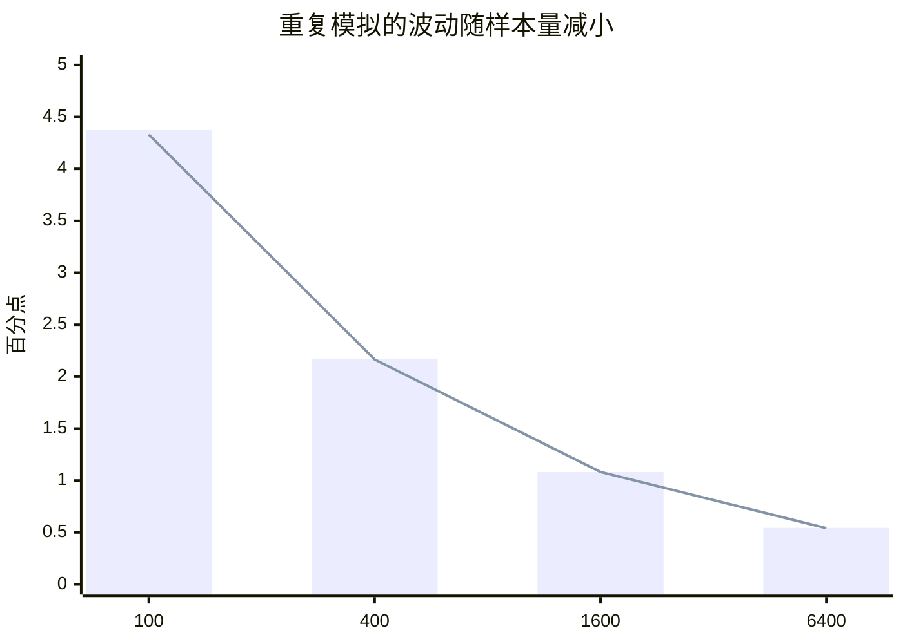

# 蒙特卡罗估计与模拟误差

如果一个概率难以直接求出，但能按明确的规则重复生成随机场景，可以把每次场景转换成一个 0 或 1。令 $I_i=1$ 表示第 $i$ 次场景中事件发生，否则为 0。则
$$
\widehat p=\frac{1}{n}\sum_{i=1}^{n}I_i
$$
就是事件概率的蒙特卡罗估计（Monte Carlo estimate）。独立同分布且模拟正确时，0/1 的平均值随试验次数增加而靠近事件概率 $p$。对一般期望，思路相同，只是把 0/1 换成每次试验得到的数值。

## 自拟例：两件事都完成的概率

设一组任务中的两个独立子任务各有 $0.5$ 的概率按时完成。两者都按时完成记 1，其他情况记 0。这里可以先用 $0.5\times0.5=0.25$ 验证模拟：独立模拟 100 组若观察到 20 组完成，估计值是 $0.20$，不能用单个子任务的按时比例来替代。本题的一次试验是“一组”，事件也必须定义在同一个单位上。

模拟结果为 $0.20$ 时，估计标准误可用
$$
\widehat{\mathrm{SE}}=\sqrt{\frac{\widehat p(1-\widehat p)}{n}}
=\sqrt{\frac{0.2\times0.8}{100}}=0.04
$$
近似评估。若成功比例不变，把独立试验次数提高到 400，标准误约为 $0.02$。因为误差的典型尺度随 $1/\sqrt n$ 下降，想把随机波动减半通常要做约四倍试验；不意味着每次追加试验后估计值都更接近真值。

### 误差减半需要多少次？

上面的 $0.04$ 是用**某次**模拟的 $\widehat p=0.20$ 估出来的；这个自编模型另有已知真值 $p=0.25$，可直接计算理论标准误 $\sqrt{0.25(1-0.25)/n}$。现在对每个样本量独立重复估计 5,000 次，每次抽取一个二项计数 $K$（试验次数 $n$、成功概率 $0.25$），再记录 $K/n$。这些估计值的样本标准差是图里的实测波动。横轴每一格把样本量乘四，不是固定差值；纵轴单位为百分点。（可复现设置：Python 3.12，随机种子 20261121，按横轴顺序依次采样。）

> [!WARNING]
> ==样本量乘四，减半的是重复估计的典型波动，不是一次估计的实际误差==。柱顶接近理论折线，说明这个模拟实验的波动与模型预测相符，不能用来证明模型假设在真实任务里也成立。

## 多跑能解决什么？

假如两个子任务依赖同一设备，实际可能总是一起成功或一起失败。它们各自按时的概率仍可为 $0.5$，但两者都按时的概率变成 $0.5$。如果仍用两个独立随机数模拟，一百万次只会更精确地逼近错误模型的 $0.25$。增加次数解决的是**抽样误差**，不是**模型假设错误**。当试验一次都没发生事件时，插入式标准误公式甚至会给出 0，也不能据此断定真实概率为零。
