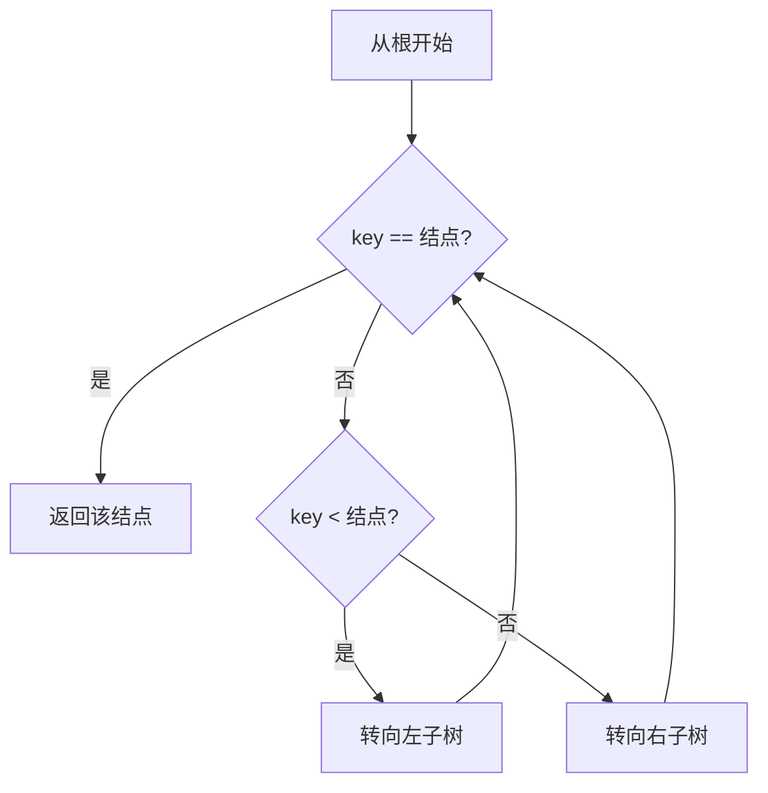
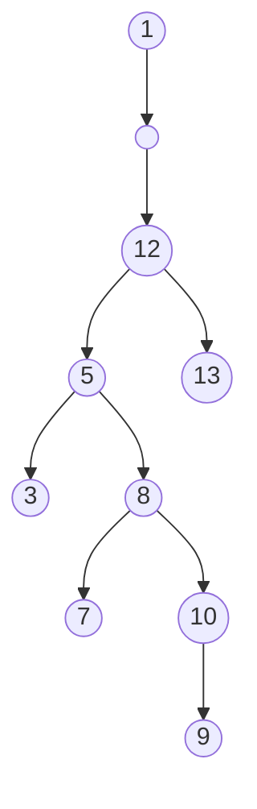

# 二叉搜索树的搜索算法分析及最坏情况

> [!IMPORTANT]
> 二叉搜索树（BST）的搜索本质是**不断缩小查找区间**：若目标值小于当前结点，则进入左子树；若大于，则进入右子树；相等则命中。

## 它是什么与为什么需要

在无序数组中找元素必须逐个比对，时间复杂度 $O(n)$。如果数据按“左小右大”组织成二叉树，每次比较就能淘汰一半候选结点——这正是 BST 搜索的核心思想。

## 怎么做：搜索算法分析

设树高为 $h$，搜索时从根走到目标（或空指针），最多经过 $h+1$ 个结点。因此==单次搜索的时间复杂度为 $O(h)$==。

但 $h$ 取决于树的形态：

- **最好情况**：树完全平衡，$h = \lfloor \log_2 n \rfloor$，搜索 $O(\log n)$。
- **最坏情况**：所有结点退化成一条链（如按升序依次插入），$h = n - 1$，搜索退化为 $O(n)$。

> [!WARNING]
> 南邮考试高频坑点：**BST 的最坏时间复杂度不是 $O(\log n)$，而是 $O(n)$**。题目若问“最坏情况下的比较次数”，答案就是 $n$（或树的高度 $+1$）。

## 相近概念对比

| 结构 | 平均搜索 | 最坏搜索 | 是否自平衡 |
|------|---------|---------|-----------|
| 普通 BST | $O(\log n)$ | $O(n)$ | 否 |
| AVL 树 | $O(\log n)$ | $O(\log n)$ | 是 |
| 有序数组二分 | $O(\log n)$ | $O(\log n)$ | 静态结构 |

> [!NOTE]
> BST 和 AVL 树的搜索流程完全相同，区别仅在于 AVL 通过旋转保证 $h = O(\log n)$，从而消除了最坏退化。

## 算对了的例子

以真题数据集合 $d=\{1, 12, 5, 8, 3, 10, 7, 13, 9\}$ 依次插入构造 BST 为例：

**问题**：在这棵树中搜索 `9`，需要比较几次？

**逐步推演**：

1. 根结点 `1`：$9 > 1$，向右走；
2. 结点 `12`：$9 < 12$，向左走；
3. 结点 `5`：$9 > 5$，向右走；
4. 结点 `8`：$9 > 8$，向右走；
5. 结点 `10`：$9 < 10$，向左走；
6. 结点 `9`：$9 = 9$，命中！

共比较 ==6 次==。这棵树的结点总数 $n=9$，而搜索 `9` 经过了 6 层，说明此树已明显不平衡。

> [!TIP]
> 手动画 BST 的口诀：**“比根小往左，比根大往右，相等就停下”**。画图时务必严格按插入顺序逐个挂接，不要一次性排序后再建图——那是平衡树的做法，不是普通 BST。

> [!CAUTION]
> 删除操作（如删 `12`）会改变树的结构，进而影响后续搜索路径。若题目先要求删除再要求搜索，**必须先画出删除后的新树**，再在新树上执行搜索。
