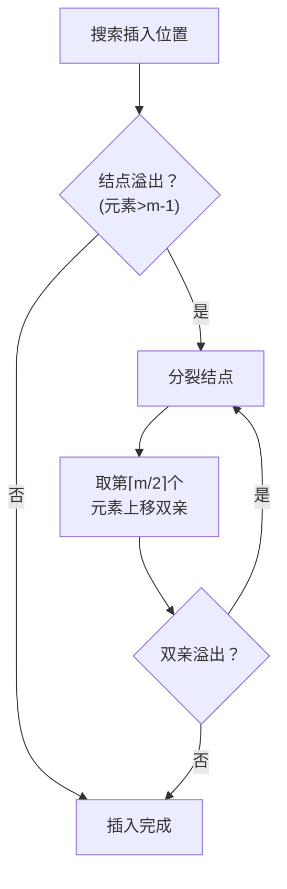

# B-树（多路平衡搜索树）的定义、插入与删除操作

> [!IMPORTANT]
> B-树（多路平衡搜索树）是为==外存（磁盘）==设计的动态集表示结构。内存中用二叉平衡树，而磁盘读写以“块”为单位，B-树通过让一个结点存储多个关键字来降低树高，从而减少磁盘访问次数。

## 定义与核心性质

一棵 $m$ 阶 B-树是一棵 $m$ 叉搜索树，它或者是空树，或者满足：

1. **根结点**至少有 $2$ 个孩子（若非叶子）。
2. **除根以外的非失败结点**至少有 $\lceil m/2 \rceil$ 个孩子，即至少包含 $\lceil m/2 \rceil - 1$ 个元素。
3. **每个结点**至多有 $m$ 个孩子，即至多包含 $m-1$ 个元素。
4. **所有失败结点**都在同一层（保证绝对平衡）。

设 B-树包含 $N$ 个元素，则失败结点个数为 $N+1$。树高 $h$ 满足：

$$h \le \log_{\lceil m/2 \rceil} \frac{N+1}{2} + 1$$

> [!TIP]
> 记忆口诀：“上限看 $m$，下限看 $\lceil m/2 \rceil$”。结点内元素个数范围是 $[\lceil m/2 \rceil - 1,\; m-1]$（根除外）。

## 搜索、插入与删除

### 搜索
从根出发，在结点内部（有序表）用顺序或二分搜索找关键字，决定走哪个分支指针，直到找到或到达失败结点。磁盘访问次数最多为树高 $h$。

### 插入
插入总是发生在==叶子结点==。步骤如下：

1. 搜索关键字，若已存在则插入失败；否则定位到应插入的叶子结点 $q$。
2. 将新元素和一个空指针插入 $q$。
3. 若 $q$ 未溢出（元素数 $\le m-1$），结束。
4. 若溢出，此时共有 $m$ 个关键字。在第 $\lceil m/2 \rceil$ 个关键字处==分裂==：前 $\lceil m/2 \rceil - 1$ 个留在 $q$，该关键字上移双亲，后 $m-\lceil m/2 \rceil$ 个放入新结点 $q'$，并将 $q'$ 接入双亲的相应分支。$m$ 为奇数时两边数量相等；$m$ 为偶数时右边多一个。
5. 若根结点分裂，产生新根，树高加 $1$。

### 删除
删除也从叶子开始。若被删元素不在叶子中，用它右子树上的最小元素（后继）==替代==，转化为叶子删除。

删除后若结点元素数 $< \lceil m/2 \rceil - 1$，发生==下溢==，处理策略：

| 情况 | 操作 | 说明 |
|---|---|---|
| 兄弟有多余元素 | **借** | 从相邻兄弟借一个元素，双亲分隔元素下移 |
| 兄弟也刚好下限 | **连接（合并）** | 与兄弟及双亲的分隔元素合并为一个结点 |

> [!WARNING]
> 若连接导致根结点变空（元素被删光），则保留的子结点成为新根，==树高减 1==。

## 完整示例

**补充例子**：从只有关键字 $60$ 的 3 阶 B-树开始，依次插入 $90,25,45$，再删除 $60$。每个非根非失败结点允许 $1$ 至 $2$ 个关键字。

| 操作 | 根 | 根的孩子 | 说明 |
|---|---|---|---|
| 初始 | $[60]$ | 无 | 根同时是叶子 |
| 插入 $90$ | $[60,90]$ | 无 | 未溢出 |
| 插入 $25$ | $[60]$ | $[25]$、$[90]$ | 暂得 $[25,60,90]$，中间的 $60$ 上移成为新根 |
| 插入 $45$ | $[60]$ | $[25,45]$、$[90]$ | 在左叶子中有序插入 |
| 删除 $60$ | $[45]$ | $[25]$、$[90]$ | 先以后继 $90$ 替换根中的 $60$，再删右叶子中的 $90$；右叶子下溢，向左兄弟借 $45$，经根转移完成调整 |

借位的中间状态是根 $[90]$、左孩子 $[25,45]$、右孩子为空：把左兄弟最大值 $45$ 上移到根，再把原分隔关键字 $90$ 下移到右孩子。调整后各结点关键字数满足下限，中序关键字为 $25,45,90$，与插入后再删除 $60$ 的结果一致。

## 常见坑点辨析

> [!CAUTION]
> 1. **分裂位置算错**：$m$ 阶 B-树分裂位置是 $\lceil m/2 \rceil$，不是 $\lfloor m/2 \rfloor$。例如 4 阶树分裂在第 2 个元素，3 阶树也在第 2 个元素。
> 2. **混淆 B-树与 AVL 树**：AVL 树旋转是在内存中维持二叉平衡；B-树的分裂/连接是为了适应磁盘块大小。
> 3. **忘记替代**：删除非叶子结点时，必须先找后继替代，不能直接从内部删除，否则会破坏多路搜索性质。
