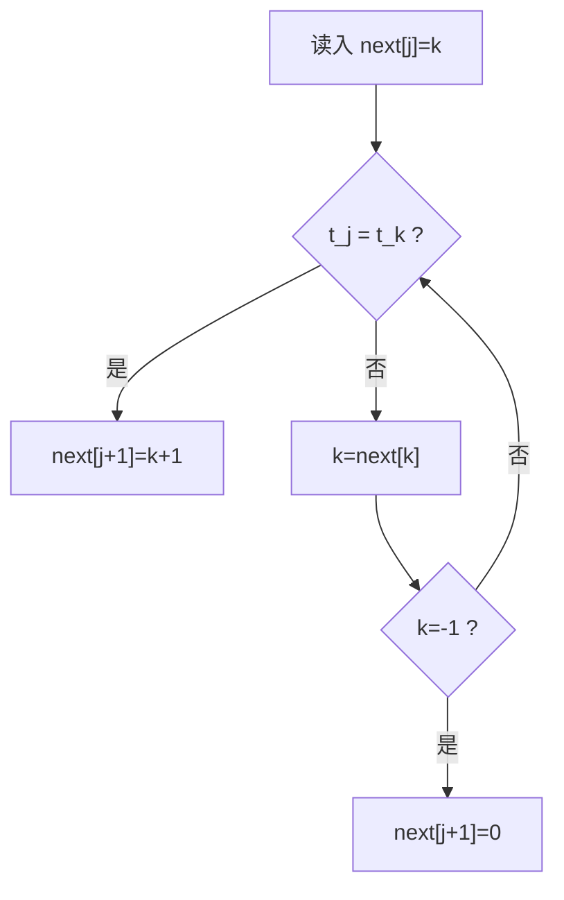

# KMP模式匹配算法中的失败函数（next数组）递推计算

## 失败函数是什么

设模式串 $T=t_0t_1\cdots t_{m-1}$，失配位置 $j$ 对应的 **next 值**记为 $next[j]$。它表示：当主串当前字符与 $t_j$ 失配时，模式串应当回退到哪个位置继续比较。

$$
next[j]=\max\{k\mid 0\le k<j,\ t_0\cdots t_{k-1}=t_{j-k}\cdots t_{j-1}\}
$$

也就是取前缀 $t_0\cdots t_{j-1}$ 的 ==最长相等前后缀== 的长度 $k$。约定：

$$
next[0]=-1,\qquad next[1]=0
$$

> [!IMPORTANT]
> 核心含义：$next[j]$ 是“已匹配前缀”中，既可当前缀又可当后缀的最长长度。

---

## 为什么可以递推

直接对每个 $j$ 都重新枚举所有前后缀会很慢。关键在于：

- 若已经知道 $next[j]=k$；
- 那么计算 $next[j+1]$ 时，只需看 $t_j$ 与 $t_k$ 是否相同。

常见递推写法为：

$$
next[j+1]=
\begin{cases}
k+1, & t_j=t_k\\
next[k]\text{ 继续回退}, & t_j\ne t_k
\end{cases}
$$

其中 $k=next[j]$。若回退到 $k=-1$，则令 $next[j+1]=0$。

> [!TIP]
> 记忆：==相等就延长，失配就回退==。

---

## 递推计算流程

本质上，每次失配后的回退，仍然是利用已经算出的 next 值，所以整体计算是 $O(m)$。

---

## 一个算对的例子

求模式串

$$
T=\text{ababaca}
$$

的 next 数组，下标从 $0$ 开始。

先约定：

$$
next[0]=-1,\qquad next[1]=0
$$

逐个计算：

| $j$ | 前缀 | 最长相等前后缀 | $next[j]$ |
|---:|---|---|---:|
| 0 | a | 无 | -1 |
| 1 | ab | 0 | 0 |
| 2 | aba | a | 1 |
| 3 | abab | ab | 2 |
| 4 | ababa | aba | 3 |
| 5 | ababac | 0 | 0 |
| 6 | ababaca | a | 1 |

所以：

$$
next=[-1,0,0,1,2,3,0,1]
$$

> [!WARNING]
> 注意区分“$next[j]$ 是长度”还是“下一步比较的位置”。在 $0$ 起始下标下，二者数值一致；若教材采用 $1$ 起始下标，写法常会平移。

---

## 与相近概念的区别

| 概念 | 含义 | 作用 |
|---|---|---|
| next 数组 | 失配后模式串回退位置 | 指导 KMP 匹配 |
| nextval 数组 | 对 next 的优化 | 避免无效重复比较 |
| 最长相等前后缀 | next 的数学定义 | 用来推导 next |

很多教材会在 next 基础上再定义 $nextval$：

- 若 $t_j=t_{next[j]}$，则令 $nextval[j]=nextval[next[j]]$；
- 否则 $nextval[j]=next[j]$。

> [!NOTE]
> next 解决“回退到哪里”，nextval 进一步解决“回退后是否值得比较”。

---

## 常见坑

- 把 $next[j]$ 理解成“前 $j$ 个字符里的最长公共前后缀”以外的量；
- 忘记 $next[0]=-1$、$next[1]=0$ 的约定；
- 在 $t_j\ne t_k$ 时只回退一次，实际上要 ==不断令 $k=next[k]$== 直到匹配或 $k=-1$；
- 混淆 0 起始和 1 起始下标，导致整个数组错位。

一句话总结：失败函数的递推计算，就是用已经求出的 next 值，快速求出下一个 next 值。
