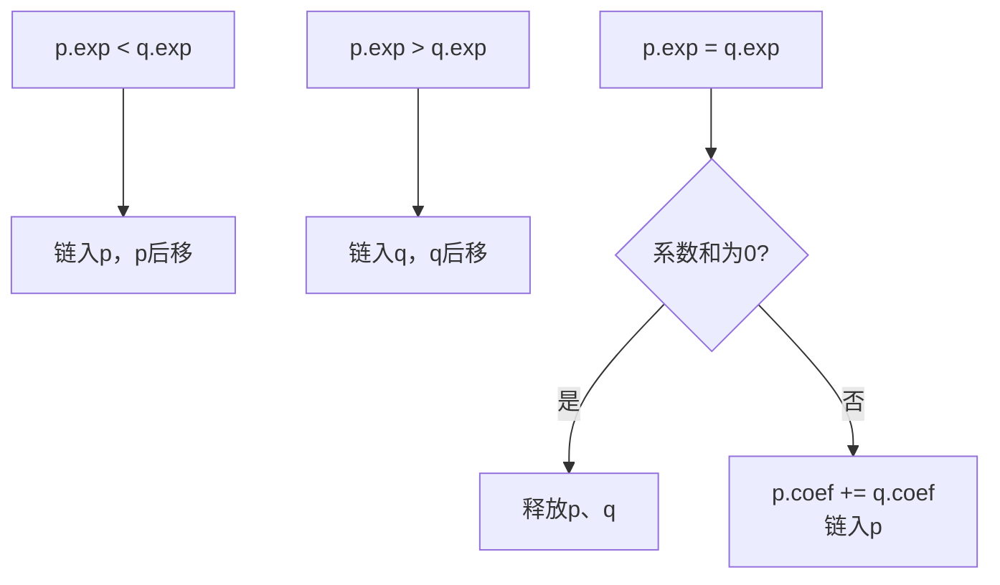
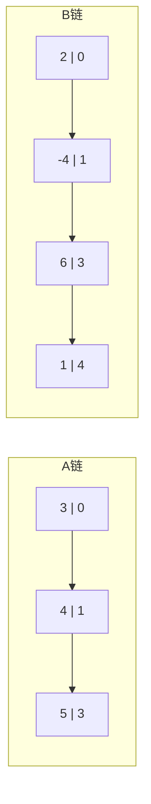
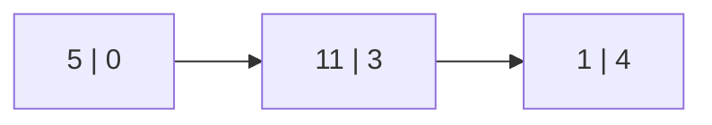

# 用带表头结点的单链表表示一元多项式及多项式相加算法

## 多项式怎么存进链表

一元多项式 $A(x)=a_0+a_1x+a_2x^2+\cdots+a_nx^n$ 中有大量零系数项，若用数组按指数顺序存储每个系数，会浪费大量空间。只保留**系数不为零的项**，每项构成一个结点：

```
coef | exp | next
```

结点按指数**升序**（或降序）链接。用带表头结点的单链表表示一个多项式，表头结点不存数据，只为统一插入、删除操作。

> [!TIP]
> 存储口诀：==系数非零才建结点，指数递增串成链==。

## 多项式相加怎么做

设 $A$、$B$ 两个多项式链表均按指数升序排列，相加结果存入 $C$（可复用 $A$ 的结点空间，或新建链表）。两把“扫描指针” $p$、$q$ 分别指向 $A$、$B$ 的首元结点，比较所指结点的指数，分三种情况：

| 指数比较 | 操作 |
|---|---|
| $p.exp < q.exp$ | 把 $p$ 结点链入 $C$，$p$ 后移 |
| $p.exp > q.exp$ | 把 $q$ 结点链入 $C$，$q$ 后移 |
| $p.exp = q.exp$ | 系数相加；和不为 0 则修改 $p$ 的系数后链入，和等于 0 则删除两结点 |



> [!IMPORTANT]
> ==指数相等时，系数相加为零的项必须删除==，不能保留系数为零的结点。

## 一个完整的例子

设 $A(x)=3+4x+5x^3$，$B(x)=2-4x+6x^3+x^4$，求 $C=A+B$。



依次扫描：

- exp 0 对 exp 0：$3+2=5$，链入 $5x^0$；
- exp 1 对 exp 1：$4+(-4)=0$，**删除**该项；
- $p$ 指 $5x^3$，$q$ 指 $6x^3$：$5+6=11$，链入 $11x^3$；
- $A$ 已空，把 $B$ 剩余的 $x^4$ 直接链入。

最终 $C(x)=5+11x^3+x^4$。



## 常见的坑

> [!WARNING]
> 相加时不要直接修改原多项式的结点后立刻释放另一结点，否则可能丢失后续链。应先保存下一结点指针，再操作。

> [!CAUTION]
> 若题目要求结果链表**不含零系数项**，忘记处理“和为 0”的情况是最高频失分点。

> [!NOTE]
> 与普通单链表合并的区别：普通合并只按值大小归并，多项式相加在指数相等时还要做一次**系数运算与可能的结点删除**。

## 复杂度

设 $A$ 有 $m$ 项、$B$ 有 $n$ 项，每一轮比较至少推进一个指针，总时间复杂度为 $O(m+n)$，空间复杂度为 $O(1)$（复用原结点时）。
