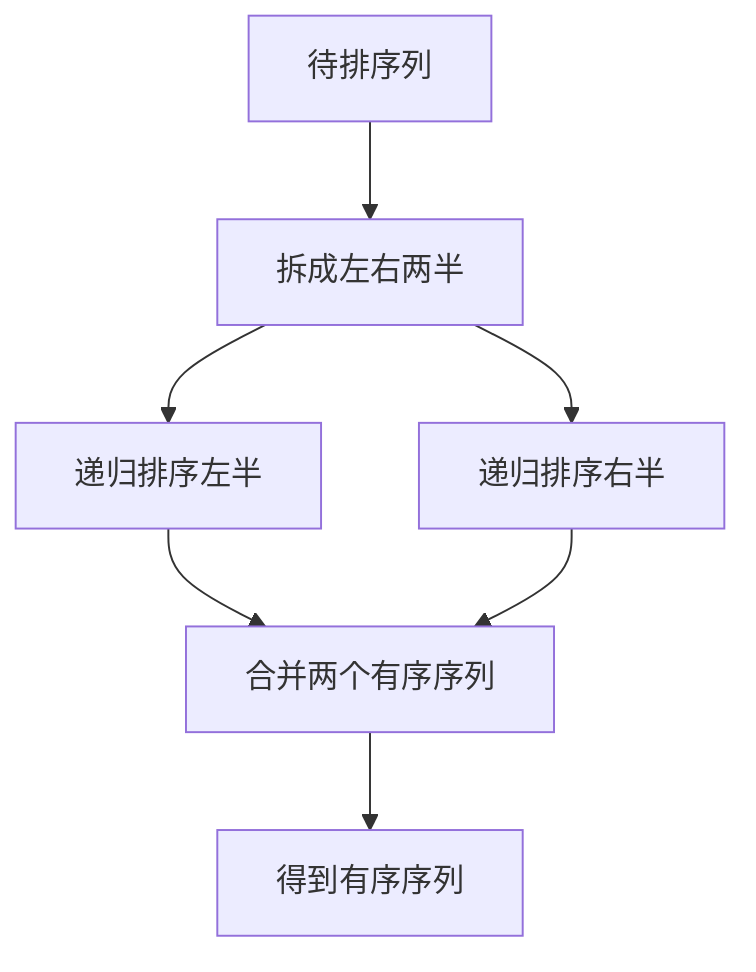
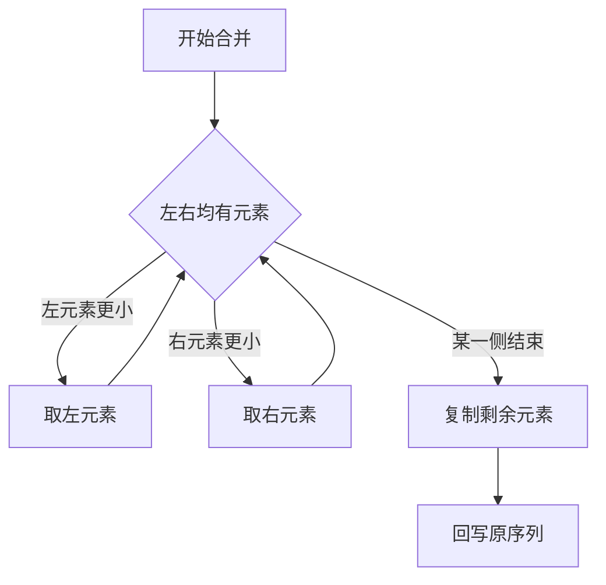

# 两路合并排序（归并排序）的算法思想与子序列合并过程

## 什么是两路合并排序

两路合并排序又称==归并排序==，它的核心思想是：先把待排序列不断拆成两个较小子序列，再把两个**已经有序**的子序列合并成一个有序序列。

> [!IMPORTANT]
> “合并”不是把两个序列直接拼在一起，而是依次比较两个序列的首元素，将较小者放入辅助数组。

它采用分治思想：==分解—合并—再分解—再合并==，直至所有子序列有序。



## 为什么需要归并排序

有些内部排序算法要求待排序列“基本有序”，否则效率会下降；归并排序则不依赖初始序列是否有序，对各种输入都能保持相同数量级的效率。

- 最坏时间复杂度：$O(n\log n)$
- 空间复杂度：$O(n)$，需要与原序列等长的辅助数组
- 稳定性：==稳定==，相等元素合并时保持原有先后次序
- 适用场景：记录较大、需要稳定排序、要求最坏时间复杂度有保证

> [!NOTE]
> 归并排序的时间复杂度来自“每层合并共处理约 $n$ 个元素、共有约 $\log_2 n$ 层”，而不是只根据递归层数判断。

## 分解过程

设序列长度为 $n$，每次将当前区间 $[low,high]$ 从中间分成左右两部分：

$$
mid=\left\lfloor\frac{low+high}{2}\right\rfloor
$$

左半部分为 $[low,mid]$，右半部分为 $[mid+1,high]$。递归处理两半后，它们分别有序。

例如：

```text
原序列：49 38 65 97 76 13 27 49
```

第一次分成：

```text
左：49 38 65 97
右：76 13 27 49
```

递归排序后得到两个有序子序列：

```text
左：38 49 65 97
右：13 27 49 76
```

最后进行两路合并。

## 子序列合并过程

设置三个指针：

- `i`：指向左子序列当前元素；
- `j`：指向右子序列当前元素；
- `k`：指向辅助数组中下一个存放位置。

每次比较 `A[i]` 与 `A[j]`：

1. 若 `A[i] <= A[j]`，将 `A[i]` 放入 `R[k]`，随后 `i++`、`k++`；
2. 否则将 `A[j]` 放入 `R[k]`，随后 `j++`、`k++`；
3. 某一序列用完后，将另一序列剩余元素依次复制到 `R[k...]`；
4. 最后把辅助数组中的结果复制回原数组。



以上面的两个有序子序列为例，合并结果为：

```text
13 27 38 49 49 65 76 97
```

两个 `49` 原本分别来自左、右子序列。==左边的 `49` 先放入，右边的 `49` 后放入==，因此相等元素的相对次序没有改变，体现了归并排序的稳定性。

> [!WARNING]
> 比较条件应写成 `A[i] <= A[j]`，不能写成 `<`。若相等时总取右边元素，就可能破坏稳定性。

## 与相近排序算法的区别

| 算法 | 主要思想 | 最坏时间 | 空间 | 稳定性 |
|---|---|---:|---:|---|
| 直接插入排序 | 逐个插入到有序区 | $O(n^2)$ | $O(1)$ | 稳定 |
| 冒泡排序 | 相邻元素交换 | $O(n^2)$ | $O(1)$ | 稳定 |
| 简单选择排序 | 选择最小或最大元素 | $O(n^2)$ | $O(1)$ | 不稳定 |
| 快速排序 | 划分后递归排序 | $O(n^2)$ | $O(\log n)$ | 不稳定 |
| 堆排序 | 建立并调整堆 | $O(n\log n)$ | $O(1)$ | 不稳定 |
| ==归并排序== | ==分解并合并有序子序列== | ==$O(n\log n)$== | ==$O(n)$== | ==稳定== |

若待排序列已经有序或基本有序，直接插入排序通常很合适；完全无序时，可考虑快速排序、堆排序或归并排序。若还要求稳定，归并排序更合适。

## 常见坑

1. **只会写递归，不懂合并。** 合并时必须处理“一边已经取完”的情况。
2. **误把拼接当作合并。** 两个有序序列不能直接拼接成有序序列。
3. **索引或区间边界混乱。** 递归区间应包含 `mid+1` 到 `high`。
4. **认为归并排序是原地排序。** 它需要 $O(n)$ 辅助空间。
5. **把每一趟误认为只处理一个元素。** 每趟合并都要扫描约 $n$ 个元素，共有约 $\lceil\log_2 n\rceil$ 趟。

> [!TIP]
> 快速排序的关键是“划分”，归并排序的关键是“合并”；一个先确定位置区间，一个先产生有序结果再拼接。
