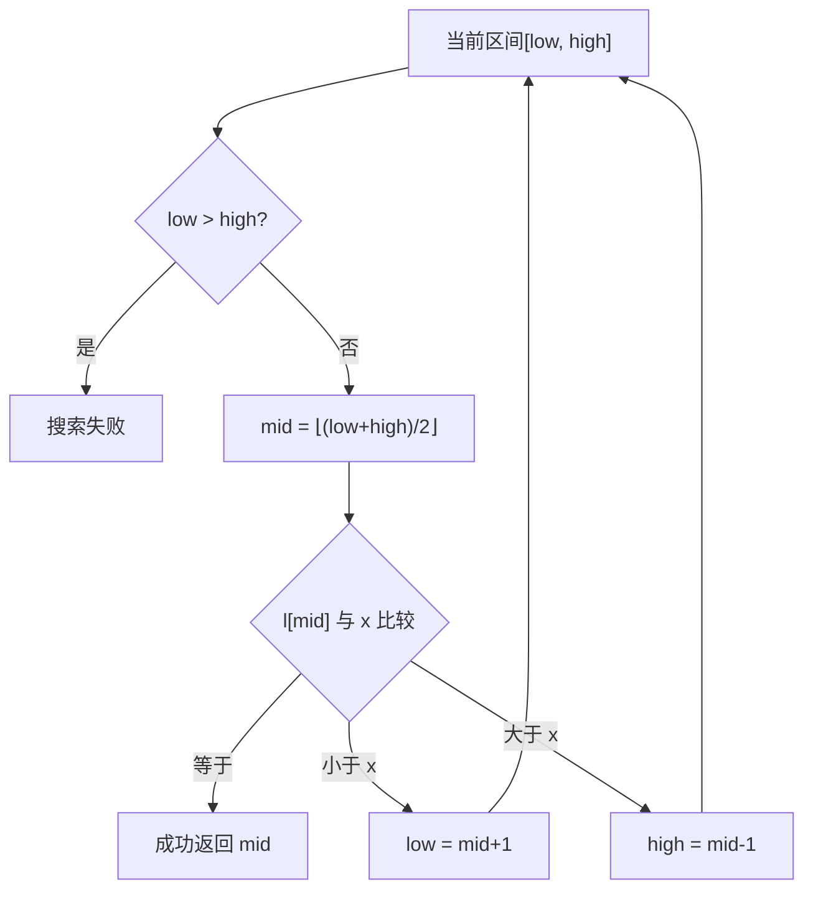

# 二分搜索（对半搜索）的递归与非递归算法实现

## 二分搜索与对半搜索

**它是什么**：二分搜索（Binary Search）是在**有序表**上进行的搜索算法。基本思想是：每轮取一个“分割点”将当前搜索区间拆成左右两个子表，比较分割点元素与目标 $x$ 的关键字，即可排除掉其中一个子表，把问题规模缩小一半。根据分割点选取方式不同，可分为对半搜索、一致对半搜索、斐波那契搜索、插值搜索等。

**为什么需要**：顺序搜索在 $n$ 个元素中平均要比较 $\frac{n+1}{2}$ 次（$O(n)$）。而二分搜索每轮砍半，比较次数降到 $O(\log n)$。代价是：==表必须事先按关键字有序==，且通常要求顺序存储（能 $O(1)$ 随机访问中点）。

## 对半搜索的执行过程

对半搜索的分割点固定为**当前子表的中点元素**。设当前区间为 $[low, high]$，中点下标

$$mid = \left\lfloor \frac{low+high}{2} \right\rfloor$$

比较 $l[mid]$ 与 $x$ 有三种结果：

| 比较结果 | 下一步操作 |
|---|---|
| $l[mid] = x$ | 搜索成功，返回 $mid$ |
| $l[mid] < x$ | 在右子表 $[mid+1, high]$ 继续 |
| $l[mid] > x$ | 在左子表 $[low, mid-1]$ 继续 |

当 $low > high$ 时区间为空，搜索失败。



## 递归与非递归实现

**非递归（迭代）**：

```cpp
template <class T>
ResultCode ListSet<T>::Search(T& x) const {
    int low = 0, high = n - 1;
    while (low <= high) {
        int mid = (low + high) / 2;
        if (l[mid] == x) { x = l[mid]; return Success; }
        else if (l[mid] < x) low = mid + 1;
        else high = mid - 1;
    }
    return NotPresent;
}
```

**递归**：

```cpp
template <class T>
int ListSet<T>::BSearch(T& x, int low, int high) const {
    if (low > high) return -1;              // 失败
    int mid = (low + high) / 2;
    if (l[mid] == x) return mid;            // 成功
    else if (l[mid] < x)
        return BSearch(x, mid + 1, high);   // 右子表
    else
        return BSearch(x, low, mid - 1);    // 左子表
}
```

两者逻辑完全等价，迭代版省掉了函数调用栈开销，实际工程更常用。

## 判定树与性能分析

对半搜索的执行过程可用一棵**二叉判定树**模拟：表元素是内部结点，失败位置是外部结点（方形）。搜索 $x$ 就是沿根到某结点的路径走，**比较次数 = 路径上的结点数**。

> [!IMPORTANT]
> 对半搜索成功时比较次数不超过 $\lfloor \log_2 n \rfloor + 1$；失败时需要 $\lfloor \log_2 n \rfloor$ 或 $\lfloor \log_2 n \rfloor + 1$ 次比较。成功平均搜索长度 $ASL_{succ} \approx \log_2(n+1) - 1$。

## 一个算对了的例子

对 14 个元素的有序表 $A[1]\sim A[14]$ 查找 $A[4]$：

- 第 1 次：区间 $[1,14]$，$mid=\lfloor 15/2\rfloor=7$，比较 $A[7]$
- $A[4]<A[7]$，区间缩至 $[1,6]$，$mid=\lfloor 7/2\rfloor=3$，比较 $A[3]$
- $A[4]>A[3]$，区间缩至 $[4,6]$，$mid=5$，比较 $A[5]$
- $A[4]<A[5]$，区间缩至 $[4,4]$，$mid=4$，比较 $A[4]$，命中

比较序列：$A[7], A[3], A[5], A[4]$。

> [!WARNING]
> 常见错误：区间更新写成 `low = mid` 或 `high = mid`（死循环）；中点计算 `(low+high)/2` 在极大数组中可能溢出，工程上应写 `low + (high - low) / 2`。另外，==对半搜索只适用于有序顺序表==，链表上无法高效取中点。
