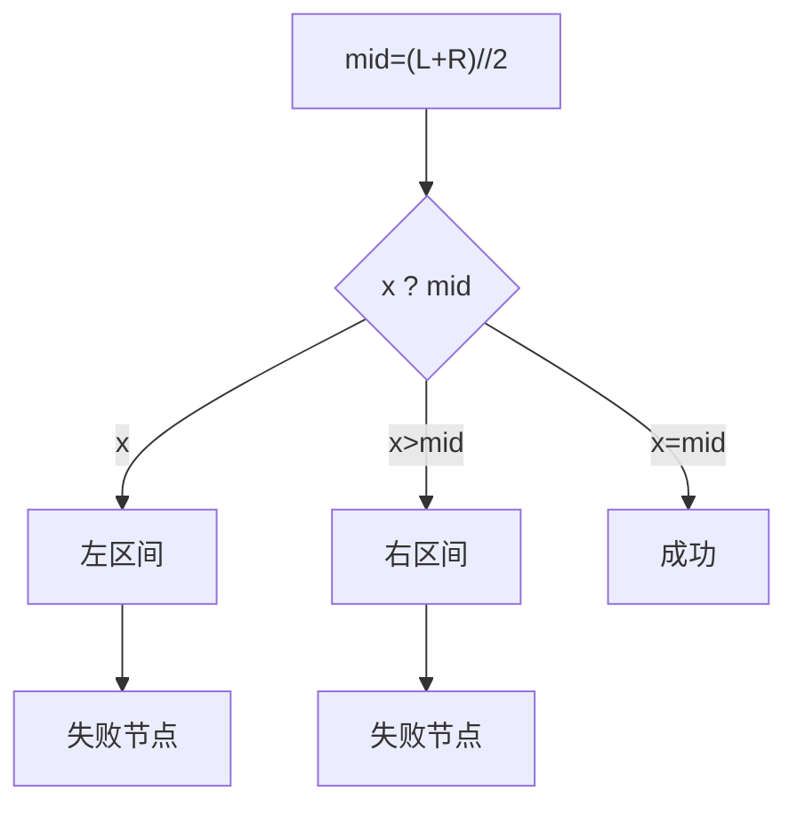
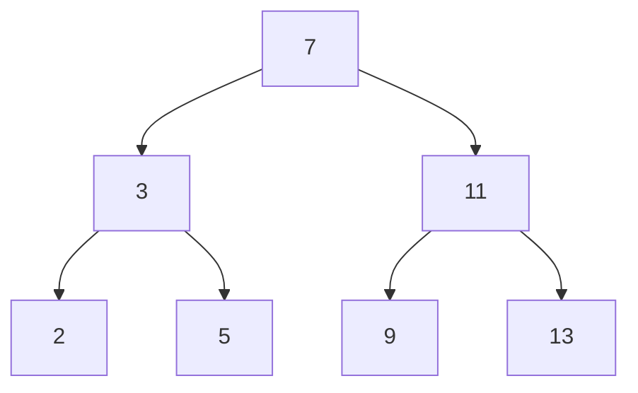

# 二分搜索的二叉判定树构造及搜索性能分析

二分搜索（对半搜索）每次取区间中点与目标比较，把范围缩小一半。能不能把整个搜索过程"画出来"，再据此精确算出比较次数？——能，这就是==二分搜索的二叉判定树==。

## 什么是对半搜索的二叉判定树

设有序表 $A[1..n]$，把对半搜索过程中"每次比较"看作一个节点：

- **内部节点**：一次比较 $x$ 与 $A[\text{mid}]$，标上下标 $\text{mid}$；
- **左子树**：$x < A[\text{mid}]$，到左半区间继续；
- **右子树**：$x > A[\text{mid}]$，到右半区间继续；
- **外部节点（失败节点）**：区间为空，搜索失败。

==判定树中从根到某内部节点的路径长度 + 1，就是查找成功时的比较次数==；从根到外部节点的路径长度，就是查找失败时的比较次数。

> [!NOTE]
> 判定树形态只由 $n$ 决定，与具体元素值无关。下标用 $1..n$，中点统一取 $\text{mid}=\lfloor (L+R)/2 \rfloor$（向下取整），不同教材取整方式不同会导致树形略有差异。

## 构造方法（以 $n=14$ 为例）

只需把每次对半搜索的 mid 作为根递归下去：

- 区间 $[1,14]$：$\text{mid}=\lfloor(1+14)/2\rfloor=7$ → 根是 $A[7]$；
- 左区间 $[1,6]$：$\text{mid}=3$ → $A[3]$；
- 右区间 $[8,14]$：$\text{mid}=11$ → $A[11]$；
- ……以此类推，直到区间为空。

> [!TIP]
> 手工构造口诀：==写区间、算中点、递归左右==。先写 $[L,R]$，算出 $\text{mid}$ 写在节点，再对 $[L,\text{mid}-1]$ 和 $[\text{mid}+1,R]$ 重复，直到 $L>R$。

## 搜索性能分析

设 $n$ 个内部节点，==失败节点共 $n+1$ 个==。

| 指标 | 公式 |
| --- | --- |
| 树高（成功最多比较） | $h=\lfloor \log_2 n \rfloor + 1$ |
| 成功最少比较 | $1$ |
| 失败最少比较 | $\approx \lfloor \log_2 n \rfloor$（较浅的外部节点） |
| 失败最多比较 | $\approx \lfloor \log_2 n \rfloor + 1$ |

- **成功平均查找长度（ASL）**：近似为 $\log_2(n+1)-1$，满二叉树时
  $$ASL_{成功}=\frac{1}{n}\sum_{i=1}^{h} i\cdot(\text{第 } i \text{ 层节点数}) \approx \log_2(n+1)-1$$
- **失败平均查找长度**：$$ASL_{失败}=\frac{1}{n+1}\sum_{\text{外部节点}}(\text{路径长})$$

> [!IMPORTANT]
> ==$O(\log n)$ 的来源==：每比较一次区间至少减半，$n \to n/2 \to n/4 \to \cdots \to 1$，共 $\approx \log_2 n$ 次。

## 算一个对了的例子（$n=14$，查 $A[4]$）

区间收缩过程（下标取整向下）：

| 次数 | 区间 | mid | 比较 |
| --- | --- | --- | --- |
| 1 | $[1,14]$ | 7 | $4<7$ |
| 2 | $[1,6]$ | 3 | $4>3$ |
| 3 | $[4,6]$ | 5 | $4<5$ |
| 4 | $[4,4]$ | 4 | $4=4$，成功 |

被比较元素依次是 ==$A[7],A[3],A[5],A[4]$==（对应真题选项 B）。

## 常见的坑

> [!WARNING]
> - **失败"至少"比较几次**：看==最浅==的外部节点，不是树高！例如 $n=100$，$h=\lfloor\log_2 100\rfloor+1=7$，但有些失败节点在第 6 层就到达，故失败最少比较 $\lfloor \log_2 100\rfloor = 6$ 次。
> - **mid 的取整**：$\lfloor(L+R)/2\rfloor$ 与 $\lceil(L+R)/2\rceil$ 会得到不同判定树，答题时以题目/课件约定为准。
> - **成功/失败 ASL 分母不同**：成功除以 $n$，失败除以 $n+1$。

> [!CAUTION]
> 不要把"树高"直接当作"失败最少比较次数"。==树高是成功/失败的上界，最少比较次数对应最浅路径==，这是选择题最常设的陷阱。
