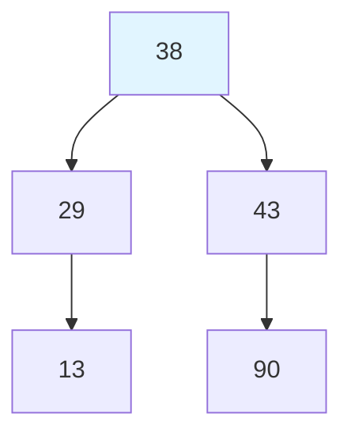
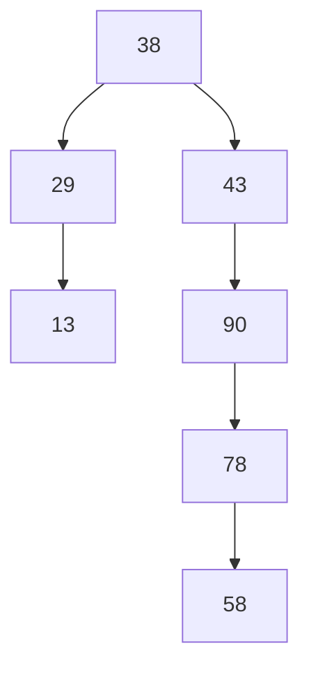

# 二叉搜索树（BST）的定义、查找、插入与删除算法

动态数据集需要频繁查找、插入、删除元素。数组查找慢，链表插入快但查找慢。有没有一种结构能兼顾？二叉搜索树（Binary Search Tree, BST）就是答案。它利用二叉树的“二分”特性，让动态集操作平均只需 $O(\log_2 n)$ 时间。

## 定义与核心性质

二叉搜索树又称二叉排序树。它要么是空树，要么满足：对于任意结点，其**左子树**所有关键字值**小于**该结点，**右子树**所有关键字值**大于**该结点，且左右子树也分别是二叉搜索树（假设关键字各不相同）。

> [!IMPORTANT]
> ==性质7.1：中序遍历二叉搜索树，必得递增有序序列==。这是BST最本质的特征，也是构造和删除操作的理论依据。

## 查找：与二分查找异曲同工

从根开始，若 $x$ 等于当前结点关键字则命中；若 $x$ 更小则入左子树，更大则入右子树。迭代版本用 `while` 循环即可，每次比较排除一半子树，直至找到或遇到空指针（失败）。

## 插入：总是成为叶子

插入前必须先查找确定位置。为什么新结点一定是叶子？因为查找失败时恰好停在空子树，此时只需将新结点 $p$ 挂到双亲 $q$ 下（左或右由 $x$ 与 $q$ 的关键字比较决定）。若原树为空，$p$ 直接成为根。

## 删除：三种情况，最难的是“双子”

删除需先定位被删结点 $p$ 及其双亲 $q$，然后分情况：

1. **$p$ 是叶子**：直接摘除，修改 $q$ 的指针为 `NULL`。
2. **$p$ 只有一棵子树**：用 $p$ 的子树根替换 $p$ 的位置。
3. **$p$ 有左右子树**：==不能直接删==。需找到 $p$ 的**中序后继**（右子树最小值，即右子树最左下结点）$s$，用 $s$ 的值替换 $p$，然后删除 $s$（$s$ 必为前两种情况之一）。

> [!WARNING]
> 删除有两棵子树的结点时，==必须用中序后继（或前驱）顶替==，否则中序遍历的有序性被破坏，树就不再是BST。

## 完整例子：构造与删除

以序列 $\{38, 43, 90, 29, 13, 78, 58\}$ 构造BST，然后删除 $78$。

**构造过程**：38为根；43入右；90入43右；29入38左；13入29左；78入90左；58入78左。

**删除 78**：78 只有左孩子 58（情况2），用 58 替换 78 的位置即可。此时根结点仍为 **38**。

> [!TIP]
> 平均情况下，BST 的查找、插入、删除复杂度均为 $O(\log_2 n)$；但若输入有序导致退化为单链，则最坏 $O(n)$。这正是后续引入二叉平衡树（AVL）的原因——通过旋转强制保持平衡。
