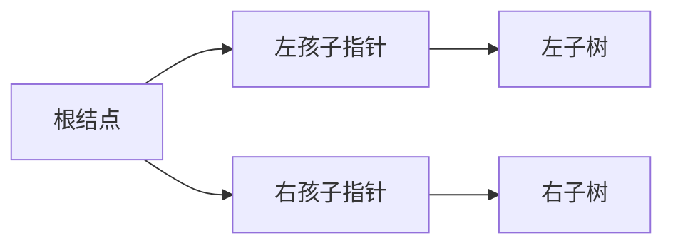

# 二叉树的顺序存储与链接存储（二叉链表）

## 顺序存储与链接存储的选择

二叉树在内存中该如何组织？按完全二叉树的下标规则用数组存放一般二叉树时，需要为缺失的结点保留空位，可能浪费大量空间。==顺序存储特别适合完全二叉树==；一般二叉树通常采用二叉链表，但并非不能使用数组表示。

> [!IMPORTANT]
> 二叉链表是南邮《数据结构》课程中二叉树的==默认存储结构==，由 `leftChild`、`data`、`rightChild` 三个域组成，天然支持从双亲到孩子的单向访问。



若应用频繁需要从孩子回溯双亲，可在结点中增设 `parent` 域，构成三叉链表。但需注意：这会增加存储开销，且插入删除时需额外维护该指针。

## 二叉链表的核心操作

如何判断一个结点是否为叶子？观察其左右指针是否同时为空。这正是历年填空题的高频考点：指针 `p` 所指结点为叶结点的条件是 `p->leftChild == NULL && p->rightChild == NULL`。

> [!TIP]
> 叶子判定条件务必写全“&&”关系，仅判断一侧为空可能误将度为1的结点当作叶子。

求叶子数目 `LeavesInTree()` 是典型的递归算法设计题。思考两个关键问题：递归出口是什么？子问题如何合并？当根为空返回0；当根为叶子返回1；否则返回左右子树叶子数之和。

```cpp
template<class T>
int BinaryTree<T>::LeavesInTree(TreeNode<T>* root) {
    if (root == NULL) return 0;
    if (root->leftChild == NULL && root->rightChild == NULL)
        return 1;
    return LeavesInTree(root->leftChild) 
         + LeavesInTree(root->rightChild);
}
```

> [!WARNING]
> `Clear()` 释放所有结点必须通过后序遍历实现，==不可先释放父结点再访问子结点==，否则指针悬空导致未定义行为。

## 顺序存储的遍历还原

完全二叉树用一维数组存储时，下标 $i$ 的左孩子为 $2i+1$，右孩子为 $2i+2$（0起始）。给定数组 `[A,B,C,D,E,F]`，如何快速写出遍历序列？

| 存储方式 | 优点 | 缺点 | 适用场景 |
| :--- | :--- | :--- | :--- |
| 顺序存储 | 随机访问、省指针 | 非完全树浪费空间 | 完全二叉树/堆 |
| 二叉链表 | 灵活、无空洞 | 无法直接找双亲 | 一般二叉树 |
| 三叉链表 | 双向访问 | 存储开销大 | 需频繁回溯 |

> [!NOTE]
> 孩子兄弟表示法（左子右兄弟）本质上就是树的二叉链表表示，每个结点的 `leftChild` 指向第一个孩子，`rightChild` 指向下一个兄弟，实现了树到二叉树的等价转换。

以数组 `[A,B,C,D,E,F]` 为例，还原出的二叉树结构为：A 的孩子是 B、C；B 的孩子是 D、E；C 的左孩子是 F。据此可得：前序 ABDECF，中序 DBEAFC，后序 DEBFCA。==掌握下标映射关系是顺序存储解题的关键==。
