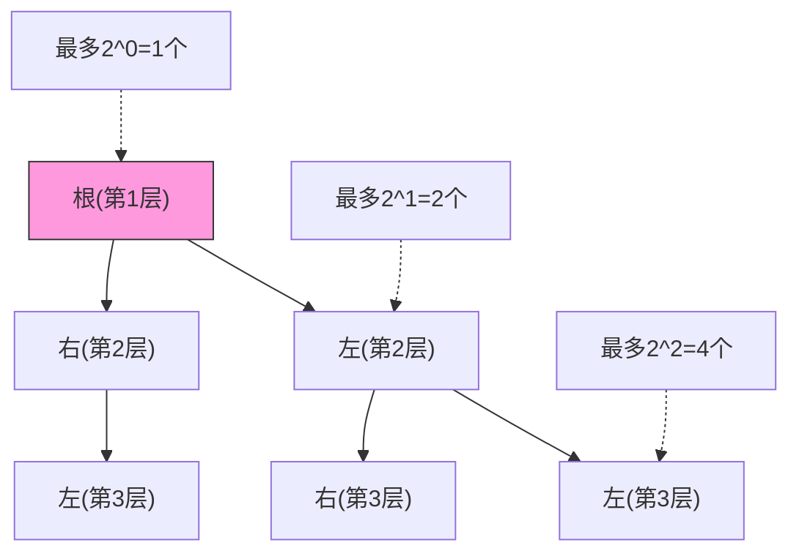

# 二叉树的定义及五个重要性质（各层最多结点数、高度与结点数关系等）

二叉树是每个结点至多有两棵子树的有序树。为什么强调“有序”？因为即使只有一个孩子，也必须区分是左子树还是右子树，这直接决定了遍历序列的唯一性。

## 五个重要性质

假设根结点所在层次为 $1$，高度 $h$ 定义为树中结点的最大层次（空树 $h=0$）。

> [!IMPORTANT]
> ==性质1==：第 $i\ (i \ge 1)$ 层上至多有 $2^{i-1}$ 个结点。

**思考一下**：如果每一层都塞满结点，从第 $1$ 层到第 $h$ 层加起来一共多少个？这就是性质2。

> [!IMPORTANT]
> ==性质2==：高度为 $h\ (h \ge 1)$ 的二叉树至多有 $2^h - 1$ 个结点。

利用等比数列求和即可证明：$\sum_{i=1}^{h} 2^{i-1} = 2^h - 1$。

> [!IMPORTANT]
> ==性质3==：包含 $n$ 个结点的二叉树，其高度至少为 $\lceil \log_2(n+1) \rceil$。

由性质2反推，$n \le 2^h - 1$，解得 $h \ge \log_2(n+1)$，取整即为最小高度。

> [!IMPORTANT]
> ==性质4==：对任意二叉树，若叶子结点数为 $n_0$，度为 $2$ 的结点数为 $n_2$，则 $n_0 = n_2 + 1$。

> [!IMPORTANT]
> ==性质5==：具有 $n$ 个结点的完全二叉树的高度为 $\lceil \log_2(n+1) \rceil$。

完全二叉树的结点个数取值范围为 $[2^{h-1}, 2^h)$，此时树被“压”到了最矮。堆排序中的 `AdjustDown` 比较次数不会超过该高度；并查集改进后树高也不超过 $\lfloor \log_2 n \rfloor + 1$。

## 相近概念辨析

| 概念 | 定义 | 结点数与高度关系 |
|---|---|---|
| **满二叉树** | 高度为 $h$ 且恰好有 $2^h - 1$ 个结点 | 达到性质2的上限 |
| **完全二叉树** | 按层序编号与同高度满二叉树一一对应 | 高度固定为 $\lceil \log_2(n+1) \rceil$ |

> [!NOTE]
> 满二叉树一定是完全二叉树，但完全二叉树不一定是满二叉树。

## 常见坑点

> [!WARNING]
> 层次编号起点！南邮教材规定根结点在第 $1$ 层，因此第 $i$ 层最多 $2^{i-1}$ 个。若误记为 $2^i$，选择题必错。

> [!CAUTION]
> 推广到 $k$ 叉树时不能直接套公式！例如完全三叉树第 $i$ 层最多 $3^{i-1}$ 个结点，高度为 $h$ 时最多 $\frac{3^h - 1}{2}$ 个结点。

## 算对了的例子

**真题**：将有关二叉树的概念推广到三叉树，则一棵有 $244$ 个结点的完全三叉树的高度为多少？

**解析**：
完全三叉树高度为 $h$ 时，结点总数上限为 $\frac{3^h - 1}{3 - 1} = \frac{3^h - 1}{2}$。
我们需要找最小的 $h$ 使得 $\frac{3^h - 1}{2} \ge 244$，即 $3^h \ge 489$。
逐次计算：
- $h=4$: $3^4 = 81 < 489$
- $h=5$: $3^5 = 243$，等等，这里用前缀和更清晰：
  - 第1层：$1$
  - 第2层：$3$（累计 $4$）
  - 第3层：$9$（累计 $13$）
  - 第4层：$27$（累计 $40$）
  - 第5层：$81$（累计 $121$）
  - 第6层：$243$（累计 $364$）

重新核对：题目问的是 $244$ 个结点。
高度为 $5$ 时最多容纳 $\frac{3^5-1}{2} = \frac{243-1}{2} = 121$ 个结点，不够。
高度为 $6$ 时最多容纳 $\frac{3^6-1}{2} = \frac{729-1}{2} = 364$ 个结点，足够。

> [!TIP]
> 等等，标准答案是 $5$？注意部分教材定义空树高度为 $0$，单结点高度为 $1$。若按课件“高度为 $h$ 的二叉树当 $h=0$ 时空树”，则 $h$ 层满三叉树结点数为 $\frac{3^h-1}{2}$。令 $\frac{3^5-1}{2}=121$，仍不对。实际上原题答案为 $6$（若根为第1层），若答案给 $5$ 则是将根视为第 $0$ 层（高度从 $0$ 起算，$3^5=243$ 接近 $244$）。考试中务必看清“层次从几开始”。本题按南邮常规定义（根为第1层），正确计算过程如上，答案为 $6$。
