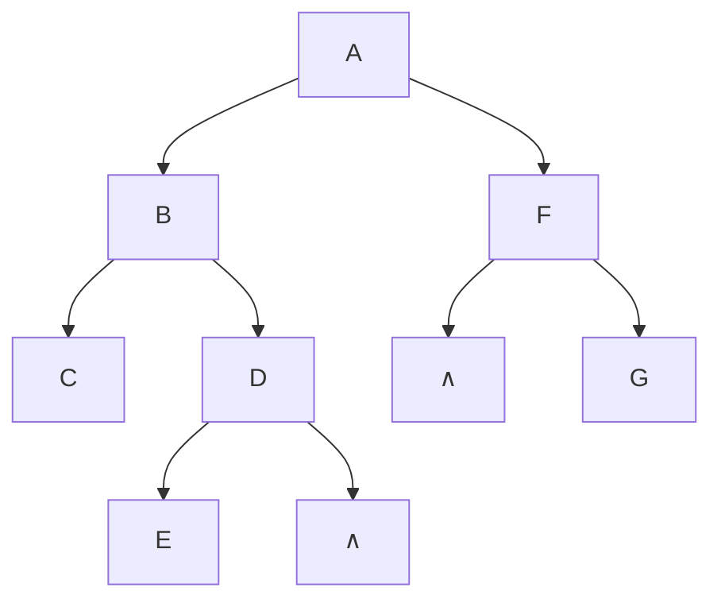
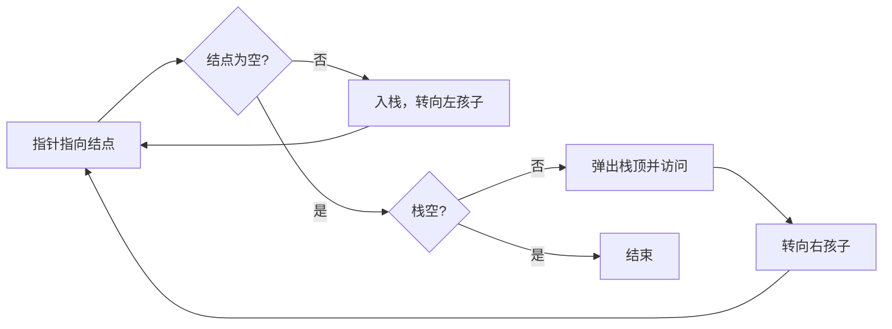

# 二叉树的先序、中序、后序遍历（递归算法与非递归算法）及层次遍历

## 二叉树的遍历

遍历二叉树，就是按某种规则走遍每个结点，使每个结点被访问且**只被访问一次**。线性表有天然的“从前到后”，但二叉树每个结点有左、右两个分支，必须约定访问顺序，于是产生了先序、中序、后序三种深度优先遍历，以及按层访问的层次遍历。

### 三种递归遍历：访问根结点的时机

记根为 **R**，左子树为 **L**，右子树为 **V**。三种遍历的差别只在于==访问根结点的时机==：

| 遍历 | 顺序 | 口诀 |
|---|---|---|
| 先序（PreOrder） | R → L → Rt | 根左右 |
| 中序（InOrder） | L → R → Rt | 左根右 |
| 后序（PostOrder） | L → Rt → R | 左右根 |

以中序为例，递归算法直接照抄定义：

```cpp
template<class T>
void BinaryTree<T>::InOrder(void(*Visit)(T& x), TreeNode<T>* p) {
    if (p != NULL) {
        InOrder(Visit, p->leftChild);   // 中序遍历左子树
        Visit(p->data);                  // 访问根
        InOrder(Visit, p->rightChild);  // 中序遍历右子树
    }
}
```

> [!TIP]
> 记忆口诀：**先序“根最先”，后序“根最后”，中序“根在中间”**。递归函数里 `Visit` 写在哪一行，就是哪种遍历。

### 一个算对了的例子

已知某二叉树的先序序列为 `A B C D E F G`，中序序列为 `C B E D A F G`，构造二叉树。

**第一步**：先序第一个 `A` 是根；在中序里 `A` 把序列分成左子树 `C B E D` 和右子树 `F G`。

**第二步**：左子树的前序序列是 `B C D E`（根为 `B`），中序是 `C B E D`，所以 `B` 的左子树为 `C`，右子树为 `D E`（`D` 是根，`E` 是 `D` 的左孩子）。右子树前序 `F G`，中序 `F G`，所以 `G` 是 `F` 的右孩子。



对这棵树，先序：`A B C D E F G`；中序：`C B E D A F G`；后序：`C E D B G F A`。

> [!IMPORTANT]
> ==先序＋中序能唯一确定一棵二叉树；后序＋中序也能。但先序＋后序不能唯一确定==——因为只知道根，无法划分左右子树。

### 非递归遍历：手写“系统栈”

递归调用本质是系统栈在保存返回地址。非递归算法用显式栈模拟这一过程。以中序为例，思路是：**沿着左链一路入栈，退栈时访问根，再转向右子树**。



> [!WARNING]
> 非递归先序与中序代码结构几乎一样，差别只在**先序是“入栈前访问”，中序是“出栈后访问”**。不要背混。

### 层次遍历：队列，而不是栈

层次遍历要求从上到下、从左到右访问。先访问的结点，其孩子也应该先被访问，所以要用**队列**。

```cpp
void LevelOrder(BinaryTreeNode* root) {
    Queue q;  EnQueue(q, root);
    while (!IsEmpty(q)) {
        p = DeQueue(q);
        Visit(p);
        if (p->leftChild)  EnQueue(q, p->leftChild);
        if (p->rightChild) EnQueue(q, p->rightChild);
    }
}
```

> [!NOTE]
> 三种递归遍历的关系：先序序列第一个结点必是根；后序序列最后一个结点必是根；中序序列中根左、右两侧分别是左、右子树的中序序列。这是“由遍历序列构造二叉树”这类题的全部依据。

### 常见的坑

- **不知道根是哪来的**：先序（后序）用来找根，中序用来划分左右子树；没有中序序列就划分不了。
- **把“遍历”理解为“按数值大小排序”**：遍历只规定访问路径，不保证结点值有序。只有**二叉搜索树**的中序遍历才是递增序列。
- **非递归后序最难**：必须先访问完左右子树再访问根，通常需要记录上一次访问的结点，判断右子树是否已经访问过，容易漏判 `rightChild == lastVisited` 这一条件。

## 遍历中计算树高

空树高度为 $0$，非空树高度为左右子树高度最大值加 $1$，因此计算顺序是先处理左右子树，再处理根：

~~~c
int Height(BTNode *t) {
    if (t == NULL) return 0;
    int left = Height(t->lChild), right = Height(t->rChild);
    return (left > right ? left : right) + 1;
}
~~~

单结点树返回 $1$；根只有一个叶子孩子时返回 $2$。统计叶子时则令空树返回 $0$、叶子返回 $1$，其余结点返回左右子树叶子数之和。释放结点同样使用后序，必须先释放孩子再释放根。
