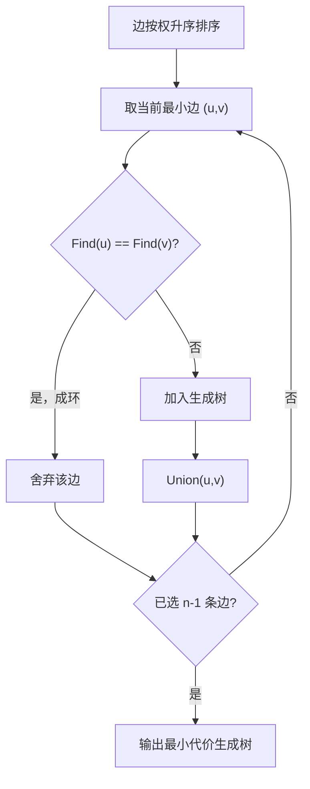
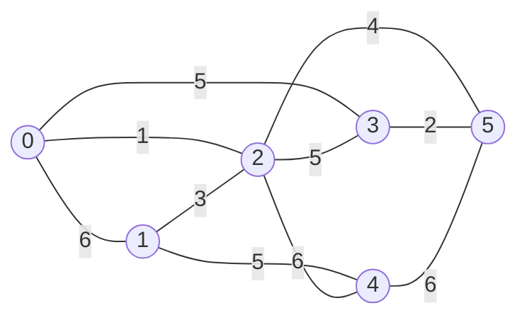

# 克鲁斯卡尔（Kruskal）算法及并查集的应用

## 它是什么

==克鲁斯卡尔算法==是构造**最小代价生成树**的贪心算法。给定一个无向连通网络，它从所有边中按权值从小到大依次挑选，每次加入一条**不会形成回路**的边，直到选出 $n-1$ 条边为止。

判断"是否形成回路"靠的是==并查集==：每个顶点初始自成一个集合，加入边 $(u,v)$ 时检查 $u$ 和 $v$ 是否已在同一集合——若在同一集合，加入必成环，舍弃；否则加入该边，并把两个集合**合并**。

## 为什么需要并查集

如果每次加边都用 DFS/BFS 判环，代价太高。并查集把"判环"转化为两个操作：

- **Find(x)**：找 $x$ 所在集合的代表元（根）；
- **Union(x, y)**：把两个集合合并。

配合**路径压缩**与**按秩合并**，单次操作近似 $O(1)$，整个算法复杂度主要取决于排序：$O(e \log e)$。

## 怎么做：一个算对的例子

对下图（顶点 0~5）执行 Kruskal：

边按权升序：$(0,2,1)$、$(3,5,2)$、$(1,2,3)$、$(2,5,4)$、$(0,3,5)$、$(1,4,5)$、$(2,3,5)$、$(0,1,6)$、$(2,4,6)$、$(4,5,6)$。

| 步骤 | 边（权） | 是否同集合 | 操作 |
|---|---|---|---|
| 1 | (0,2) 权1 | 否 | 加入，合并{0,2} |
| 2 | (3,5) 权2 | 否 | 加入，合并{3,5} |
| 3 | (1,2) 权3 | 否 | 加入，合并{0,1,2} |
| 4 | (2,5) 权4 | 否 | 加入，合并{0,1,2,3,5} |
| 5 | (0,3) 权5 | **是** | 成环，舍弃 |
| 6 | (1,4) 权5 | 否 | 加入，合并{0,1,2,3,4,5} |

已选 $6-1=5$ 条边，结束。最小代价 $= 1+2+3+4+5 = \mathbf{15}$。

> [!TIP]
> 考试手算口诀：**排序 → 从小到大试 → 成环就扔 → 凑够 n−1 条停**。判断是否成环只需看两端点是否已被已选边连通。

## 与 Prim 的区别

| 对比项 | Prim | Kruskal |
|---|---|---|
| 贪心对象 | 顶点（从一棵树向外长） | 边（全局选最小边） |
| 过程形态 | 始终是一棵连通树 | 先森林后合并成树 |
| 判环结构 | 不需要 | ==必须用并查集== |
| 适用图 | 稠密图更优 | 稀疏图更优 |
| 复杂度 | $O(n^2)$（邻接矩阵） | $O(e\log e)$ |

> [!WARNING]
> **常见坑一**：边数凑够 $n-1$ 就停，不要把剩下的小权边继续加。
> **常见坑二**：同权边可任取，最小生成树可能不唯一，但==最小代价唯一==。
> **常见坑三**：Kruskal 不要求中间过程连通，看到"森林"别慌，最后一定连成一棵树（前提是原图连通）。

> [!NOTE]
> 课件中 `template <class T> void ExtLGraph<T>::Kruskal()` 的实现要点：边集数组排序后顺序扫描，用 parent 数组实现并查集，Find 时做路径压缩。若原图不连通，算法得到的是**最小生成森林**，可作为连通性判定的副产品。
