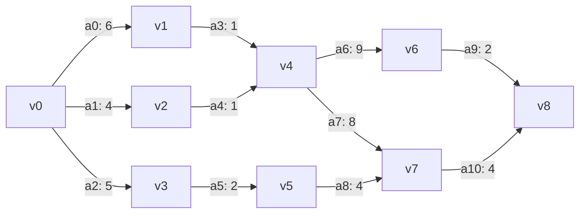

# AOE网、关键活动与关键路径算法（earliest与latest的计算）

## AOE 网是什么

AOE（Activity On Edge，边活动网络）是一种**带权有向无环图**：顶点表示**事件**（某时刻的状态，表示它的入边活动均已完成、出边活动可以开始），有向边表示**活动**，边上的权值是该活动持续的时间。它主要用于估算一项工程的完成时间。

> [!IMPORTANT]
> **关键路径**是从源点到汇点的**最长路径**，其长度就是整个工程的**最短完成时间**。关键路径上的活动称为**关键活动**——若它不能按期完成，整个工程就会延期。

## 为什么需要找关键活动

一个工程里活动有先有后、有长有短。假设某条支路要 19 天，另一条只要 11 天，那么 11 天那条即使拖一两天也无妨，19 天那条却一天都拖不得。

> [!TIP]
> 想缩短工期，把资源投在**非关键活动**上是白费的；只有压缩**关键活动**才可能缩短整个工期。但注意：压缩到一定程度后，原来的非关键路径可能变成新的关键路径。

## 四个量的计算

要定量找出关键活动，先算事件的最早/最晚发生时间，再算活动的最早/最晚开始时间。

**① 事件最早发生时间 earliest(i)**：从源点 $v_0$ 到 $v_i$ 的最长路径长度。

$$\text{earliest}(j)=\max_{i\in P(j)}\{\text{earliest}(i)+w(i,j)\},\quad \text{earliest}(0)=0$$

其中 $P(j)$ 是 $v_j$ 的前驱集合。为保证递推时前驱都已算好，**按拓扑排序的次序**计算。

**② 事件最晚发生时间 latest(i)**：在不影响工期的前提下，事件 $v_i$ 允许的最晚发生时间。

$$\text{latest}(i)=\min_{j\in S(i)}\{\text{latest}(j)-w(i,j)\},\quad \text{latest}(n)=\text{earliest}(n)$$

自后向前递推，$S(i)$ 是 $v_i$ 的后继集合。

**③④ 活动 $a_k$（对应边 $\langle v_i,v_j\rangle$，权 $w$）的最早/最晚开始时间**：

$$\text{early}(k)=\text{earliest}(i),\qquad \text{late}(k)=\text{latest}(j)-w(i,j)$$

> [!IMPORTANT]
> 若 $\text{early}(k)=\text{late}(k)$，则 $a_k$ 是**关键活动**；把所有关键活动连起来即得关键路径。

## 算例（对应上图）

按拓扑序 $v_0,v_1,v_2,v_3,v_4,v_5,v_6,v_7,v_8$ 计算：

| 项目 | $v_0$ | $v_1$ | $v_2$ | $v_3$ | $v_4$ | $v_5$ | $v_6$ | $v_7$ | $v_8$ |
|---|---|---|---|---|---|---|---|---|---|
| earliest | 0 | 6 | 4 | 5 | 7 | 7 | 16 | 15 | 19 |
| latest   | 0 | 6 | 6 | 9 | 7 | 11 | 17 | 15 | 19 |

例如 $\text{earliest}(4)=\max\{6+1,\,4+1\}=7$，$\text{latest}(5)=19-(4+4)=11$。

再算每个活动的 early 与 late：

| 项目 | $a_0$ | $a_1$ | $a_2$ | $a_3$ | $a_4$ | $a_5$ | $a_6$ | $a_7$ | $a_8$ | $a_9$ | $a_{10}$ |
|---|---|---|---|---|---|---|---|---|---|---|---|
| early | 0 | 0 | 0 | 6 | 4 | 5 | 7 | 7 | 7 | 16 | 15 |
| late  | 0 | 2 | 4 | 6 | 6 | 9 | 8 | 7 | 11 | 17 | 15 |
| 关键活动 | * | | | * | | | | * | | | * |

于是关键路径为 $v_0\to v_1\to v_4\to v_7\to v_8$，长度 $6+1+8+4=19$。

## 与 AOV 网的区别

| | AOV 网 | AOE 网 |
|---|---|---|
| 边表示 | 活动（无权） | 活动（带持续时间） |
| 顶点表示 | 事件 | 事件 |
| 研究目的 | 拓扑排序、判断先后约束 | 估算工期、找关键活动 |
| 核心算法 | 拓扑排序 | 拓扑排序 + 双向递推 |

## 常见坑

> [!WARNING]
> - earliest 是**取最大**（要等所有前驱都完成），latest 是**取最小**（不能拖累任何后继），方向不要搞反。
> - 关键路径**可能不止一条**，所有满足 $\text{early}=\text{late}$ 的活动都要标出。
> - 计算 earliest 前必须先做**拓扑排序**，否则前驱的值还没算出来。

> [!CAUTION]
> 关键活动的时间余量为 $\text{late}(k)-\text{early}(k)=0$。若某活动余量为 0 但不在你画的那条"最长路"上，别急着删——它仍属于某条关键路径，同样是关键活动。
