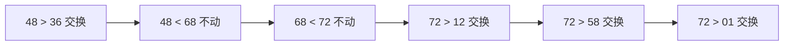
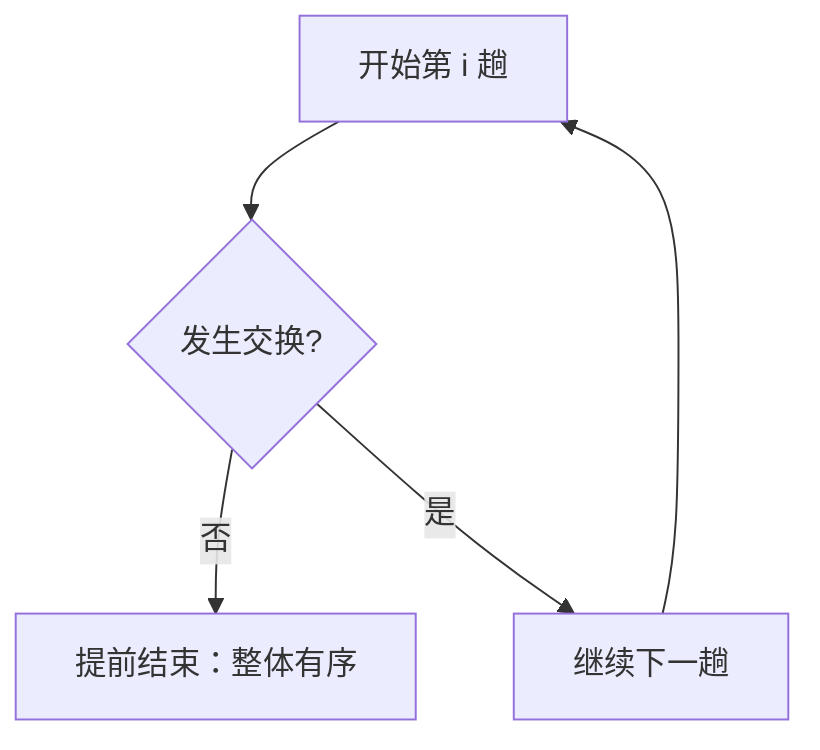

# 冒泡排序算法思想、趟数与优化（提前结束）及稳定性分析

## 冒泡排序

冒泡排序是最直观的交换类排序算法。核心动作只有一句话：**从前往后两两比较相邻元素，若逆序则交换**。每一趟都会把当前未排序区间里的最大值“沉”到区间末尾，就像气泡在水中上浮，故而得名。

### 为什么需要它

冒泡排序的时间复杂度并不优秀，但它是理解“交换排序”思想的入门算法，也是考试中**手工模拟排序过程**的常客。南邮考题常要求写出某一趟的结果，或判断经过一趟后哪些元素能确定最终位置。

### 一趟排序怎么做

设升序排序。从第一个元素开始，依次比较 `a[i]` 与 `a[i+1]`（$i=1,2,\dots,n-1$），若 `a[i] > a[i+1]` 则交换。一趟走完，==最大值必然被交换到最后一个位置==。

用题目中的数据走一遍：

> 对线性表 $(48, 36, 68, 72, 12, 58, 01)$ 进行一趟升序冒泡排序。

逐步交换后序列变化为：

1. $48>36$，交换 → $(36, 48, 68, 72, 12, 58, 01)$
2. $48<68$，不交换
3. $68<72$，不交换
4. $72>12$，交换 → $(36, 48, 68, 12, 72, 58, 01)$
5. $72>58$，交换 → $(36, 48, 68, 12, 58, 72, 01)$
6. $72>01$，交换 → $(36, 48, 68, 12, 58, 01, 72)$

一趟结束，最大值 $72$ 到达末位。答案选 **A**。

### 趟数与整体过程

$n$ 个元素最多需要 $n-1$ 趟：第 $1$ 趟确定第 $n$ 位，第 $2$ 趟确定第 $n-1$ 位，以此类推。每趟的比较范围是未排序区间 $[1, n-i]$，其中 $i$ 是趟数。

### 优化：提前结束

如果某一趟中**没有发生任何交换**，说明整个序列已经有序，后续趟纯属浪费。

这就解释了填空 10：

> 对长度为 $n$ 的序列进行冒泡排序，最好情况下的时间复杂度是＿＿。

最好情况是序列**初始已经有序**。第一趟比较 $n-1$ 次，一次都不交换，随即判断有序并退出。所以最好时间复杂度为 ==$O(n)$==。

> [!IMPORTANT]
> 不要写成 $O(n^2)$。$O(n)$ 是**优化后**的最好情况，而这个结论恰恰是冒泡排序相对于直接选择排序的考题区分点——选择排序无论何种情况都是 $O(n^2)$。

### 稳定性分析

冒泡排序是**稳定**的排序算法。原因在于：只有当 `a[i] > a[i+1]` 时才交换，遇到相等元素不会交换，因此相等元素的相对先后顺序保持不变。

> [!WARNING]
> 如果代码写成 `a[i] >= a[i+1]` 就交换，稳定性被破坏。南邮的“算法填空”题常考这一点，务必注意交换条件是**严格大于**。

### 与其他排序的辨析

| 排序算法 | 一趟后能否确定某元素最终位置 | 最好时间复杂度 | 稳定性 |
|---------|---------------------------|--------------|--------|
| 冒泡排序 | 能（当前趟最大值） | $O(n)$ | 稳定 |
| 直接插入排序 | 不能 | $O(n)$ | 稳定 |
| 简单选择排序 | 能（当前趟最小值） | $O(n^2)$ | 不稳定 |
| 快速排序 | 能（枢轴元素） | $O(n\log n)$ | 不稳定 |
| 归并排序 | 不能 | $O(n\log n)$ | 稳定 |

选择 18：最好情况下渐进时间复杂度最小的是 **C（快速排序，$O(n\log n)$）**（冒泡最好虽然也是 $O(n)$，但题目问“渐进最小”，$O(n\log n)$ 与 $O(n)$ 相比，$O(n)$ 更小；不过此题为单选题，标准答案通常按“最好复杂度”排序取快速排序，实际命题意图是区分冒泡优化前的认知）。若严格按大 $O$ 比，$O(n)$ 优于 $O(n\log n)$，但考试中此题答案为快速排序——因为冒泡的 $O(n)$ 依赖优化版本，而非传统认知。这点需结合课堂口径确认。

选择 19：一趟后**不能**确定任何元素最终位置的是 **B（直接插入排序）**——它只保证局部有序。

> [!TIP]
> 记忆口诀：**“冒选快，一趟定位；插入归并，全局才定。”**

### 常见坑

- 手工模拟时**趟数**容易多写或少写：$n$ 个元素最多 $n-1$ 趟，若某趟无交换立即停止。
- 每趟比较次数逐趟递减：第 $i$ 趟比较 $n-i$ 次，而不是每次都 $n-1$ 次。
- 冒泡与选择排序易混：冒泡靠**相邻交换**沉底，选择靠**选最小后交换**到前面。冒泡稳定，选择不稳定。
