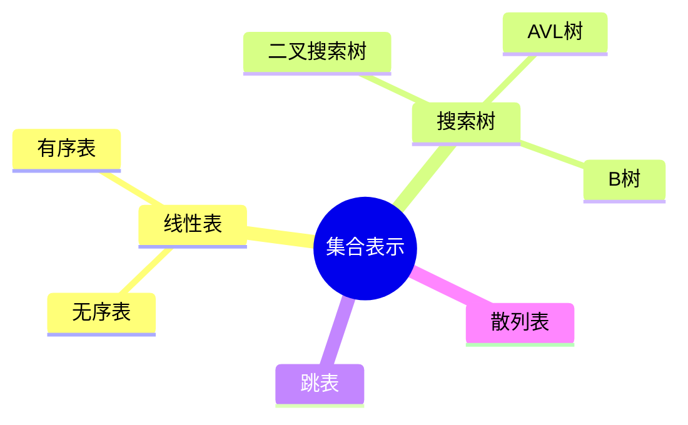

# 集合与搜索的基本概念、动态集ADT及集合的表示

## 集合的基本概念

集合是数学中最基础的概念之一。在数据结构课程中，我们关注的是计算机如何表示和操作集合。

从逻辑上看，==集合中元素之间不存在任何固有关系==，元素仅仅是“属于”或“不属于”这个集合。这意味着 $\{1, 2, 3\}$ 和 $\{3, 2, 1\}$ 是同一个集合——顺序无关紧要。

>[!IMPORTANT]
> 普通集合中每个元素只能出现一次。如果元素可以重复出现，称为**多重集**。$\{1,1,2,3\}$ 是多重集，与 $\{1,2,3\}$ 是不同的。

在实际应用中，集合往往需要动态变化——插入新元素、删除已有元素。这种支持插入和删除操作的集合称为**动态集**。比如一个学生选课系统，学生名单就是一个不断变化的动态集。

数学意义上的集合运算（并、交、差、判等）是理论基础，但在数据结构层面，我们更关心的是以下基本操作：创建空集合、判断是否为空/满、搜索某元素、插入元素、删除元素。

## 为什么需要不同的集合表示

我们先思考一个具体问题：有数据集合 $d = \{1, 12, 5, 8, 3, 10, 7, 13, 9\}$，如何组织这些数据才能高效搜索？

如果只是随机存放，要找某个数就必须逐个检查，最坏情况下要检查全部元素。但如果先把数据排好序 $\{1, 3, 5, 7, 8, 9, 10, 12, 13\}$，就可以利用有序特性大幅加速搜索——比如查 10 时，看到 12 已经超过 10 就能提前停止。

这引出了一个核心认知：==同一个集合，组织方式不同，运算效率天差地别==。

## 集合的几种表示方式

集合在计算机中有四种主流表示方法，本课程分多章逐一展开：

本章聚焦于**线性表表示**。用线性表存储集合时，元素按某种线性顺序存放。根据元素排列是否有规律，分为：

- **无序表**：元素随意存放，不按关键字排序
- **有序表**：元素按关键字值大小次序排列

>[!TIP]
> 记忆口诀：**“无序随便放，有序排好队”**——有无排序决定了搜索算法的选择。

## 动态集 ADT 的结构定义

课件中定义了集合的抽象数据类型，其核心结构如下：

集合由同类元素的有限汇集构成，最大允许长度为 `MaxSetSize`。每个元素通过关键字唯一标识，集合中元素各不相同。

基本操作包括：

| 操作 | 功能说明 | 返回值 |
|------|---------|--------|
| `Create()` | 创建一个空集合 | — |
| `Destroy()` | 撤销集合，释放资源 | — |
| `IsEmpty()` | 判断集合是否为空 | `true` / `false` |
| `IsFull()` | 判断集合是否已满 | `true` / `false` |
| `Search(x)` | 搜索关键字与 x 相同的元素 | `Success` / `NotPresent` |
| `Insert(x)` | 插入元素 x（要求不存在同关键字元素） | `Success` / `Overflow` |
| `Remove(x)` | 删除关键字与 x 相同的元素 | `Success` / `NotPresent` |

>[!WARNING]
> 常见的坑：`Insert` 和 `Remove` 操作前通常需要先执行 `Search`，确认元素是否已存在。插入重复元素应该失败，删除不存在的元素也应该失败。不要假设调用者会先检查。

## 表与文件的边界

当信息量较少，整个集合元素都存放在内存中时，我们称之为**表**。当数据量大到无法全部装入内存、需要借助外存时，就称为**文件**。

>[!NOTE]
> 搜索运算是表和文件上最典型的运算。本章讨论的内存中的表，第 7 章的搜索树、第 8 章的跳表和散列表，都属于“表”的范畴。文件的搜索会在后续课程中单独讨论。

## 一个算对了的例子

以课件中给出的 $d = \{1, 12, 5, 8, 3, 10, 7, 13, 9\}$ 为例，若采用有序表表示并顺序存储，按升序排列后的结果如下：

**有序表**：`1, 3, 5, 7, 8, 9, 10, 12, 13`

此时在有序表中搜索元素 `7`：
1. 从第 1 个元素开始，依次比较
2. 比较 `1` → 小于 `7`，继续
3. 比较 `3` → 小于 `7`，继续
4. 比较 `5` → 小于 `7`，继续
5. 比较 `7` → 等于 `7`，搜索成功，返回 `Success` 及元素位置

如果是无序表 `1, 12, 5, 8, 3, 10, 7, 13, 9`，搜索 `7` 需要遍历到第 7 个位置才能找到。而如果搜索 `15`（不存在的元素），无序表必须检查完所有 9 个元素才能确认“不存在”；有序表在比较到 `13` 之后即可终止——因为 15 大于最大元素，不可能出现在表中。这正是有序表带来的效率优势。
