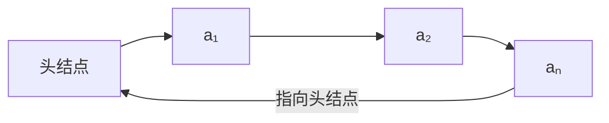

# 单循环链表的结构特点
单循环链表是单链表的一种变形：把单链表中最后一个结点的空指针 `NULL` 改为指向头结点，使整个链表首尾相接，形成一个环。空表时，头结点的指针域指向自身。

> [!IMPORTANT]
> 单循环链表与单链表的唯一区别是：==尾结点的指针域不再为 `NULL`，而是指向头结点==，因此从任一结点出发都能访问到表中所有结点。



## 为什么需要循环链表

单链表找后继方便，但找前驱必须从表头重新遍历，时间复杂度为 $O(n)$。循环链表把尾部"接回"头部，使得：

- 从任一结点出发，沿 `next` 指针都能回到出发点，遍历整个表只需 $O(n)$；
- 对==频繁在表头、表尾两端操作==的场合（如队列的入队、出队），配合尾指针 `rear` 可以高效定位两端，不必从头扫描。

## 判空与判尾

这是考试最爱设坑的地方。设 `L` 为带头结点的单循环链表：

| 操作 | 单链表 | 单循环链表 |
|------|--------|------------|
| 判空 | `L->next == NULL` | `L->next == L` |
| 判尾（p 是否为尾结点） | `p->next == NULL` | `p->next == L` |

> [!WARNING]
> 单循环链表中**没有 `NULL` 指针**。若沿用单链表的思路写 `while (p->next != NULL)` 或 `p->next == NULL`，会陷入死循环或判断失效。判空、判尾、遍历终止都必须以"是否回到头结点 `L`"为依据。

## 与相近结构的对比

| 结构 | 尾结点指针域 | 找后继 | 找前驱 | 典型应用 |
|------|--------------|--------|--------|----------|
| 单链表 | `NULL` | $O(1)$ | $O(n)$ | 顺序访问 |
| 单循环链表 | 指向头结点 | $O(1)$ | $O(n)$ | 约瑟夫问题、循环队列 |
| 双向循环链表 | 前驱指向尾、后继指向头 | $O(1)$ | $O(1)$ | 频繁双向查找 |

> [!NOTE]
> 单循环链表只解决了"从尾部回到头部"的问题，找前驱仍需绕一圈，平均 $O(n)$。若题目要求两端高效访问前驱，应考虑双向循环链表。

## 一个算对的例子

> 带头结点的单循环链表 `L`，数据域依次为 `a₁, a₂, …, aₙ`。写算法删除首元结点（即 `a₁`）。

思路：单循环链表无 `NULL`，必须先找到尾结点 `p`（满足 `p->next == L`），让尾结点直接指向 `a₂`，再释放 `a₁`。

```c
void DeleteFirst(LinkList L) {
    LinkList p = L, q;
    if (L->next == L) return;      // 空表，直接返回
    while (p->next != L)           // 找尾结点
        p = p->next;
    q = L->next;                   // q 指向 a₁
    L->next = q->next;             // 头结点指向 a₂
    p->next = L;                   // 尾结点仍指向头结点
    free(q);
}
```

> [!TIP]
> 记忆口诀：==判空看自身，判尾看回头==。写循环链表算法时，先问自己"终止条件写对了吗——是不是把头结点 `L` 当终点？"

> [!CAUTION]
> 若先释放 `a₁` 再修改尾结点指针，会丢失 `a₂` 的地址；务必先完成所有链接修改，最后 `free`。
