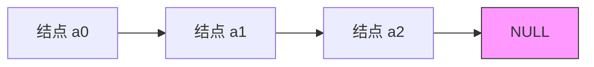
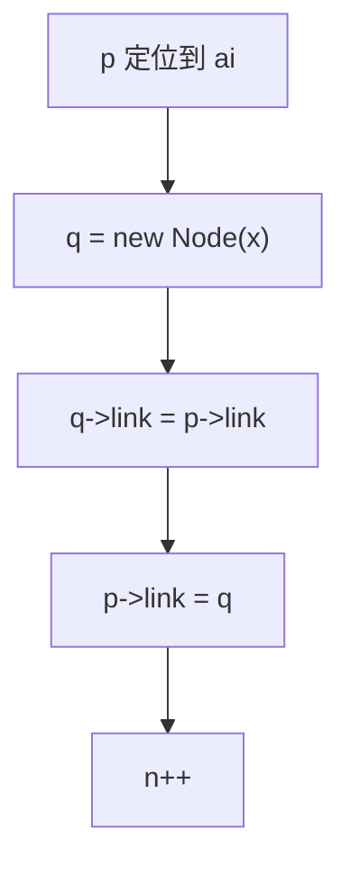

# 单链表的结点结构及初始化、查找、插入、删除、撤销运算

单链表用一组任意的存储单元存放线性表的元素，结点之间靠指针依次串联。每个结点包含两个域：`element` 存放数据，`link` 存放后继结点的地址。设当前结点为 `p`，则 `p->link` 指向它的直接后继。



> [!IMPORTANT]
> 单链表与顺序表的本质区别在于：==链表失去随机存取特性==，必须从头指针 `first` 出发沿链逐个计数查找；但插入、删除只需修改指针，无需移动大量元素。

## 初始化

初始化运算构造一个空表，只需将头指针置空，并令长度 `n = 0`。

```cpp
template <class T>
SingleList<T>::SingleList() {
    first = NULL;
    n = 0;
}
```

> [!TIP]
> 若采用带表头结点的单链表，初始化时需创建一个头结点，令 `first->link = NULL`。判断空表的条件变为 `first->link == NULL`，可省去对第一个结点插入、删除的特殊处理。

## 查找

查找下标为 $i$ 的元素（即表中第 $i+1$ 个元素），必须从头指针开始逐个结点计数，找到第 $i$ 个结点后取出其 `element` 值。

```cpp
template <class T>
bool SingleList<T>::Find(int i, T& x) const {
    if (i < 0 || i > n - 1) {
        cout << "Out Of Bounds";
        return false;
    }
    Node<T>* p = first;
    for (int j = 0; j < i; j++)  // 逐个计数
        p = p->link;
    x = p->element;
    return true;
}
```

查找操作的时间复杂度为 $O(n)$，因为平均需要扫描半个表长。

## 插入

在元素 $a_i$ 之后插入新元素 $x$。若 $i = -1$，表示将 $x$ 插在最前面。核心步骤分为三步：



```cpp
template <class T>
bool SingleList<T>::Insert(int i, T x) {
    if (i < -1 || i > n - 1) {
        cout << "Out Of Bounds";
        return false;
    }
    Node<T>* q = new Node<T>(x);
    if (i == -1) {              // 插在表头
        q->link = first;
        first = q;
    } else {                    // 一般情况
        Node<T>* p = first;
        for (int j = 0; j < i; j++)
            p = p->link;        // p 指向 ai
        q->link = p->link;
        p->link = q;
    }
    n++;
    return true;
}
```

> [!WARNING]
> 指针修改顺序不可颠倒：必须先执行 `q->link = p->link`，再执行 `p->link = q`。若先改 `p->link`，则原链表后继结点的地址将丢失，导致链表“断链”。

## 删除

删除下标为 $i$ 的元素 $a_i$，需先找到其前驱结点 $q$，然后令 `q->link` 指向 $a_i$ 的后继，最后释放 $a_i$ 的存储空间。

```cpp
template <class T>
bool SingleList<T>::Delete(int i) {
    if (!n) {
        cout << "UnderFlow";
        return false;
    }
    if (i < 0 || i > n - 1) {
        cout << "Out Of Bounds";
        return false;
    }
    Node<T>* p = first;
    if (i == 0) {               // 删除头结点
        first = first->link;
        delete p;
    } else {                    // 一般情况
        Node<T>* q = first;
        for (int j = 0; j < i - 1; j++)
            q = q->link;        // q 指向 ai-1
        p = q->link;            // p 指向待删结点
        q->link = p->link;
        delete p;
    }
    n--;
    return true;
}
```

> [!CAUTION]
> 删除操作必须释放被删结点的内存（`delete p`），否则会造成内存泄漏。同时，==删除前必须先定位前驱==，单链表无法直接获取前驱结点。

## 撤销

撤销运算释放链表中所有结点占用的动态存储空间，防止内存泄漏。

```cpp
template <class T>
SingleList<T>::~SingleList() {
    Node<T>* p;
    while (first) {
        p = first;
        first = first->link;
        delete p;
    }
}
```

## 与顺序表的对比

| 运算 | 顺序表 | 单链表 |
|------|--------|--------|
| 查找 | $O(1)$ 随机存取 | $O(n)$ 顺序查找 |
| 插入 | $O(n)$ 移动元素 | $O(n)$ 查找定位，修改指针 $O(1)$ |
| 删除 | $O(n)$ 移动元素 | $O(n)$ 查找定位，修改指针 $O(1)$ |
| 空间 | 静态分配，可能浪费 | 动态分配，需额外指针域 |

> [!NOTE]
> 若问题中频繁在 $q(x)$ 上做插入和删除运算（如多项式相加），顺序表需大量移动元素，效率低下，==不宜采用顺序存储==，应选用链表结构。
