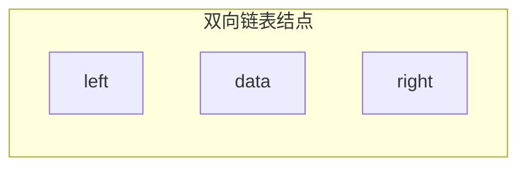

# 双向链表的结点结构、插入与删除操作

在单链表中，如果想找某个结点的前驱，只能从头遍历。有没有办法让链表“双向通行”？这就是双向链表要解决的问题。

## 结点结构

与单链表只有一个 `link`（或 `next`）指针不同，双向链表的每个结点包含==三个域==：数据域 `data`、左指针域 `left`（指向前驱）、右指针域 `right`（指向后继）。



> [!IMPORTANT]
> 核心定义：双向链表的结点通过 `left` 和 `right` 两个指针，将前驱和后继连接起来，支持双向遍历。

## 插入操作

**问题引导**：若要在指针 `p` 所指示的结点**之前**插入一个值为 `x` 的新结点 `q`，需要修改几个指针？

单链表插入一般只需修改 2 个指针，而双向链表因为要维护前后关系，==插入操作的核心步骤是修改 4 个指针==：

1. `q->right = p;` （新结点的右指针指向 p）
2. `q->left = p->left;` （新结点的左指针指向 p 的前驱）
3. `p->left->right = q;` （p 的前驱的右指针改为指向 q）
4. `p->left = q;` （p 的左指针改为指向 q）

> [!WARNING]
> 指针修改顺序极其关键！必须先处理 `q` 的两个指针以及 `p->left->right`，最后再修改 `p->left`。如果提前执行了 `p->left = q`，就再也找不到 `p` 原来的前驱了。

## 删除操作

若要删除双链表中非头尾的结点 `p`，同样需要跨过 `p`，将它的前驱和后继直接相连。

> [!TIP]
> 记忆口诀：“前驱的后继变后继，后继的前驱变前驱”。

```mermaid
flowchart LR
    A["p->left"] -->|"right 跨过 p"| C["p->right"]
    C -->|"left 跨过 p"| A
    style A fill:#d4edda
    style C fill:#d4edda
    style P["p (待删)"] fill:#f8d7da
    A --- P
    P --- C
```

删除操作的核心步骤只需两行代码：
$$p\text{->left->right} = p\text{->right;}$$
$$p\text{->right->left} = p\text{->left;}$$

## 与单链表及顺序表的区别

| 比较维度 | 顺序表 | 单链表 | 双向链表 |
| :--- | :--- | :--- | :--- |
| **插入/删除效率** | 低（平均移动 $\frac{n-1}{2}$ 个元素） | 高（改 2 个指针） | 高（改 4 或 2 个指针） |
| **查找前驱** | $O(1)$（通过下标） | $O(n)$（必须遍历） | $O(1)$（直接读 `left`） |
| **空间开销** | 无额外指针 | 1 个指针域 | 2 个指针域 |

> [!NOTE]
> 课件中提到带表头结点的单链表可以简化插入和删除（避免区分一般情况和特殊情况），这一思想同样适用于双向循环链表，加上表头后能进一步消除边界判断。

## 真题实战

**题目**：设双向链表中结点包括 `data`、`left`、`right`，若要删除一个双链表中结点 `p`（非头结点和尾结点）的操作是（ ）。

A. `p->left->right = p->right; p->right->left = p->left;`
B. `p->left = NULL; p->right = NULL;`
C. `p->right->left = p; p->left->right = p;`
D. `p->left->right = p; p->right->left = p;`

**解析**：
删除 `p` 的本质是让 `p` 脱离链表。
- B 选项只是把 `p` 自己的指针清空，并没有把链表重新连起来，错误。
- C、D 选项反而把前驱和后继又指回了 `p`，逻辑完全相反。
- A 选项完美对应了上面推导的核心步骤：前驱的 `right` 指向 `p` 的后继，后继的 `left` 指向 `p` 的前驱。

> [!CAUTION]
> 考试中极易混淆 `p->left->right` 和 `p->right->left` 的含义。记住：`p->left` 是一个结点，`p->left->right` 就是“左边那个结点的右指针”，这样拆解就不会选错。

**答案**：A
