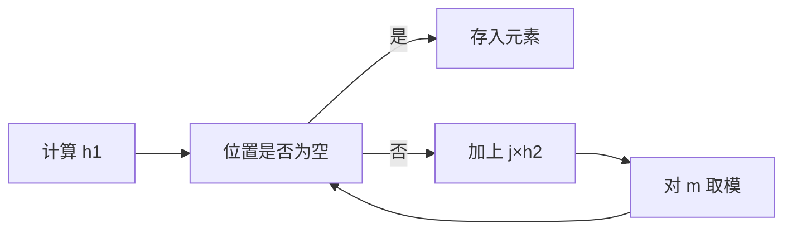

# 其他开地址法：双散列法的探查序列生成

## 什么是双散列法

双散列法是==开地址法==的一种。发生冲突时，不固定向后移动一个位置，也不依次尝试平方位置，而是使用两个散列函数：

- $h_1(key)$：确定初始位置；
- $h_2(key)$：确定探查步长。

一般令

$$
Loc_j=\bigl(h_1(key)+j\cdot h_2(key)\bigr)\bmod m,\qquad 0\le j<m
$$

其中 $d_0=0$，$d_1=1\cdot h_2(key)$，$d_2=2\cdot h_2(key)$，依此类推。

> [!IMPORTANT]
> 双散列法的核心是“初始位置由 $h_1$ 决定，冲突后的移动距离由 $h_2$ 决定”。

## 为什么要使用两个散列函数

如果线性探查法与二次探查法产生大量聚集，查找效率会明显下降。双散列法尽量让冲突后的探查序列分散在表中，因此通常能获得更均匀的分布。

双散列法与线性探查法的区别如下：

| 方法 | 冲突后的探查位置 |
|---|---|
| 线性探查法 | $h_1+1,h_1+2,\ldots$ |
| 二次探查法 | $h_1+1^2,h_1+2^2,\ldots$ 或乘常数形式 |
| 双散列法 | $h_1+j\cdot h_2$ |

## 怎样生成探查序列

以题中条件为例：

$$
m=13,\qquad h_1(key)=key\bmod13
$$

$$
h_2(key)=key\bmod11+1
$$

由于 $h_2(key)\in[1,11]$，因此步长一定非零；而且步长与 13 互质，探查序列能够遍历全部 13 个位置。

例如关键字 52：

$$
h_1(52)=52\bmod13=0
$$

$$
h_2(52)=52\bmod11+1=8
$$

其探查序列为：

| 探查次数 $j$ | 地址 $(0+8j)\bmod13$ |
|---:|---:|
| 0 | 0 |
| 1 | 8 |
| 2 | 3 |
| 3 | 11 |
| 4 | 6 |
| 5 | 1 |
| 6 | 9 |
| 7 | 4 |
| 8 | 12 |
| 9 | 7 |
| 10 | 2 |
| 11 | 10 |
| 12 | 5 |

若表下标为 $0\sim12$，52 应检查位置 $0,8,3,11,\ldots$，遇到第一个空位置就存入。

## 完整建表示例

仍按上述散列函数，将 52、37、24、27、83、13、62、48 依次插入。下标为 $0\sim12$：

| 下标 | 0 | 1 | 2 | 3 | 4 | 5 | 6 | 7 | 8 | 9 | 10 | 11 | 12 |
|---:|---:|---:|---:|---:|---:|---:|---:|---:|---:|---:|---:|---:|---:|
| 关键字 | 52 | 83 | 48 | 24 | 37 |  |  | 27 |  | 62 |  |  |

各元素的插入结果为：

- 52：$h_1=0$，直接存入下标 0。
- 37：$h_1=11$，$h_2=5$；依次检查 11、3、8、0、5，下标 3 为空，存入 3。
- 24：$h_1=11$，$h_2=3$；检查 11、1，下标 1 为空，存入 1。
- 27：$h_1=1$，$h_2=6$；检查 1、7，下标 7 为空，存入 7。
- 83：$h_1=5$，$h_2=7$；检查 5、12，下标 12 为空，存入 12。
- 13：$h_1=0$，$h_2=3$；检查 0、3、6，下标 6 为空，存入 6。
- 62：$h_1=10$，$h_2=8$；检查 10、5、0、8、3、11、6、1,9，下标 9 为空，存入 9。
- 48：$h_1=9$，$h_2=5$；检查 9、1、6、11、3,8,0,5,10,2，下标 2 为空，存入 2。

> [!TIP]
> 计算时先写出 $h_1$ 和 $h_2$，再按 $j=0,1,2,\ldots$ 列出“初始位置、步长、地址”。遇到第一个空槽即停止，且 ==不跨过已占位置继续寻找其他空槽==。

## 常见坑

> [!WARNING]
> ① 探查序列必须包含初始位置 $j=0$；② 每前进一步都要对 $m$ 取模；③ $h_2$ 不是冲突次数；④ 删除元素不能简单清空，否则会截断查找链。

双散列法本质上仍是开放定址：发生冲突后沿确定序列寻找空位置。其关键优势是探查序列更分散，但设计时必须保证 $h_2(key)\ne0$，并尽量使步长与表长 $m$ 互质，否则可能漏掉部分槽位。
