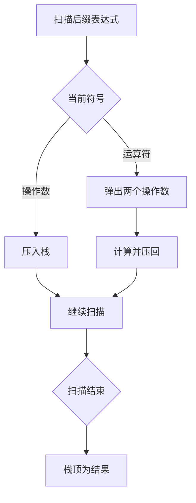

# 利用栈计算后缀表达式的值

## 什么是后缀表达式

后缀表达式（也称逆波兰表达式）是一种不使用括号、运算符放在操作数之后的表达式形式。中缀表达式必须结合优先级和结合性确定运算顺序，而后缀表达式通过运算符出现的顺序直接表达计算顺序，天然适合用栈求值。

例如，中缀表达式：

$$
a*b+c/d
$$

转换为后缀表达式：

```text
a b * c d / +
```

其含义是：先算 `a*b`，再算 `c/d`，最后把两者相加。

> [!IMPORTANT]
> ==后缀表达式的求值规则：数字入栈；遇到运算符，先弹出两个数，计算后把结果重新入栈。==

## 为什么需要用栈

后缀表达式中的运算符具有“后出现、先参与计算”的特点。求值时，后出现的运算符往往对应表达式中更深的一层运算，因此需要后进先出的数据结构保存中间结果。

栈正好满足这一要求：

1. 从左到右扫描后缀表达式；
2. 遇到操作数，将其压入栈；
3. 遇到运算符，从栈顶弹出两个操作数；
4. 执行运算，将结果压回栈；
5. 扫描结束后，栈中唯一的元素就是表达式的值。



## 操作数顺序不能弄反

若运算符写作 $\circ$，弹出时先得到右操作数 $b$，后得到左操作数 $a$，所以应计算：

$$
a\circ b
$$

而不是 $b\circ a$。

| 表达式 | 弹栈顺序 | 正确计算 |
|---|---|---|
| `a b -` | 先 `b`，后 `a` | $a-b$ |
| `a b /` | 先 `b`，后 `a` | $a/b$ |
| `a b ^` | 先 `b`，后 `a` | $a^b$ |

> [!WARNING]
> 减法和除法的操作数顺序是常见失分点。不能把“先弹出”直接当作“被减数”或“被除数”。

## 算例：计算 `a b * c d / +`

设 $a=6$、$b=2$、$c=8$、$d=4$。

| 读入符号 | 栈中状态（栈底在左） | 说明 |
|---|---|---|
| `a` | `6` | $a$ 入栈 |
| `b` | `6 2` | $b$ 入栈 |
| `*` | `12` | $6\times2=12$ |
| `c` | `12 8` | $c$ 入栈 |
| `d` | `12 8 4` | $d$ 入栈 |
| `/` | `12 2` | $8/4=2$ |
| `+` | `14` | $12+2=14$ |

因此最终结果为：

$$
(6\times2)+(8/4)=14
$$

> [!TIP]
> 快速检查：把后缀表达式中的运算符依次替换成对应的中缀括号形式。`a b * c d / +` 可还原为 `((a*b)+(c/d))`，能有效发现漏括号、顺序错误等问题。

## 与中缀表达式求值的区别

| 对比项 | 中缀表达式求值 | 后缀表达式求值 |
|---|---|---|
| 运算顺序依据 | 优先级、结合性、括号 | 符号出现顺序 |
| 常用结构 | 两个栈 | 一个栈 |
| 运算符处理 | 通常延后处理 | 立即计算 |
| 是否需要括号 | 用于改变运算顺序 | 不需要括号 |

> [!NOTE]
> 后缀表达式求值不需要另设运算符栈，因为遇到运算符时即可直接计算并把结果压回操作数栈，这正是它算法简洁的原因。
