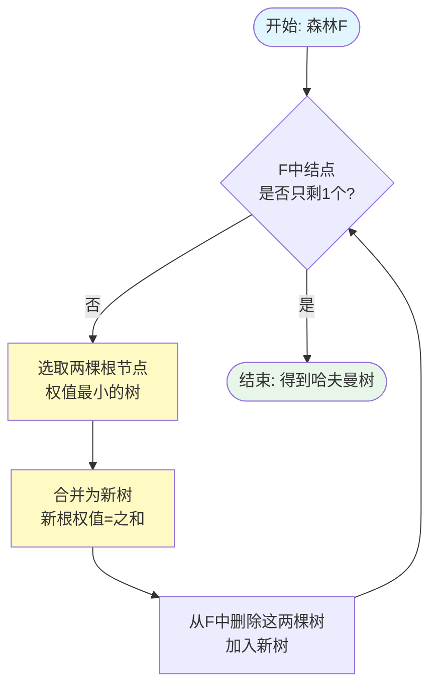

# 哈夫曼树的构造算法（哈夫曼算法）、带权路径长度（WPL）与哈夫曼编码

## 哈夫曼树与带权路径长度

在数据通信中，若字符出现频率不同，使用等长编码会浪费空间。如何让高频字符用短码、低频字符用长码，从而使总传输长度最短？这就引入了==哈夫曼树（最优二叉树）==。

对于一棵有 $n$ 个叶子结点的二叉树，若每个叶子结点有权值 $w_i$，从根到该叶子的路径长度为 $l_i$，则树的**带权路径长度（WPL）**定义为：
$$ WPL = \sum_{i=1}^{n} w_i l_i $$
哈夫曼树即是 WPL 最小的二叉树。其核心性质是：**权值越大的叶子离根越近**。

> [!IMPORTANT]
> 若哈夫曼树叶子结点数为 $n$，则总结点数为 $2n-1$（因为哈夫曼树只有度为 0 和 2 的结点，无度为 1 的结点）。

## 哈夫曼算法构造流程

构造过程遵循“贪心”策略，每次选取权值最小的两个结点合并。

具体步骤：
1. 初始化：将 $n$ 个权值看作 $n$ 棵仅含根结点的二叉树，构成森林 $F$。
2. 选择：在 $F$ 中选取两棵根结点权值**最小**的树作为左右子树。
3. 合并：构造一棵新二叉树，其根结点权值为左右子树根结点权值之和。
4. 更新：从 $F$ 中删去这两棵树，将新树加入 $F$。
5. 重复：直到 $F$ 中只剩一棵树为止。

> [!WARNING]
> 题目若约定“左小右大”，应将较小权值放左侧，较大权值放右侧。若权值相等，仍需要规定并列结点的选择顺序；仅约定左右大小并不能保证所有输入的树形与编码唯一。不同的合法哈夫曼树可以有相同的最小 WPL。

## 哈夫曼编码与应用

利用哈夫曼树可生成**前缀编码**（任一字符编码都不是另一字符编码的前缀），避免译码歧义。通常规定：左分支标记为 `0`，右分支标记为 `1`（或反之），从根到叶子的路径序列即为该字符的哈夫曼编码。

| 特性 | 等长编码 | 哈夫曼编码 |
| :--- | :--- | :--- |
| 编码长度 | 固定 | 可变（变长） |
| 空间效率 | 低 | ==高（WPL最小）== |
| 译码难度 | 简单 | 需依赖树结构 |

## 典型例题解析

**题目**：设权值集合 $W = \{13, 55, 7, 19, 17\}$，构造哈夫曼树（左小右大），求 WPL。

**推导过程**：
1. 排序：$\{7, 13, 17, 19, 55\}$
2. 取最小 $7, 13$ 合并 $\rightarrow$ 新结点 $20$。森林变为 $\{17, 19, 20, 55\}$
3. 取最小 $17, 19$ 合并 $\rightarrow$ 新结点 $36$。森林变为 $\{20, 36, 55\}$
4. 取最小 $20, 36$ 合并 $\rightarrow$ 新结点 $56$。森林变为 $\{55, 56\}$
   *注意：此时 $20$ 的左孩子是 $7$，右孩子是 $13$；$36$ 的左孩子是 $17$，右孩子是 $19$。*
   *新结点 $56$ 的左孩子是 $20$，右孩子是 $36$。*
5. 取 $55, 56$ 合并 $\rightarrow$ 根结点 $111$。

**计算 WPL**：
方法一（定义法）：
- $7$: 路径长度 3 ($7 \to 20 \to 56 \to 111$)
- $13$: 路径长度 3
- $17$: 路径长度 3 ($17 \to 36 \to 56 \to 111$)
- $19$: 路径长度 3
- $55$: 路径长度 1
$$ WPL = 7\times3 + 13\times3 + 17\times3 + 19\times3 + 55\times1 = 21+39+51+57+55 = 223 $$

方法二（非叶子结点权值之和）：
$$ WPL = 20 + 36 + 56 + 111 = 223 $$

> [!TIP]
> 验证技巧：WPL 等于构造过程中所有**新生成结点**的权值之和。此例中 $20+36+56+111=223$，计算更快捷且不易出错。
