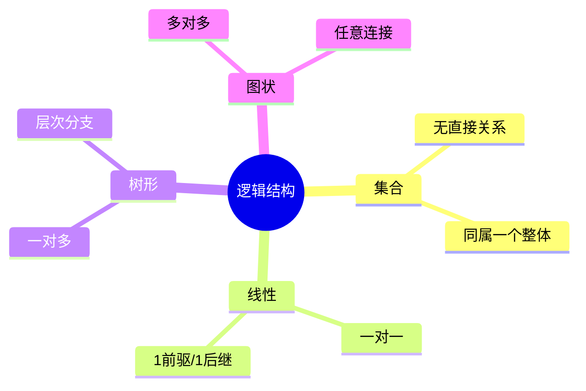

# 数据的四种基本逻辑结构（集合、线性、树形、图状）

在深入算法细节前，不妨先思考：当我们谈论“数据结构”时，究竟是在描述数据在内存中的摆放位置，还是数据元素之间固有的关联？如果更换了编程语言或硬件平台，这种关联是否依然存在？

> [!IMPORTANT]
> 数据的==逻辑结构==与计算机无关，它仅反映数据元素间固有的逻辑关系。而物理（存储）结构才是逻辑结构在计算机内的具体实现。南邮历年考题反复强调这一区分。

## 四种基本逻辑结构

根据课件定义，数据结构是相互之间存在一种或多种特定关系的数据元素集合。用二元组表示为 $DataStructure = (D, R)$，其中 $D$ 是数据元素的有限集合，$R$ 是 $D$ 上关系的集合。依据 $R$ 的不同特征，逻辑结构分为四类：

| 结构类型 | 关系特征 | 前驱/后继数量 | 典型应用 |
| :--- | :--- | :--- | :--- |
| 集合 | 元素间无其他关系 | 0 / 0 | 散列表、并查集 |
| 线性 | 一对一顺序关系 | ≤1 / ≤1 | 数组、链表、栈 |
| 树形 | 一对多层级关系 | 1 / n | 二叉搜索树、堆 |
| 图状 | 多对多网状关系 | n / n | 路由、社交网络 |

> [!NOTE]
> “线性结构按照价格从高到低排列”这类描述，指的是数据按某种==逻辑次序==组织，而非物理地址连续。顺序存储只是线性结构的一种物理实现方式，切勿将“线性”等同于“顺序表”。

## 辨析逻辑结构与物理结构

这是本章最核心的考点。逻辑结构关注“是什么”，物理结构关注“怎么存”。

- **逻辑结构**：由问题本身决定，独立于计算机。例如学生成绩按学号排序，无论用数组还是链表存储，其线性逻辑不变。
- **物理结构**：依赖具体机器和语言，包括顺序、链式、索引、散列等存储方式。

> [!WARNING]
> 填空题常考“四种逻辑结构”，标准答案为==集合、线性、树、图==。切勿填入“顺序”“链表”等物理存储术语，这是高频失分点。

## 真题验证与避坑

回顾经典选择题：“在数据结构中，与所使用的计算机无关的是数据的＿＿结构。”选项含物理、逻辑、存储、运算。根据上述辨析，==逻辑结构==是唯一不依赖硬件和实现的答案。

再看填空题：“数据结构的四种逻辑结构是：______、线性、树和图结构。”此处必须填“集合”。许多同学误填“数组”或“栈”，混淆了抽象数据类型与逻辑分类。

> [!TIP]
> 判断逻辑结构类型的口诀：==看关系，不看存储==。问自己：元素间是一对一、一对多、多对多，还是毫无关联？答案即对应线性、树形、图状或集合。后续章节的线性表（第2章）、树（第5章）、图（第7章）及集合搜索（第6章），正是这四种逻辑结构的具体展开。
