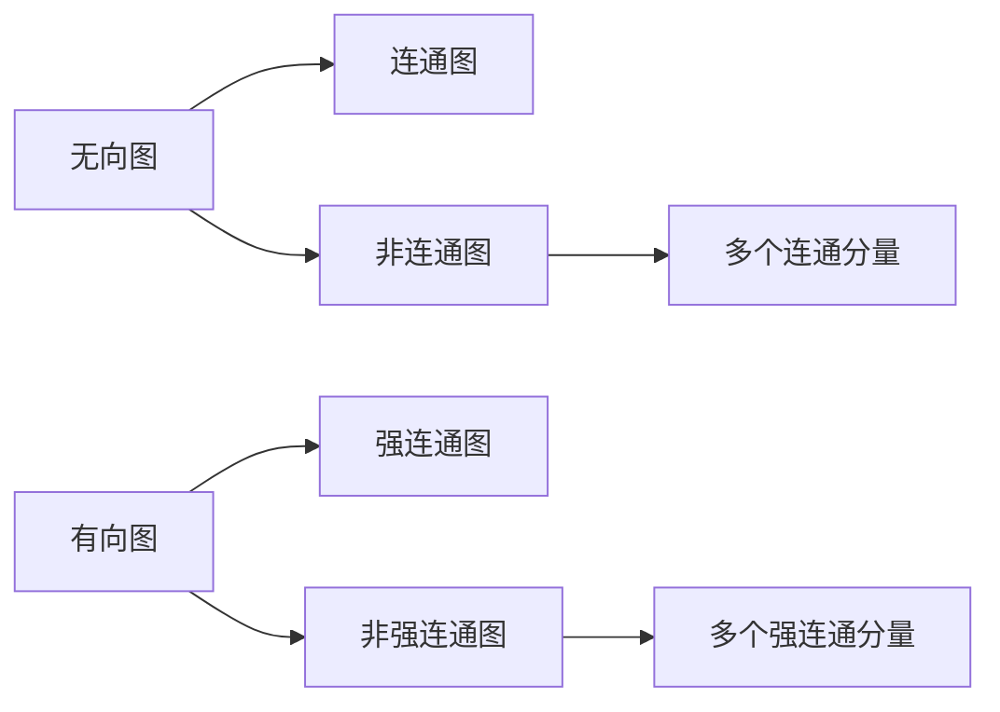

# 图的定义与术语（有向图、无向图、连通分量、强连通分量、DAG图等）

## 图的定义与分类

图 $G=(V,E)$ 由顶点集 $V$ 和边集 $E$ 组成，用来描述对象之间的多对多关系，如课程先修关系、通信线路和交通网络。与线性表、树相比，图中任意两个顶点都可能相关。

| 类型 | 边的表示 | 方向与邻接关系 |
|---|---|---|
| 无向图 | $(u,v)$ | 边偶对无序，$(u,v)=(v,u)$，$u$ 与 $v$ 相邻接 |
| 有向图 | $\langle u,v\rangle$ | 边偶对有序，$u$ 为始点（尾），$v$ 为终点（头）；$u$ 邻接到 $v$，$v$ 邻接自 $u$ |

无向图的邻接矩阵一定对称，因为 $A[u][v]=A[v][u]$；有向图、AOV 网和 AOE 网的邻接矩阵通常不对称。

## 路径、回路与连通性

路径是满足边连接要求的顶点序列，路径上边的数目称为**路径长度**。除起点和终点外其余顶点各不相同的路径称为简单路径；起点和终点相同的简单路径称为回路。

无向图中，若 $u$ 到 $v$ 存在路径，则称两顶点连通；任意两个顶点都连通的无向图称为连通图。若从任意顶点出发进行一次 DFS 都能访问全部顶点，该无向图必为连通图。

有向图必须检查双向可达性：任意 $u,v$ 之间既存在 $u\to v$ 的路径，又存在 $v\to u$ 的路径，才是强连通图。

## 连通分量与强连通分量

连通分量是无向图的**极大连通子图**；强连通分量是有向图的**极大强连通子图**。这里的“极大”是指不能再加入原图中的顶点或边而仍保持相应连通性，不是“顶点最多”。

> [!WARNING]
> 求分量时不能只写顶点数最多的一个，也不能只列顶点。应列出全部分量，并写出每个分量内部顶点之间的所有边。

例如，无向图分为 $\{0,1,2\}$ 与 $\{3,4\}$ 两组，组内连通、组间无路径，则它有两个连通分量。即使某个有向图忽略方向后连通，也不代表它强连通。

## 度、生成树与 DAG

无向图中，顶点的度是与它相关联的边数。有向图中，入度是以该顶点为头的弧数，出度是以该顶点为尾的弧数，且：

$$\text{度}=\text{入度}+\text{出度}$$

无向连通图的生成树包含全部 $n$ 个顶点和 $n-1$ 条边，是极小连通子图；再加一条边就会形成回路。有向无环图（DAG）是不包含回路的有向图，AOV 网用顶点表示活动、弧表示领先关系，AOE 网则用顶点表示事件、带权弧表示活动。

> [!IMPORTANT]
> ==DAG 只要求“有向且无回路”，不要求强连通，也不要求任意两点可达。==

## 典型例题

具有 $n$ 个顶点的有向完全图中，每个顶点都可向其余 $n-1$ 个顶点各引出一条弧，因此边总数为：

$$n(n-1)$$

答案选 **B**。无向完全图的 $(u,v)$ 与 $(v,u)$ 是同一条边，所以边数才是 $\dfrac{n(n-1)}2$；==有向完全图不能除以 2==。
