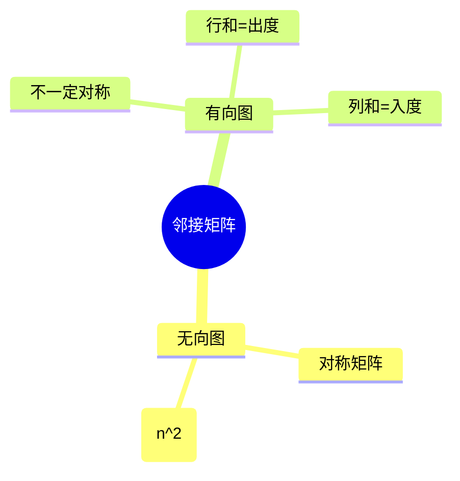

# 图的邻接矩阵存储表示及边的搜索、插入、删除实现

## 邻接矩阵存储表示

图的邻接矩阵（Adjacency Matrix）是用两个数组来表示图：一个一维数组存储顶点信息，一个二维数组 `a[n][n]` 存储边或弧的信息。对于带权图，若顶点 $u$ 到 $v$ 有边且权值为 $w$，则 `a[u][v] = w`；若无直接相连的边，通常设为 $\infty$（或 0，视具体定义而定，南邮课件中常以 $\infty$ 表示无边）。

> [!IMPORTANT]
> ==核心性质==：无向图的邻接矩阵是**对称矩阵**。即 $a[i][j] = a[j][i]$。这是因为无向边 $(u, v)$ 等价于 $(v, u)$。



## 边的搜索、插入与删除实现

在邻接矩阵中，基本操作的时间复杂度主要取决于顶点的索引访问，均为 $O(1)$，这与邻接表需要遍历链表不同。

### 1. 搜索存在性 `Exist(u, v)`
直接检查矩阵元素 `a[u][v]`。
- 若 `a[u][v] != ∞`（或特定标记），返回 `true`。
- 否则返回 `false`。

### 2. 插入边 `Insert(u, v, w)`
向图中添加权为 $w$ 的边 $<u,v>$。需先判断边是否已存在，避免重复插入。

```cpp
template <class T>
ResultCode MGraph<T>::Insert(int u, int v, T& w) {
    if (u < 0 || u >= n || v < 0 || v >= n) return Failure; // 越界检查
    if (a[u][v] != noEdge) return Duplicate; // 边已存在
    a[u][v] = w; 
    if (!directed) a[v][u] = w; // 若是无向图，需对称赋值
    return Success;
}
```

### 3. 删除边
将 `a[u][v]` 重置为 `noEdge`（如 $\infty$）。若是无向图，同样需处理 `a[v][u]`。

> [!TIP]
> **对比邻接表**：邻接矩阵插入/删除极快 $O(1)$，但空间开销大 $O(n^2)$，适合**稠密图**；邻接表节省空间 $O(n+e)$，适合**稀疏图**，但查找特定边需遍历链表 $O(degree)$。

## 常见考点与避坑指南

| 特性 | 无向图 | 有向图 |
| :--- | :--- | :--- |
| **矩阵对称性** | ==必对称== | 一般不对称 |
| **非零元素个数** | $2 \times$ 边数 | 等于边数 |
| **第 $i$ 行非零元** | 顶点 $i$ 的度 | 顶点 $i$ 的**出度** |
| **第 $i$ 列非零元** | 顶点 $i$ 的度 | 顶点 $i$ 的**入度** |

> [!WARNING]
> **易错点**：
> 1. **无向图操作遗漏**：在无向图中插入或删除边时，必须同时修改 `a[u][v]` 和 `a[v][u]`，否则会导致矩阵不对称，破坏逻辑一致性。
> 2. **完全图边数**：具有 $n$ 个顶点的**有向完全图**，边总数为 $n(n-1)$；**无向完全图**为 $n(n-1)/2$。
> 3. **连通图最少边**：$n$ 个顶点的无向连通图，至少有 $n-1$ 条边。在邻接矩阵中，由于对称性，非零元素至少有 $2(n-1)$ 个。

## 典型例题解析

**题目**：在将 $n$ 个顶点无向连通图用邻接矩阵表示时，该矩阵至少有 ______ 个非零元素。

**解析**：
要使 $n$ 个顶点连通，最少需要构成一棵生成树，即拥有 $n-1$ 条边。
因为是无向图，每条边 $(u, v)$ 在矩阵中对应两个位置：`a[u][v]` 和 `a[v][u]`。
因此，非零元素的最小数量 = $2 \times (n - 1)$。

> [!NOTE]
> 若题目问的是“有向图”，则答案仅为 $n-1$（假设强连通或仅考虑弱连通下的最少边结构，通常指生成树对应的有向边）。但本题明确为**无向**，故需乘 2。
