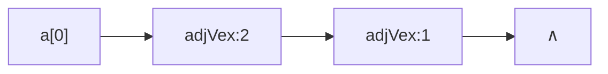

# 图的邻接表存储表示及边的搜索、插入、删除实现

## 它是什么：邻接表怎么存一张图

如果你要把一张图交给计算机，最直观的办法是画表格（邻接矩阵），但顶点一多，那张表就很空很浪费。南邮课件里讲的**邻接表**，就是给每个顶点 $u$ 挂一条单链表，$a[u]$ 指向这条链表的头，链表里每个结点表示一条从 $u$ 发出的边 $<u,v>$，带上权值 $w$。

顶点编号通常就是数组下标 $0\sim n-1$。边结点（课件里的 `ENode`）至少要有：`adjVex`（邻接点）和 `nextArc`（下一条边）；带权图还要存 `w`。

## 为什么需要它

邻接矩阵查边是 $O(1)$，但插入删除边要动整行、空间是 $O(n^2)$。邻接表只在 $a[u]$ 那条链上操作，==搜索、插入、删除都只在对应的单链表里走==，对稀疏图更省空间、动态改边更快。

## 怎么做：Exist / Insert / Remove

课件给的运算只有三个，都在 $a[u]$ 上折腾：

| 运算 | 含义 | 做法 | 返回 |
|---|---|---|---|
| `Exist(u,v)` | 搜边 $<u,v>$ | 从头扫 $a[u]$ 链，找 `adjVex==v` | `true/false` |
| `Insert(u,v,w)` | 加边 $<u,v>$ | 若 `Exist` 已 true 则 `Duplicate`；否则新结点插到 $a[u]$ **最前面** | `success/Duplicate/Failure` |
| `Remove(u,v)` | 删边 $<u,v>$ | 在 $a[u]$ 链里摘掉该结点 | `success/NotPresent` |

`Insert` 插最前面，所以时间是 $O(1)$（不算查重）；`Exist` 和 `Remove` 最坏要把这条出边链表走完。

> [!IMPORTANT]
> 有向图只在 $a[u]$ 上加/删；无向图每条边 $<u,v>$ 会同时出现在 $a[u]$ 和 $a[v]$ 里，==无向图必须两边都改==。

## 和相近概念的区别

- 邻接矩阵：$n\times n$ 表格，`Exist` $O(1)$、空间大。
- 邻接表：链表数组，`Exist` 与 $u$ 的出度有关、空间为 $O(n+e)$。
- 入度/出度：出度=数 $a[u]$ 链表长度；入度要==扫全表==数 `adjVex==v` 的次数（这正是考题“顶点 6 的入度”的做法）。

## 常见的坑

> [!WARNING]
> 无向图插入忘了同步插反向边，会导致 DFS/BFS 遍历“走一半”。
>
> 把“顶点 6 的入度”当成 `a[6]` 链表长度——那是出度。

## 一个算对了的例子

考题：上面那个无向图邻接表，从 `v1` 深度优先遍历。

`v1` 先走 `v2`（链表最前），`v2` 走未访问的 `v4`，`v4` 走未访问的 `v3`，`v3` 走 `v5`，`v5` 走 `v6`。

> [!TIP]
> 结果为：`v1, v2, v4, v3, v5, v6`。因为链表顺序决定了“第一个没访问过的邻居先走”，==遍历序列由邻接表里插边的前后次序决定==。
