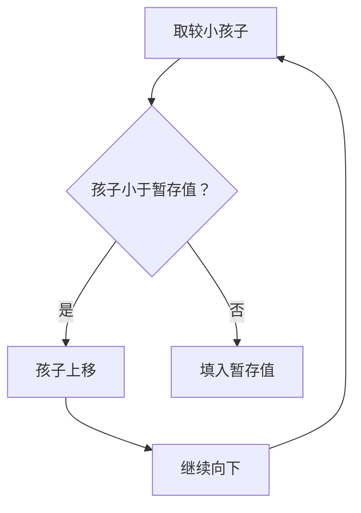

# 堆的定义（最小堆/最大堆）、向下调整建堆及优先权队列的插入与删除

堆是==一种特殊的完全二叉树==，它用**顺序存储**保存，并满足“父结点与孩子结点之间的关键字大小关系”。在优先权队列中，每次都要先处理优先权最高的元素；若用普通数组，找最小值要扫描整个序列，而用堆可以把插入、删除都控制在 $O(\log n)$。

## 最小堆与最大堆

最小堆要求每个结点的关键字都不大于其孩子，因此==堆顶（根结点）是整棵树的最小元素==；最大堆则相反，堆顶是最大元素。注意：堆只约束“父子关系”，**不要求左、右子树之间有序，也不是二叉搜索树**。

若数组下标从 $0$ 开始，结点 $i$ 的左、右孩子分别为 $2i+1$、$2i+2$，父结点为 $\lfloor(i-1)/2\rfloor$。因此最小堆可写为：
$$heap[i]\le heap[2i+1],\qquad heap[i]\le heap[2i+2]$$
（孩子存在时才需检查）。

例如序列 $(23,53,34,65,83,74)$ 是最小堆：$23\le53,34$，$53\le65,83$，$34\le74$。而 $(23,98,34,65,83,74)$ 不是，因为 $98>65$，破坏了堆序。

| 结构 | 核心约束 | 能否直接得到全局有序序列 |
|---|---|---|
| 最小堆 | 父结点不大于孩子 | 不能 |
| 最大堆 | 父结点不小于孩子 | 不能 |
| 二叉搜索树 | 左子树 $<$ 根 $<$ 右子树 | 中序遍历可以 |

## 向下调整建堆

把任意序列调整成最小堆，使用 `AdjustDown(heap,r,j)`：在下标 $r$ 到 $j$ 的范围内，暂存 `heap[r]`，每次选出左右孩子中的较小者；若它小于暂存值，就把孩子上移，继续向下检查，否则停止。

建堆时，叶子无需调整，所以从最后一个非叶子结点 $\lfloor(n-2)/2\rfloor$ 开始，==逆序处理到根结点 $0$==。这样处理某个结点时，它的两棵子树已经是最小堆。

以 $(36,91,24,12,47,30,52,85)$ 为例，$n=8$，从 $r=3$ 开始：

| 调整结点 | 操作 | 调整后序列 |
|---|---|---|
| $r=3$ | $12$ 已不大于 $85$ | 不变 |
| $r=2$ | $24$ 已不大于 $30,52$ | 不变 |
| $r=1$ | $91$ 与较小孩子 $12$ 交换 | $(36,12,24,91,47,30,52,85)$ |
| $r=0$ | $36$ 先与 $12$ 交换，再与 $47$ 交换 | $(12,36,24,85,47,30,52,91)$ |

最终序列满足所有父子约束，因此建堆成功。向下调整建堆的总时间复杂度为 $O(n)$，优于逐元素向上调整建堆的 $O(n\log n)$。

## 优先权队列的插入与删除

课件的 `PrioQueue` 以最小堆存储元素，最小值代表最高优先权。

- **插入 `Append(x)`**：把 $x$ 放到数组末尾，再与父结点比较；若小于父结点则交换，逐层向上调整（sift-up），直到恢复堆序。
- **删除 `Serve(x)`**：堆顶就是最高优先权元素，先保存它；把最后一个元素移到堆顶，堆规模减一，再从根执行向下调整（sift-down）。

> [!WARNING]
> 删除堆顶后不能简单删去根结点，也不能只比较一次孩子。必须用末尾元素补根，并持续调整，直到父结点不大于孩子或到达叶子。

> [!TIP]
> 记忆：**插入在末尾，向上调；删顶用尾补，向下调；建堆从最后非叶子开始，逆序调。** 插入、删除均为 $O(\log n)$，取堆顶为 $O(1)$。
