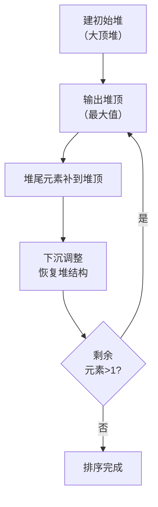
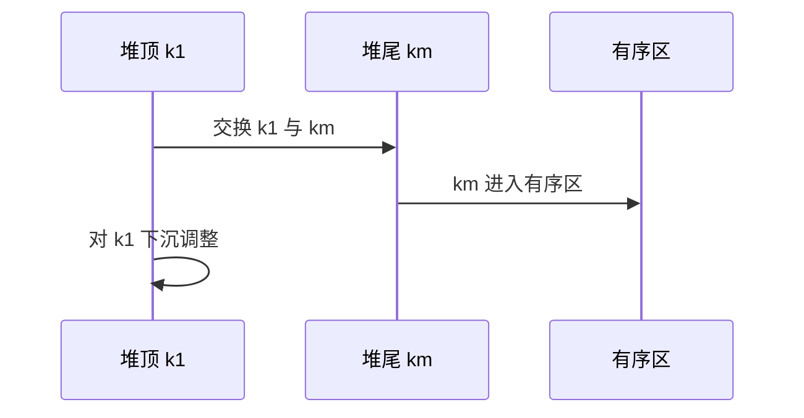
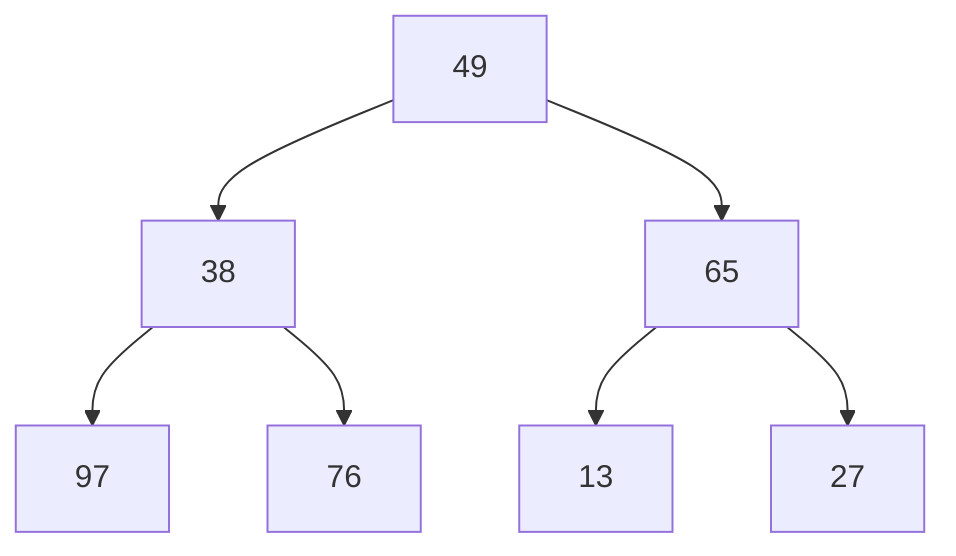

# 堆排序的基本思想、建初始堆与输出堆顶后的调整过程

## 堆排序

堆排序是一种**基于完全二叉树的选择排序**。它利用“堆”这种结构，每次都能快速找到当前未排序部分的最大（或最小）元素，从而完成排序。

### 为什么需要堆排序

普通选择排序每一趟都要遍历整个未排序区找最值，总时间 $O(n^2)$。而堆排序把“找最值”的代价降到了 $O(\log n)$——因为最大值（大顶堆）永远在堆顶，取走堆顶后只需一趟“下沉”就能恢复堆结构。总时间复杂度为 $O(n \log n)$，且**原地排序**，不需要额外数组。

### 什么是堆

若有 $n$ 个元素的序列 $\{k_1, k_2, \dots, k_n\}$ 满足：

- $k_i \ge k_{2i}$ 且 $k_i \ge k_{2i+1}$（大顶堆）
- 或 $k_i \le k_{2i}$ 且 $k_i \le k_{2i+1}$（小顶堆）

则称该序列为堆。堆对应一棵**完全二叉树**：编号 $i$ 的结点，左孩子编号 $2i$，右孩子编号 $2i+1$。

> [!IMPORTANT]
> ==大顶堆的堆顶（根）是当前序列的最大值；小顶堆的堆顶是最小值。== 堆排序升序用大顶堆，降序用小顶堆。

### 整体思路

堆排序分两步：**建初始堆** → **反复输出堆顶并调整**。

### 建初始堆

从最后一个非叶结点开始，**从右往左、从下往上**逐个做“下沉”调整。

最后一个非叶结点的编号是 $\lfloor n/2 \rfloor$。

> [!NOTE]
> 为什么从 $\lfloor n/2 \rfloor$ 开始？因为编号大于 $\lfloor n/2 \rfloor$ 的结点都是叶子，它们天然是“只有一个结点的堆”，不需要调整。

**“下沉”步骤**（以结点 $i$ 为例，大顶堆）：

1. 比较 $k_i$ 与左右孩子，找出较大的孩子；
2. 若较大孩子比 $k_i$ 大，则交换两者；
3. 交换后可能破坏下层堆结构，因此继续沿交换路径向下调整，直到不需要交换或到达叶子。

### 输出堆顶后的调整

建好大顶堆后，$k_1$ 就是最大值：

1. **交换** $k_1$ 与当前堆尾 $k_m$（$m$ 为当前堆大小）；
2. **堆大小减 1**——原来的最大值已“沉底”，不再属于堆；
3. 堆顶新换上来的元素可能破坏堆性质，对 $k_1$ 做一次**下沉**，恢复堆结构。

重复以上过程，直到堆大小为 1。

### 算一个例子

对序列 $\{49, 38, 65, 97, 76, 13, 27\}$ 建大顶堆并完成第一趟排序。

**建初始堆**：$n=7$，最后一个非叶结点编号 $\lfloor 7/2 \rfloor = 3$，依次调整结点 3、2、1。

初始完全二叉树：

调整结点 3（65，孩子 13、27）：65 > 两个孩子，不交换。

调整结点 2（38，孩子 97、76）：97 最大，交换 38 与 97；交换后 38 到位置 4，无孩子，停止。此时序列为 $\{49, 97, 65, 38, 76, 13, 27\}$。

调整结点 1（49，孩子 97、65）：97 最大，交换 49 与 97；49 到位置 2，孩子 38、76，76 更大，交换 49 与 76；49 到位置 5，无孩子，停止。

最终大顶堆为 $\{97, 76, 65, 38, 49, 13, 27\}$：

**第一趟排序**：交换 $k_1=97$ 与 $k_7=27$，堆大小减为 6，序列变为 $\{27, 76, 65, 38, 49, 13, \ 97\}$。

对堆顶 27 下沉：孩子 76 > 65，且 76 > 27，交换 27 与 76；27 到位置 2，孩子 38 < 49，49 更大且 > 27，交换 27 与 49；27 到位置 5，无孩子，停止。

第一趟结束后：$\{76, 49, 65, 38, 27, 13, \ 97\}$，其中 **97 已就位**。

### 和直接选择排序的区别

| 比较项 | 直接选择排序 | 堆排序 |
| --- | --- | --- |
| 找最值方式 | 每趟线性扫描 | 堆顶直接取最值 |
| 调整代价 | $O(n)$ | $O(\log n)$ |
| 总时间 | $O(n^2)$ | $O(n \log n)$ |
| 稳定性 | 不稳定 | 不稳定 |
| 额外空间 | $O(1)$ | $O(1)$ |

> [!WARNING]
> 堆排序**不稳定**：例如 $\{3, 3', 2\}$ 建堆后两个 3 的相对位置可能改变。考题若问“哪种排序不稳定且 $O(n\log n)$”，堆排序常和快排一起入选。

> [!TIP]
> 记忆：**升序建大顶堆**。“大”顶堆把“大”的沉到最后，所以升序。反过来，降序建小顶堆。

> [!CAUTION]
> 建堆时是从 $\lfloor n/2 \rfloor$ 号结点**向前、向下**调整，不是从 1 号开始“从上往下”。从根开始建堆会漏掉下层已经形成的堆结构，容易出错。
