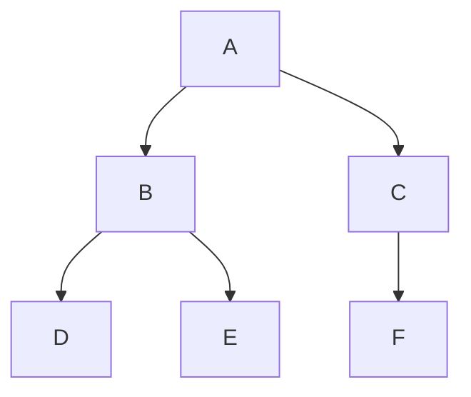

# 完全二叉树的性质与扩充二叉树（2-树）的定义

## 完全二叉树：形状与性质

完全二叉树是一种“紧凑”的二叉树：除最后一层外，其余各层结点都达到最大个数，且最后一层结点==从左向右连续排列==，中间不能留空。

上图有 $6$ 个结点，是真题数组 `A B C D E F` 对应的完全二叉树。若再给 $C$ 添加右孩子，它仍是完全二叉树；但若只给 $C$ 添加右孩子而没有左孩子，就不是。

> [!IMPORTANT]
> 深度为 $k$ 的满二叉树有 $2^k-1$ 个结点；完全二叉树只要求最后一层向左集中，==不一定是满二叉树==。

设完全二叉树有 $n$ 个结点，其高度（层数，根为第 $1$ 层）为

$$
h=\lfloor \log_2 n\rfloor+1=\lceil \log_2(n+1)\rceil .
$$

叶子只可能出现在最后两层。若叶子数为 $n_0$，度为 $2$ 的结点数为 $n_2$，仍有二叉树通用关系 $n_0=n_2+1$；完全二叉树中度为 $1$ 的结点==至多一个==，且若存在，它只有左孩子。

## 顺序存储与下标关系

完全二叉树适合用一维数组存放，不必为每个结点保存左右孩子指针。若根结点下标为 $1$，结点 $i$ 的关系为：

| 对象 | 下标或判断条件 |
|---|---|
| 左孩子 | $2i$，要求 $2i\le n$ |
| 右孩子 | $2i+1$，要求 $2i+1\le n$ |
| 双亲 | $\lfloor i/2\rfloor$，其中 $i>1$ |

这也是堆能够直接用数组实现的基础：知道一个元素的位置，就能算出它的双亲和孩子的位置。

> [!WARNING]
> 若数组从下标 $0$ 开始且根放在 $0$，左、右孩子分别是 $2i+1$、$2i+2$，双亲是 $\lfloor(i-1)/2\rfloor$。做题前先确认下标约定，不能混用两套公式。

## 一个算对了的例子

真题数组依次存放 `A B C D E F`，按完全二叉树规则得到：$A$ 的孩子是 $B,C$；$B$ 的孩子是 $D,E$；$C$ 只有左孩子 $F$。因此：

| 遍历方式 | 访问顺序 |
|---|---|
| 前序：根、左、右 | `A B D E C F` |
| 中序：左、根、右 | `D B E A F C` |
| 后序：左、右、根 | `D E B F C A` |

> [!TIP]
> 数组下标题先恢复树形，再遍历；不要直接把数组顺序当成某一种遍历序列。

同类计算也可推广到完全 $m$ 叉树：各层最多有 $1,m,m^2,\ldots$ 个结点，前 $h-1$ 层最多共有 $\frac{m^{h-1}-1}{m-1}$ 个结点。完全三叉树有 $244$ 个结点时，前 $4$ 层最多 $1+3+9+27=40$ 个，前 $5$ 层最多 $40+81=121$ 个，似乎放不下 $244$ 个；但第 $6$ 层容量为 $243$，所以按“各层达到最大、最后一层左齐”的通常定义，高度应为 $6$。若课程答案给 $5$，往往采用了不同的“完全三叉树”约定，考试时应以教师课件定义为准。

## 扩充二叉树（2-树）

课件定义：==扩充二叉树也称 2-树，其中除叶子结点外，其余结点都必须有两个孩子==。也就是说，每个内部结点的度都为 $2$，不存在度为 $1$ 的结点。

| 概念 | 核心限制 | 是否允许度为 $1$ 的结点 |
|---|---|---|
| 满二叉树 | 每层结点均达到最大 | 不允许 |
| 完全二叉树 | 最后一层左齐，其余层满 | 至多一个，且只有左孩子 |
| 扩充二叉树（2-树） | 内部结点均有两个孩子 | 不允许 |

2-树不要求各层填满，也不要求叶子同层，因此它不一定是完全二叉树；完全二叉树若含一个度为 $1$ 的结点，也不是 2-树。只有根结点的树是 2-树的边界情形。若 2-树有 $n_0$ 个叶子，则内部结点数为 $n_0-1$，总结点数为 $2n_0-1$，必为奇数。
