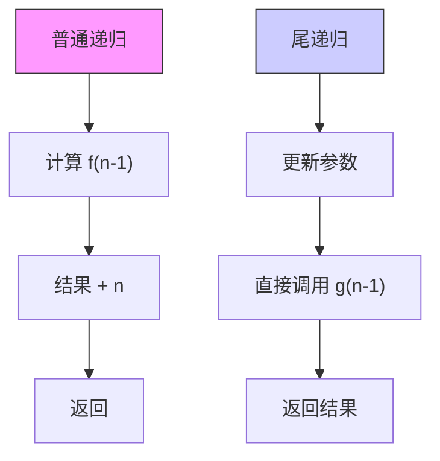

# 尾递归的概念及其转化为迭代的方法

# 尾递归的概念及其转化为迭代的方法

## 什么是尾递归？

在递归调用中，如果**递归调用是函数体中最后执行的语句**，且其返回值直接作为当前函数的返回值（即不参与后续的任何运算），则称该递归为==尾递归==。

> [!IMPORTANT]
> 核心定义：递归调用后无其他操作，返回值直接返回。

普通递归与尾递归的区别在于“现场保护”。普通递归在返回时需要恢复上一层的局部变量和断点，而尾递归因为后续无操作，理论上不需要保留当前栈帧。



## 为什么需要转化？

虽然尾递归逻辑清晰，但若编译器未做**尾递归优化（TCO）**，每次调用仍会压栈。当 $n$ 较大时，会导致==栈溢出（Stack Overflow）==。将其转化为迭代（循环），可以使用固定的 $O(1)$ 空间复杂度，避免栈深度限制。

## 如何转化为迭代？

转化核心思路：**用循环变量替代递归参数，用累加器替代返回值**。

1.  **识别状态**：找出递归函数中变化的参数。
2.  **初始化**：将初始参数赋值给循环变量。
3.  **循环更新**：在 `while` 或 `for` 循环中，根据递归关系更新变量。
4.  **终止条件**：当满足递归基准情况时，跳出循环并返回结果。

> [!TIP]
> 记忆技巧：把“向下递推”的过程变成“向上累加”或“参数更新”的过程。

### 典型示例：阶乘 $n!$

**尾递归形式**：
```c
int fact_tail(int n, int acc) {
    if (n == 0) return acc; // 基准情况
    return fact_tail(n - 1, n * acc); // 尾调用
}
// 调用: fact_tail(n, 1)
```

**转化为迭代**：
```c
int fact_iter(int n) {
    int acc = 1; // 初始化累加器
    while (n > 0) {
        acc = n * acc; // 更新状态
        n = n - 1;     // 更新参数
    }
    return acc;
}
```

## 常见坑与辨析

| 特性 | 普通递归 | 尾递归 | 迭代 |
| :--- | :--- | :--- | :--- |
| **空间复杂度** | $O(n)$ | $O(n)$* / $O(1)$** | $O(1)$ |
| **可读性** | 高 | 中 | 低 |
| **栈溢出风险** | 高 | 中（依赖编译器） | 无 |

> [!WARNING]
> 易错点：`return func(n-1) + 1` **不是**尾递归！因为返回后还需执行 `+1` 操作。

> [!CAUTION]
> 高危误区：并非所有递归都能轻易转为尾递归。若递归包含分支合并（如斐波那契 $F(n-1)+F(n-2)$），需借助显式栈或数学公式转化，不能简单替换为循环变量。

==核心结论==：尾递归是递归的特例，转化为迭代的本质是**消除对调用栈的依赖**，通过循环变量维护状态。在南邮考试中，重点在于识别是否为尾递归，并手动写出等价的 `while` 循环结构。
