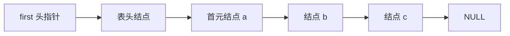

# 带表头结点的单链表的类型定义与运算实现

带表头结点的单链表，是在单链表的首元结点之前**额外附加一个结点**，称为==表头结点==（head node）。它的数据域不存储有效元素（可以存表长等辅助信息），指针域 `first->next` 指向首元结点。注意区分：**表头结点不是首元结点**，`first` 是指向表头结点的头指针，而不是指向首元结点。



## 为什么需要表头结点

在不带头结点的单链表里，==空表的判定是 `first == NULL`==，而插入/删除时若涉及首元结点，必须单独写分支改 `first` 本身；一旦忘记，就会出错。引入表头结点后：

- ==空表的判定统一为 `first->next == NULL`==（这正是常考的填空结论），即使链表为空，`first` 也始终有效；
- 插入/删除在**任意位置**（包括第一位）都只需操作 `p->next`，==不需要修改头指针 `first`==，算法更简洁、少一类边界 bug。


## 类型定义与基本运算

```c
typedef int ElemType;
typedef struct LNode {
    ElemType data;
    struct LNode *next;
} LNode, *LinkList;        // LinkList 是指向结点的指针类型
```

| 运算 | 不带头结点 | 带表头结点 |
|---|---|---|
| 判空 | `first == NULL` | `first->next == NULL` |
| 插入首位 | 要改 `first` | 只改 `first->next` |
| 删除首位 | 要改 `first` | 只改 `first->next` |
| 代码分支 | 多，易错 | 统一，简洁 |

**插入**（在 `p` 之后插入新结点 `s`）：

```c
s->next = p->next;
p->next = s;
```

**删除**（删除 `p` 的后继结点）：

```c
q = p->next;
p->next = q->next;
free(q);
```

> [!WARNING]
> 顺序绝不能颠倒：插入时先写 `s->next = p->next`，删除时先把后继存进 `q` 再断链，否则会丢指针、断链，导致链表丢失或野指针。

## 一个算对了的例子

> **填空**：带头结点的单链表中，`first` 指向表头结点。当 ______ 时，带表头结点的单链表为空。
>
> **答**：`first->next == NULL`。

此时表头结点存在且指针域为 `NULL`，`first` 本身**不为 NULL**，这是和不带头结点空表判定的最大区别，也是最常挖的坑。

## 常见的坑

> [!CAUTION]
> - 把 `first` 当成首元结点：`first->data` 是表头结点的数据域，不是第 1 个元素；第 1 个元素是 `first->next->data`。
> - 空表时写 `first == NULL`：==带头结点的空表 `first` 指向有效结点，永不为 NULL==。
> - 插入/删除首元时还去改 `first`：多此一举，易破坏表结构。

> [!TIP]
> 记忆口诀：**"头结点常在，空判 next；插入改 next，first 不动弹。"**
