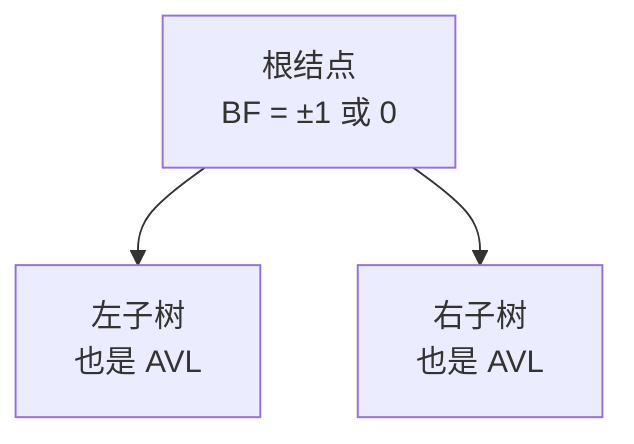
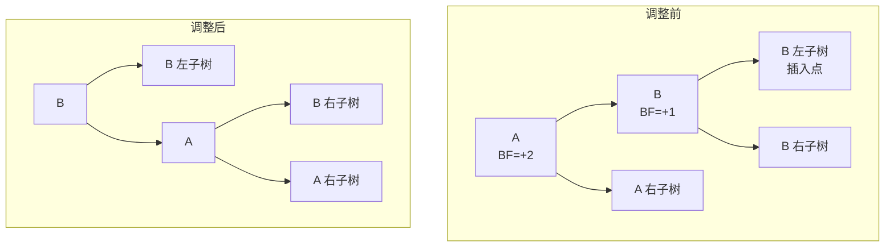
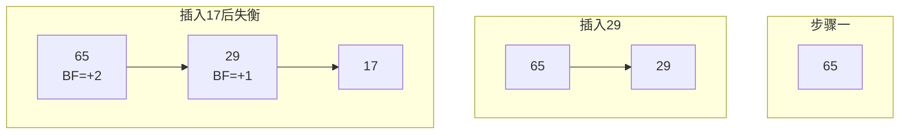

# 二叉平衡树（AVL树）的定义及四种旋转调整方法（LL、RR、LR、RL）

## 二叉平衡树（AVL树）

先看一个问题：如果依次把 `65, 29, 17, 12, 14, 13` 插入一棵普通二叉搜索树，会发生什么？

由于每个键都比前一个小，每次插入都会往左子树一路走到底，最终得到一棵“链式”的二叉树。此时查找 `13` 需要比较 6 次，效率退化为 $O(n)$。二叉平衡树正是为了解决这个问题。

### 什么是 AVL 树

> [!IMPORTANT]
> AVL 树或为空树，或满足：==左右子树高度差的绝对值不超过 1==，且 ==左右子树本身也是 AVL 树==。

一个结点的**平衡因子**定义为：

$$
BF(p) = \text{左子树高度} - \text{右子树高度}
$$

AVL 树中任一结点的平衡因子只能取 $-1, 0, +1$。一旦某个结点平衡因子变成 $+2$ 或 $-2$，就必须旋转调整。

### 为什么“插入”会破坏平衡

在 AVL 树中插入新结点，只可能让**从插入点到根这一条路径**上的祖先结点高度变化。自底向上找到第一个平衡因子变为 $\pm 2$ 的结点，记为“失衡结点”，然后根据插入位置分四种情况处理。

记失衡结点为 `A`，相关子结点为 `B`、`C`：

| 情形 | 插入位置 | 条件 | 调整 |
|------|---------|------|------|
| LL | A 的左孩子的左子树 | $BF(A)=+2,\ BF(B)=+1$ | 右旋 A |
| RR | A 的右孩子的右子树 | $BF(A)=-2,\ BF(B)=-1$ | 左旋 A |
| LR | A 的左孩子的右子树 | $BF(A)=+2,\ BF(B)=-1$ | 先左旋 B，再右旋 A |
| RL | A 的右孩子的左子树 | $BF(A)=-2,\ BF(B)=+1$ | 先右旋 B，再左旋 A |

### 四种旋转怎么做

**LL——右旋（顺时针）**：失衡结点 A 的左孩子 B“上位”，A 变成 B 的右孩子，B 原来的右子树挂到 A 的左子树位置。

RR 与 LL 镜像对称，只需左旋。

**LR——先左旋再右旋**：插入点在 A 的左孩子 B 的右子树中。先对 B 做一次左旋，使 C 成为 B 的父结点；此时局面变成 LL 型，再对 A 做一次右旋即可。

**RL——先右旋再左旋**：与 LR 镜像对称。

> [!TIP]
> 记忆口诀：**LL 右旋、RR 左旋、LR 左右、RL 右左**。中间两种是“双旋”，先照顾字母顺序——LR 先左（L）后右（R），RL 先右（R）后左（L）。

### 一个完整例子

建立序列 `65, 29, 17, 12, 14, 13` 的 AVL 树：

插入 `17` 时，`65` 的平衡因子变成 $+2$，且插入在左孩子的左子树，属 **LL 型**，对 `65` 右旋，`29` 成为根。

继续插 `12, 14`：插入 `14` 后，`29` 失衡，`12` 是 `17` 的右孩子，属 **LR 型**，先对 `17` 左旋，`14` 上位；再对 `29` 右旋，`14` 成为根。

最后插 `13`：`14` 失衡，`12` 的左子树插入，属 **LL 型**，对 `14` 右旋。

最终根结点是 ==**14**==，对应选择题答案 **B**。

> [!WARNING]
> 插入后必须**自底向上**找第一个失衡结点调整，而不是从根向下找。调整完这一个结点后，整棵树恢复平衡，不需要继续向上调整（高度恢复到插入前）。

### 与二叉搜索树的关系

AVL 树是二叉搜索树的强化版本：==仍然保持“左小右大”的搜索性质==，只是额外附加了高度平衡约束。约束越强，查找效率越稳定（$O(\log n)$），但插入删除时需要额外旋转来维护平衡。
