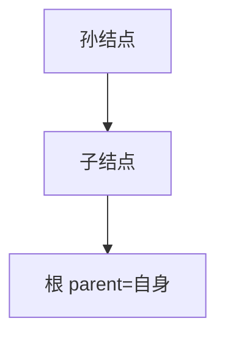

# 并查集的ADT、存储表示及Union与Find操作的改进（按秩合并、路径压缩）

## 它是什么

要处理很多元素是否属于同一组，你会怎么存？最容易想到的是给每个元素打标记，但组发生变化时改起来很乱。并查集（Union-Find / Disjoint Set）就是专门高效管理==不相交集合==的结构，只关心两件事：查一个元素在哪个集合，以及把两个集合并起来。

它的 ADT 只有三个操作：
- `Find(x)`：返回元素 $x$ 所在集合的==代表==（根结点）
- `Union(x,y)`：把 $x,y$ 所在集合合并

> [!IMPORTANT]
> 并查集的树中，谁是谁的父亲并不表示逻辑关系，只用来找代表结点。

## 存储表示

通常用双亲表示法，即数组 `parent[i]` 存结点 $i$ 的父亲下标，根结点的父亲是它自己。查找时就一路向上直到==根==。如果用普通树且不控制形状，可能退化成链，所以要做下面的改进。



## 怎么做：两种改进

想一下：链太深会让 `Find` 慢，合并也可能让树更高。于是：

- ==按秩合并==（Union by Rank）：用 `rank` 记录树高上界，总把==矮树挂到高树==下面；秩相同则任选并让新根秩加一。
- ==路径压缩==（Path Compression）：`Find` 时把路径上结点的父亲直接改成根。

两者一起用后，单次操作==近似常数时间==（严格为反阿克曼函数 $\alpha(n)$）。

> [!TIP]
> 考题常让写改进版 `Find`：递归里 `parent[x]=Find(parent[x])`，返回新父亲。

## 与相近概念的区别

并查集和一般二叉树查找不同：不用来按键找值，也不维护有序性；它只回答“是否同组”。

| 概念 | 目的 | 是否关注路径形状 |
|------|------|------------------|
| 并查集 | 集合合并与查询 | 是，需优化 |
| 二叉查找树 | 按键查找 | 是，需平衡 |
| 哈希表 | 映射取值 | 否 |

## 常见的坑与一个例子

> [!WARNING]
> 按秩合并不是按结点个数合并；路径压缩不改 `rank`，只改父亲指针。

例子：初始 `parent=[0..6]` 各成单元素，`rank` 全 0。合并 1-2（1 为根），再 `Find(3)` 并压缩后合并 3 到 1，最后压缩路径。若按顺序合并后写：

```text
Find(3)->根3；Union(3,1): rank[3]=0<rank[1]=1，故挂 3 到 1
parent: 1->1, 2->1, 3->1
```

再对深链结点做 `Find`，全都直连根，答案集合根为 1。

> [!CAUTION]
> 别把 “路径压缩” 写成重建树结构；它只在查找时顺便拉平父亲指针。
