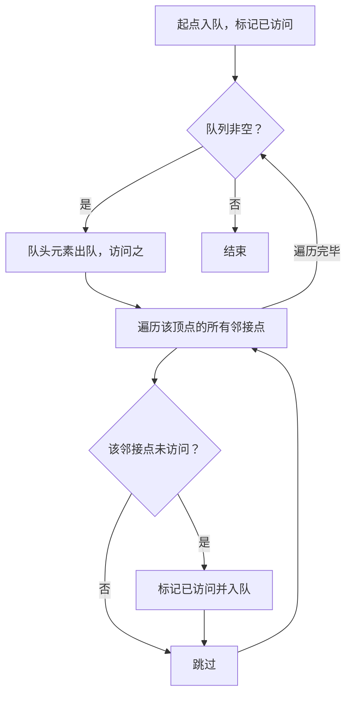

# 图的宽度优先遍历（BFS）算法及特点

## 什么是宽度优先遍历

宽度优先遍历（BFS）是一种==分层访问==的图遍历策略。它不像深度优先那样一条路走到黑，而是先访问完距离起点为 1 的所有顶点，再访问距离为 2 的，以此类推。可以想象成一颗石子投入水中，波纹一圈圈向外扩散。

## 为什么需要 BFS

不同的遍历方式揭示图的不同结构特性。BFS 的==层次性==让它特别适合解决两类问题：

1. **最短路径**：在无权图中，BFS 首次访问某个顶点时经过的边数，就是从起点到该顶点的最短路径长度。
2. **连通性分析**：一次 BFS 能访问到的所有顶点构成一个连通分量。

> [!IMPORTANT]
> ==BFS 按“距离递增”顺序访问顶点==，这是它与 DFS 最本质的区别，也是解决无权图最短路径问题的理论基础。

## BFS 怎么做

BFS 的核心数据结构是==队列==。算法流程如下：



### 代码模板（邻接表实现）

课件中的实现清晰展示了 BFS 的双层结构：

- **外层 `BFS()`**：处理非连通图，确保每个顶点都被检查。
- **内层 `BFS(int v, bool* visited)`**：从顶点 `v` 出发执行一次宽度优先遍历。

```cpp
template<class T>
void ExtLGraph<T>::BFS() {
    bool* visited = new bool[n];
    for(int i = 0; i < n; i++) visited[i] = false;
    for(int i = 0; i < n; i++)      // 处理非连通图
        if (!visited[i]) BFS(i, visited);
    delete[] visited;
}
```

内层 BFS 的核心逻辑可以概括为三步：

1. 访问起点 `v`，标记 `visited[v] = true`，`v` 入队。
2. 队列不空时，出队元素 `u`，依次检查 `u` 的所有邻接点 `w`。
3. 若 `w` 未访问，则访问、标记并入队。

## 手工模拟示例

以考题中出现的无向图为例，其邻接表如下：

```
v1 → 2 → 3 → ∧
v2 → 1 → 4 → ∧
v3 → 1 → 4 → 5 → ∧
v4 → 2 → 3 → 6 → ∧
v5 → 3 → 6 → ∧
v6 → 4 → 5 → ∧
```

从 v1 开始 BFS 的过程：

| 步骤 | 出队 | 当前队列 | 访问序列 |
|:---:|:---:|:---:|:---:|
| 初始 | — | {v1} | v1 |
| 1 | v1 | {v2, v3} | v1, v2, v3 |
| 2 | v2 | {v3, v4} | v1, v2, v3, v4 |
| 3 | v3 | {v4, v5} | v1, v2, v3, v4, v5 |
| 4 | v4 | {v5, v6} | v1, v2, v3, v4, v5, v6 |
| 5 | v5 | {v6} | 已全部入队 |
| 6 | v6 | {} | 结束 |

**最终 BFS 序列**：v1, v2, v3, v4, v5, v6

> [!TIP]
> 做题技巧：邻接表中边结点的顺序就是遍历的默认顺序。先出现的邻接点先入队，由此可唯一确定 BFS 序列。

## BFS 与 DFS 的对比

| 维度 | 深度优先遍历（DFS） | 宽度优先遍历（BFS） |
|:---:|:---|:---|
| 核心数据结构 | 栈（递归隐式栈） | 队列 |
| 访问特征 | 纵深优先，回溯 | 层次优先，逐层扩散 |
| 生成树形态 | 深度优先生成树 | 宽度优先生成树 |
| 典型应用 | 连通分量、拓扑排序 | 最短路径、二分图判定 |

回顾考题中的那一道填空题：无向图 $G=(V,E)$，$V=\{a,b,c,d,e\}$，$E=\{(a,b),(a,d),(a,c),(d,c),(b,e)\}$，从 `a` 开始得到序列 `abecd`。分析一下：访问 `a` 后，邻接点有 `b`、`d`、`c`，序列第二个是 `b` 符合 BFS 也符合 DFS。关键在第三步——序列第三个是 `e`，而 `e` 不直接与 `a` 相连，说明遍历时从 `b` 深入到了 `e`，这正是==纵深优先==的特征，所以答案是**深度优先**遍历。

> [!WARNING]
> BFS 的序列中，==任意顶点的邻接点必定在序列中连续出现==且紧邻其后的某个区段内，不会出现“跳过若干层突然访问”的情况。拿不准时，画出分层图就能快速判断。

## 性能分析

- **邻接表存储**：每个顶点入队一次，每条边被检查一次（无向图中被检查两次），时间复杂度为 ==$O(n+e)$==。
- **邻接矩阵存储**：检查所有邻接点时需扫描整行，时间复杂度为 ==$O(n^2)$==。

其中 $n$ 为顶点数，$e$ 为边数。
