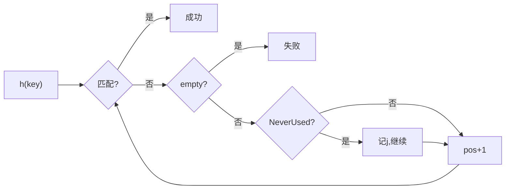

# 开地址法（线性探查法）的探查序列生成、搜索、插入与删除

## 什么是线性探查法

在散列表中，当多个关键字映射到同一地址时就会发生冲突。开地址法的核心思想是：==冲突发生时，按某种规则在表内寻找下一个空位==。线性探查法（Linear Probing）是最基础的开地址法，其探查序列为：

$$
h_i(key) = (h(key) + i) \bmod M, \quad i=0,1,2,\dots,M-1
$$

其中 $M$ 为表长。若 $h(key)$ 被占用，则依次检查 $+1, +2, \dots$ 的位置，直到找到空位或遍历完整个表。

## 搜索、插入与删除的正确姿势

### 搜索与插入

搜索从基地址 $h(key)$ 开始沿探查序列进行：

- **成功**：找到关键字等于 `key` 的元素；
- **失败**：遇到 `empty=true` 的真正空位，或回到起点（表满）。

插入时先执行搜索，仅当返回 `NotPresent` 且表未满时，将元素放入==首个遇到的可用空位==（包括 `NeverUsed` 位置）。

### 删除的陷阱与解决

> [!CAUTION]
> 直接清空被删元素会==截断后续元素的探查链==，导致本应存在的元素被误判为“不存在”。

正确做法是采用**懒惰删除**：为每个槽位增设标志域。删除时仅将元素值置为特殊标记 `NeverUsed`，但 `empty` 域保持 `false`。搜索时：

- `empty=true` → 真空中止；
- `NeverUsed` → 跳过继续探查，并记录该位置作为潜在插入点。

## 与拉链法及其他开地址法的区别

| 特性 | 线性探查法 | 二次探查法 | 拉链法 |
| :--- | :--- | :--- | :--- |
| 探查序列 | $(h+i)\bmod M$ | $(h\pm i^2)\bmod M$ | 链表遍历 |
| 聚集问题 | ==基本聚集严重== | 减轻基本聚集 | 无聚集 |
| 删除处理 | 需懒惰删除 | 需懒惰删除 | 直接删除节点 |
| 空间利用 | 表内存储，利用率≤1 | 表内存储，要求M=4k+3素数 | 额外指针开销 |

> [!WARNING]
> 线性探查法在装载因子 $\alpha > 0.7$ 时性能急剧下降，==考试中常考高负载下的探查次数计算==。

## 真题演练：关键字21的存放位置

> [!IMPORTANT]
> 表长 $M=11$，$h(key)=key\bmod 11$，依次插入 7, 38, 10, 21，求21的下标。

逐步推导：

1. $h(7)=7$，位置7空 → 存入7；
2. $h(38)=38\bmod11=5$，位置5空 → 存入38；
3. $h(10)=10$，位置10空 → 存入10；
4. $h(21)=21\bmod11=10$，位置10已被占 → 探查 $(10+1)\bmod11=0$，位置0空 → ==21存入下标0==。

> [!TIP]
> 做填空题时务必==手算每一步取模结果==，切勿心算跳步；注意探查是循环取模，不是简单加1。
